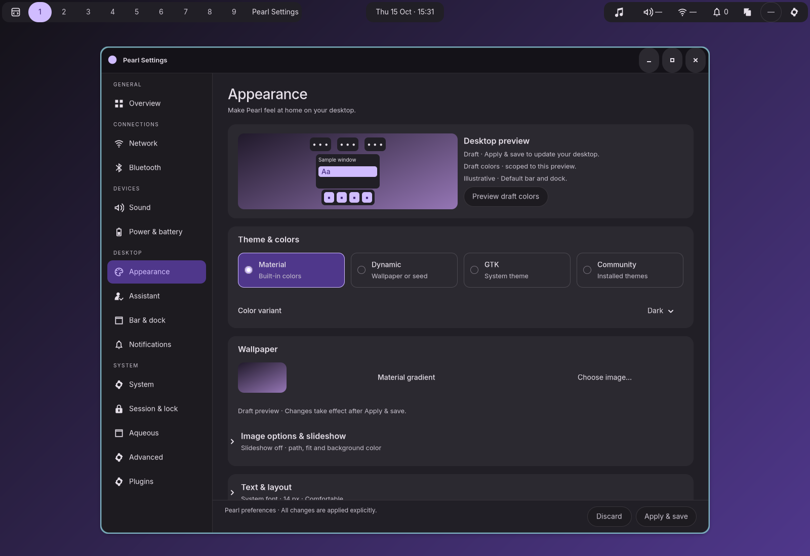

# Native Appearance redesign

Implemented October 15, 2026 in Zig/GTK. Appearance now follows the Settings
card spacing, headings, selection treatment and shared footer used by Bar & dock.
The page puts a desktop draft preview, theme choices and wallpaper before the
secondary settings. No preference schema changed.



| Native capture | What to review |
| --- | --- |
| [Dark](dark.png) / [wallpaper selected](wallpaper.png) | Preview, native radio tiles, thumbnail and image actions |
| [Light](light.png) / [GTK](native.png) | Committed window styling and scoped draft preview |
| [390 px](narrow.png) | Two-column mode choices, stacked preview, persistent footer |
| [Enlarged text](large-text.png) | GTK-measured wrapping at 560 px and 24 px font |
| [Expanded details](details.png) | Existing text and desktop controls inside expandable sections |

These are uncropped screenshots from a private 1600×1100 desktop. The wallpaper
is a deliberately plain test image. The original design drawings and generator
remain in [docs/mockups/appearance](../../docs/mockups/appearance/README.md).

## Behavior

- Four grouped native mode controls preserve the existing enum and draft.
  Community opens the theme picker if no package is selected, leaving the
  current valid mode intact. Labels, radio state and focus indicators remain native.
- Wallpaper has a thumbnail and filename/fit summary. Exact paths, background
  options and slideshow controls remain available in Image options & slideshow.
- Text, desktop icons, Night Light, application appearance, themes and login
  screen have persistent-in-window expanders and summaries. Qt review, theme
  errors and greeter status remain visible in their section headers.
- The schematic follows default bar/dock placement; symbols are illustrative.
  Generated/package colors use **Preview draft colors**, through the existing
  backend. Colors stay scoped to the sample. GTK uses native styling.
- Superseded image loads are cancelled; color results are checked against the
  originating draft. Leaving Appearance cancels its in-flight color preview.
  Apply/Discard continue to operate on the shared settings draft.
- Existing theme authoring, application-profile, Qt recovery and greeter actions
  retain their own immediate-operation semantics.

## Validation

Production and instrumented ReleaseSafe builds, `zig build test`, Zig formatting,
Python syntax checks and `git diff --check` passed. Native sessions run with
`G_DEBUG=fatal-warnings`; warnings were not suppressed.

| Suite | Result and evidence |
| --- | --- |
| `test-appearance-redesign` | Passed: real modes/seed editing, completed backend color preview without commit, navigation cancellation, chooser cancellation/selection, preview/navigation/Apply, expanded controls/Discard, dark/light/GTK/narrow/enlarged layouts. [Results](native-results.json) |
| `test-preferences` | Passed: persistence, chooser, preview and backend preference regressions. [Results](preferences-results.json) |
| `test-settings-bar-editor` | Passed: Bar & dock UI, shared draft and layout regressions. [Results](bar-results.json) |
| `test-base-material-session` | Passed: application-profile Apply/Discard, restart and actual GTK 3/4 consumers. [Results](profiles-results.json) |
| `test-custom-themes` | Passed: native theme selection, independent previews, fixed/generated palettes, cancellation and snapshot recovery. [Results](themes-results.json) |
| `test-settings-appearance` | New disclosures and mode checks pass; the suite later aborts while typing full Advanced JSON with a GtkGizmo snapshot warning. Reproduced against unmodified HEAD. [Results](appearance-suite-results.json), [current stack](snapshot-current.log), [baseline stack](snapshot-baseline.log) |
| `test-settings-presentation` | Stops on a GDK frame-timing warning during live narrow/native transitions. Final focused checks capture all Appearance variants in separately opened windows. [Results](presentation-results.json), [warning](presentation-warning.log) |
| `test-settings-app` | Stops on a GDK frame-timing warning after several window/navigation checks. [Results](settings-app-results.json), [warning](settings-app-warning.log) |
| `test-settings-accessibility` | Stops at the legacy `test-settings-page` hook returning `Unavailable`. [Results](accessibility-results.json) |
| `test-qt-session` | Native opt-in and committed Apply reach revision 2; Qt 6/engine apply, Qt 5 reports `QtPlatformThemeUnavailable`. Full suite remains blocked by that dependency. [Log](qt-session.log) |
| `test-theme-completion` | Stops on palette-source recovery retaining `UnexpectedEndOfInput` after valid content is restored. This backend failure is unresolved in this change. [Log](theme-completion.log) |
| `test-greeter-sync-ui` | Standalone sync, large-image resize, authorization denial and draft preservation pass; legacy flyout stage returns `Unavailable`. [Log](greeter-sync.log) |

The theme and greeter fixtures now seed an existing empty preference document so
first-install application-profile initialization cannot interfere with their
fixed-theme/no-commit assertions. The Qt test waits for the Apply revision before
checking integration results. Assertions were retained.

Native controls provide accessible names/states, but full screen-reader traversal
and the complete 1/1.25/1.5/2 display-scale matrix remain manual validation work.
The schematic does not simulate real widgets or per-output overrides. A successful
focused suite does not imply the broader suites above passed.

## Reproduce

```sh
ZIG_GLOBAL_CACHE_DIR="$PWD/.cache/zig" zig build build-settings build-settings-test -Doptimize=ReleaseSafe
ZIG_GLOBAL_CACHE_DIR="$PWD/.cache/zig" zig build test-appearance-redesign -Doptimize=ReleaseSafe -- --output artifacts/appearance-redesign/recheck
```

The test uses an isolated desktop and private configuration, with a controlled
Matugen fixture for deterministic preview results. Python is only the test
harness; the application changes and original mockup generator are Zig. Raw
session directories are ignored; curated screenshots, results and diagnostic
logs are retained here. See the [design plan](../../docs/APPEARANCE_REDESIGN_PLAN.md)
for the control inventory and implementation sequence.
