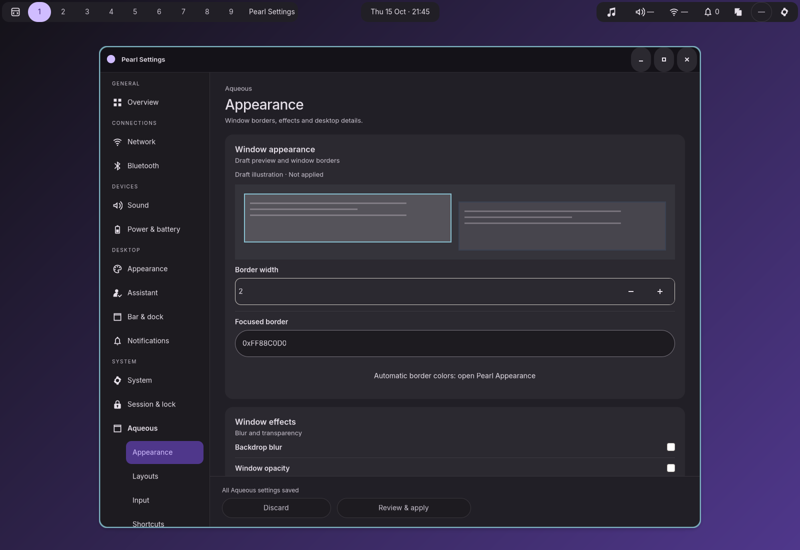

# Native Aqueous redesign

Implemented October 15, 2026 in Zig and GTK. All seven Aqueous sections now use
the card spacing, typography, disclosures, theme tokens and fixed footer of the
updated Appearance, Assistant and System pages.



The [plan](../../docs/AQUEOUS_LAYOUT_REDESIGN_PLAN.md) and
[interactive HTML mockup](../../docs/mockups/aqueous-layout/index.html) remain
available separately.

## Implementation

- The helper remains authoritative. A pure presentation map places all 221
  baseline fields exactly once, remaps border controls to Appearance, and keeps
  future fields in an Additional settings group. Unknown enum values remain
  visible without silently substituting a supported option.
- Appearance and Layouts have draft illustrations; layout radio choices come
  from the helper and support arrows/Home/End. Common input controls stay open.
  Secondary groups and the raw-source selector retain their window-local state.
- Shortcuts search matches field IDs, action labels and current chords across
  all 117 schema fields, exposing collapsed matches and preserving the query
  across navigation. Custom bindings retain their separate collection editor.
- Existing snap layouts, custom bindings, window-rule builder, display
  arrangement and declaration editors retain their callbacks and backend
  semantics. No helper protocol, configuration writer or transaction policy was
  changed.
- The footer shows changed sections and counts, Discard and Review & apply.
  Review summarizes scalar before/after values and collection changes across
  the shared Aqueous draft. A changed revision requires another review. Pearl
  preference drafts remain independent. Displays retains Apply changes and its
  protected Keep/Revert preview.
- Advanced contains status, Refresh/Validate/Rebase, raw files, full request,
  candidate effects and receipts. Review issue opens the relevant field group
  when the backend identifies it, otherwise the full request. Raw edits disable
  typed controls for their source. New presentation and review copy is localized
  in English and German; helper-provided field labels remain authoritative.
- Pages have one outer viewport. Scroll restoration waits for destination
  allocation, and rebuilt modal editors retain their restored trigger focus.
  Disclosures expose expanded state; changed save/error status is announced
  without repeating unchanged polling results.

## Captures

| Pages | Variants |
| --- | --- |
| [Appearance](appearance.png), [Layouts](layouts.png), [Input](input.png) | [Light](light.png), [native GTK](native.png) |
| [Shortcuts](shortcuts.png), [Rules](rules.png) | [390 px](narrow.png), [24 px text](large-text.png), [German](german.png) |
| [Displays](displays.png), [Advanced](advanced.png), [shared review](review.png) | [Short window](short.png), [200% scale](scale-200.png) |

These are uncropped captures of private desktop sessions. Notifications and the
shell bar belong to the compositor fixture. The focused suite captures all
seven sections in wide/560/390 px windows, dark/light/native themes, German,
large text, short windows and 125/150/200% scaling. It checks control bounds and
footer clearance. Draft illustrations are explanatory, not runtime compositor
simulations. Physical HDR/DRM preview and full screen-reader traversal remain
manual/environment-dependent checks.

## Verification

ReleaseSafe production shell, Settings, instrumented builds, and **313 unit
tests** pass: [build](build.log), [final Settings build](settings-build.log).
Zig formatting, Python harness syntax and patch whitespace checks pass. The new
suite is registered as `test-aqueous-layout`; the global registry check still
reports unrelated existing unregistered suites.

| Suite | Result |
| --- | --- |
| `test-aqueous-layout` | Passed all seven routes, 221-field coverage, disclosures, search, radio keyboard selection, mixed draft review/cancel/discard/apply, stale review rejection, independent Pearl draft preservation, raw ownership, validation-error repair link, and the complete presentation matrix. [Results](native-results.json) |
| `test-settings-displays` | Passed arrangement, selection, primary output, drag/keyboard positioning, scale, Identify, protected preview, Escape/Revert, Keep and mixed-draft review. [Results](displays-results.json) |
| `test-aqueous-settings` | Passed matching-helper transactions, receipts, collection/display operations and native leases. [Results](transactions-results.json) |
| `test-settings-boundary` | Passed handshake/isolation coverage. [Results](boundary-results.json) |
| `test-window-rule-settings` | Passed all 8 checks, including modal focus after rebuilding, typed effects, stale saves, exclusive ordering, canonical Validate/Apply, and 390/560 px dialogs. [Results](rules-results.json) |
| `test-settings-services` | Passed 23 checks, including section scroll/focus restoration, recording, apply/receipts, preview navigation and owner-disconnect rollback; stopped on a GDK frame-timing warning during the later lock scenario. [Results](services-results.json), [failure](services-failure.log), [toolkit log](services-toolkit.log) |
| `test-settings-presentation` | Reached theme/size captures; stopped on a fatal GDK frame-timing warning during native-theme switching. [Results](presentation-results.json), [failure](presentation-failure.log), [toolkit log](presentation-toolkit.log) |
| `test-settings-app` | Stopped on a fatal duplicate GDK presentation-timing warning in narrow navigation. Its report remains `running` on exceptions; this run failed. [Results](app-results.json), [failure](app-failure.log), [toolkit log](app-toolkit.log) |
| `test-settings-accessibility` | Stopped when the legacy `test-settings-page` endpoint returned `Unavailable`. [Results](accessibility-results.json), [failure](accessibility-failure.log) |
| `test-aqueous-preview` | Blocked: the current production fixture lacks the instrumented compositor. An older cached instrumented fixture was rejected by its wlroots provenance check; no provenance check was bypassed. [Initial failure](preview-fixture-failure.log) |

The toolkit warnings and legacy accessibility endpoint failure are also recorded
in the previous [System implementation report](../system-layout/README.md).
They are not counted as passes. The focused native suite permits only the two
existing named frame-timing warnings and records any encountered warnings;
other warnings and criticals fail. The existing rule/services tests were adapted
to the deliberate move of Validate into Advanced and the new review dialog.

Raw private runs are ignored; curated captures, reports and logs are retained
here. Paths inside reports can refer to those reproducible raw directories.

## Reproduce

```sh
ZIG_GLOBAL_CACHE_DIR=/tmp/pearl-zig-cache \
  zig build build-shell build-settings build-settings-test build-integration test -Doptimize=ReleaseSafe
ZIG_GLOBAL_CACHE_DIR=/tmp/pearl-zig-cache \
  zig build test-aqueous-layout -Doptimize=ReleaseSafe
ZIG_GLOBAL_CACHE_DIR=/tmp/pearl-zig-cache \
  zig build test-settings-displays test-window-rule-settings -Doptimize=ReleaseSafe
```

Private tests need D-Bus and Wayland sockets. Python is used only for integration
validation; production application changes and build registration are Zig.
