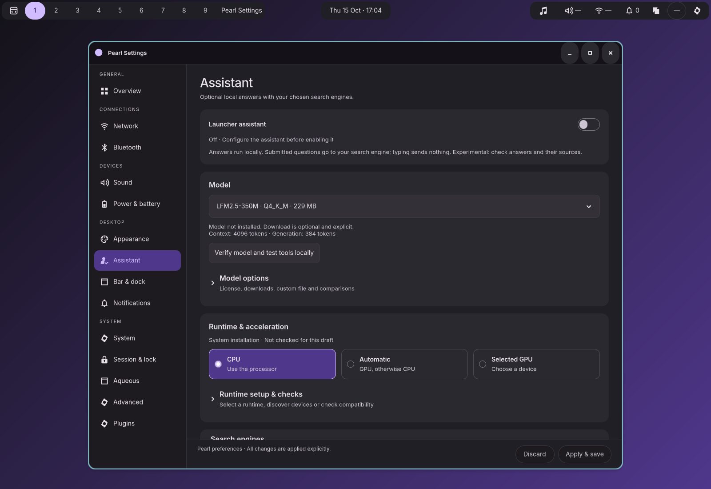

# Native Assistant layout

Implemented October 15, 2026 in Zig and GTK. Assistant now uses the card spacing,
theme colors, native selection treatment, expandable summaries, and shared footer
used by the recent Appearance, Sound, and Power updates.



## Changes

- Enablement, model choice, and CPU / Automatic / Selected GPU are the primary
  cards. Model options, runtime setup, engines, comparisons, and resources use
  disclosures that retain their expansion state during navigation.
- Runtime and engine fields appear for the selected source or connection type.
  Hiding a field preserves its stored value. Model/resource edits retain the
  existing automatic-profile reset and shared Apply/Discard behavior.
- Grouped compute radios support arrows and Home/End even when the tiles wrap.
  GTK FlowBox otherwise stops directional navigation at each tile's wrapper.
- Runtime-check results are tied to the model, runtime, compute, and resource
  configuration checked. Relevant draft changes clear the validity of that check.
  Downloaded models remain distinct from verified runtime compatibility.
- Operations retain their existing worker and cancellation behavior, with local
  feedback/cancel controls and a page-level operation summary. Failed operations
  reveal their section. Package setup retains its terminal-based lifecycle.
- Comparison candidates are grouped, action rows wrap, and results switch from
  aligned metrics to stacked cards without a horizontal scroller. History,
  samples, actual backend, stale checks, adoption, export, cancel, and skip remain.

No preference schema, model catalog, search default, benchmark scoring, or
launcher/conversation implementation changed. The original
[plan and mockups](../../docs/ASSISTANT_LAYOUT_REDESIGN_PLAN.md) remain available.

## Captures

| Native capture | What to review |
| --- | --- |
| [Dark](native/session/dark.png), [light](native/session/light.png), [GTK](native/session/native.png) | Shared theme styling and native controls |
| [390 px](native/session/narrow.png), [440 px light](native/session/narrow-light.png) | Wrapping cards, stacked compute choices, fixed footer |
| [24 px text](native/session/large-text.png) | Natural text measurement and footer wrapping |
| [Expanded settings](native/session/expanded.png) | Conditional forms and resource editing |
| [Runtime recovery](native/session/runtime-recovery.png) | Failed local discovery and section feedback |
| [125%](native/session/scale-125.png), [150%](native/session/scale-150.png), [200%](native/session/scale-200.png) | Display scaling and visible control bounds |
| [Narrow comparison](benchmark/session/benchmark-narrow.png) | Stacked metrics, stale-result protection and sample controls |

Screenshots are uncropped private desktop captures. Reload notifications come
from the compositor fixture. Benchmark numbers come from the fake runtime and
must not be interpreted as hardware performance measurements.

## Verification

Production and instrumented ReleaseSafe Settings builds, `zig build test`, Zig
formatting, Python harness syntax checks, and `git diff --check` passed.

| Suite | Result |
| --- | --- |
| `test-assistant-layout` | Passed: disclosures, radio selection and keyboard navigation, shared drafts/navigation/Discard, custom runtime failure, conditional engine fields, hidden value retention, resources, no implicit work, dark/light/GTK, narrow widths, 24 px text, and scales 1/1.25/1.5/2. [Results](native/results.json) |
| `test-agent-model-settings` | Passed: all suggested/custom model choices, automatic profile resets, exact resource values, Apply/Discard, and no downloads. [Results](model/report.json) |
| `test-agent-benchmark-settings` | Passed: runtime-check invalidation after a compute draft change, local fixture comparison, samples, draft adoption, export, stale runtime results, cancel and close cleanup, history deletion, and narrow controls. [Results](benchmark/report.json) |
| `test-settings-presentation` | Page inventory, reference themes/layouts, all-page scale checks, draft preservation and short-window footer checks passed. The compositor then asserted during output removal and closed IPC. [Results](presentation/results.json), [failure](presentation-failure.log), [compositor stack](presentation/session/compositor.log) |
| `test-settings-accessibility` | Passed its first three service/bar checks, then stopped at the legacy `test-settings-page` endpoint returning `Unavailable`, also recorded in the earlier Appearance report. [Results](accessibility/results.json), [failure](accessibility-failure.log) |
| `test-agent-launcher` | Initial no-inference and question-ranking checks passed. Stopped before Settings checks because the private compositor tiled the conversation window at 768 px instead of floating it at 440 px. The packaged [floating-window patch](../../packaging/assistant/aqueous-floating.patch) supplies that behavior. [Failure](launcher-failure.log) |

The focused layout suite records the known GDK frame-timing warning in its
`frame_warnings` array. The same warning is recorded in the earlier
[Appearance validation](../appearance-redesign/README.md). Only those specific
frame-timing messages are allowed by its log check; other toolkit warnings,
criticals, CSS errors, and panics fail. Full screen-reader traversal remains a
manual check. The broader failed suites above are not reported as passing.

Test harness adjustments target the spin button's text area rather than its
stepper, open the new disclosures through real UI interaction, wait for the
initial preferences load before benchmarking, and permit copying the existing
model when temporary fixtures live on a different filesystem.

## Reproduce

Run from the repository root with the existing build prerequisites:

```sh
zig build build-settings build-settings-test test -Doptimize=ReleaseSafe
zig build test-assistant-layout -Doptimize=ReleaseSafe
zig build test-agent-model-settings -Doptimize=ReleaseSafe
zig build test-agent-benchmark-settings -Doptimize=ReleaseSafe -- \
  --model /absolute/path/to/LFM2.5-350M-Q4_K_M.gguf \
  --output /absolute/path/to/benchmark-artifacts
```

Native suites require private D-Bus and Wayland sockets. Use an existing local
model; these layout checks do not require downloading models or calling a live
search provider. A read-only default Zig cache can be replaced with
`ZIG_GLOBAL_CACHE_DIR=/tmp/pearl-zig-cache`.
