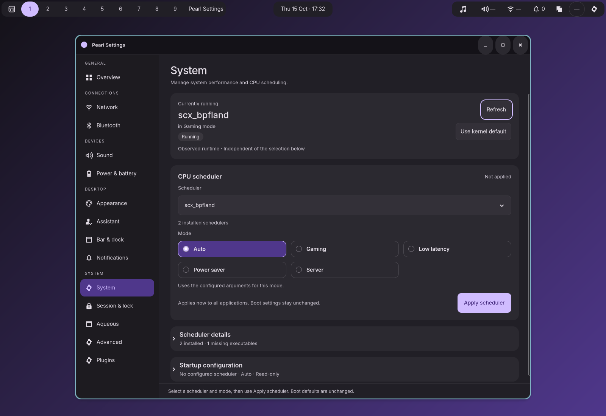

# Native System layout

Implemented October 15, 2026 in Zig and GTK. System now follows Appearance and
Assistant with a prominent current-runtime card, available mode radio tiles,
compact actions, and expandable scheduler and startup details.



## Behavior

The observed scheduler, local selection and configured boot default remain
separate. Apply scheduler and Use kernel default retain their existing immediate
runtime semantics. System keeps its own footer; drafts from other preference
pages survive navigation and scheduler actions.

Mode buttons remain stable across status updates. Missing modes hide completely;
a removed scheduler or selected mode disables Apply without substituting a
different choice. Empty argument lists still use scheduler defaults. Details
retain exact selectable JSON arguments and read-only boot information.

Background refreshes retain keyboard focus and open local selectors, while
command buttons remain disabled until fresh status is available. Local operation
receipts freeze selections until completion. Arrow keys and Home/End traverse
available modes. Settled status changes receive accessible announcements without
repeating unchanged polling evidence. Disclosures retain expansion for the
window lifetime and never issue service commands.

No scheduler backend, command protocol, preference schema or boot policy changed.
The [plan and original mockups](../../docs/SYSTEM_LAYOUT_REDESIGN_PLAN.md) remain
available separately.

## Captures

| Capture | Review |
| --- | --- |
| [Dark](dark.png), [light](light.png), [native GTK](native.png) | Theme tokens, status hierarchy, grouped selection and compact actions |
| [390 px](narrow.png), [560 px light](narrow-light.png), [short window](short.png) | Wrapped controls and a fixed footer above the window edge |
| [24 px text](large-text.png), [expanded large text](large-text-details.png) | Natural text measurement and scrollable details |
| [German](german.png), [German details](german-details.png) | Translated control labels and wrapping |
| [Expanded](expanded.png), [390 px details](narrow-details.png) | Arguments, missing binaries and read-only boot configuration |
| [125%](scale-125.png), [150%](scale-150.png), [200%](scale-200.png) | Display scaling |
| [Failed apply](failure.png), [unknown/external state](unknown.png), [missing dependency](unavailable.png) | Visible feedback and disabled runtime actions |

These are uncropped screenshots of private desktop sessions using fake scheduler
data. Reload notifications and, at 200%, the large shell bar overlap portions of
the desktop; those overlays belong to the compositor fixture. The native suite
also checks control bounds, footer clearance, and actual input at every size.
Full screen-reader traversal remains a manual check; the harness disables the
desktop accessibility bus. No host scheduler was started, switched or stopped.

## Verification

Production and instrumented ReleaseSafe Settings builds and all **310 unit
tests** pass. See [build.log](build.log). Zig formatting, Python harness syntax,
the new suite's registry entry, document links and patch whitespace were checked.

| Suite | Result |
| --- | --- |
| `test-system-layout` | Passed: radio selection, keyboard/focus across polling, disclosures, removed catalog entries/modes, absent Auto, no implicit mutations, native Apply/Stop and failure recovery, preference draft separation, all captured variants. [Results](native-results.json) |
| `test-settings-sched-ext` | Passed all 13 command/lifecycle checks, including stale generations, concurrent owners, external changes, timeouts, dependency recovery, lock, page release and helper cancellation. [Results](scheduler-results.json) |
| `test-settings-boundary` | Passed all 9 boundary checks. The test's strict capability list was updated to include the already-supported `power_settings` field. [Results](boundary-results.json) |
| `test-settings-services` | Passed 23 checks, then the frontend exited on a GDK frame-timing warning while navigating to Aqueous displays. [Results](services-results.json), [failure](services-failure.log), [toolkit log](services-toolkit.log) |
| `test-settings-presentation` | Passed the complete page inventory and captured dark/light/GTK plus narrow reference views; stopped on a GDK frame-timing warning during theme switching. [Results](presentation-results.json), [failure](presentation-failure.log), [toolkit log](presentation-toolkit.log) |
| `test-settings-accessibility` | Passed its first 3 checks; stopped because the legacy `test-settings-page` endpoint returns `Unavailable`. [Results](accessibility-results.json), [failure](accessibility-failure.log) |
| `test-settings-app` | Recorded 13 passing checks before a GDK frame-timing warning terminated the narrow frontend during navigation. Its harness leaves the report status at `running` on exception; this run failed. [Report](app-results.json), [failure](app-failure.log), [toolkit log](app-toolkit.log) |

The new focused suite uses the existing scheduler suite's exact frame-warning
allowlist and records the encountered warning in its result. Other toolkit
warnings and criticals fail. The broader suites were run unchanged apart from
the explicit boundary capability correction; their failures are not counted as
passes. These warning/legacy-endpoint limitations are also documented in the
earlier [Appearance](../appearance-redesign/README.md) and
[Assistant](../assistant-layout/README.md) validation reports.

Raw private runs are ignored; curated screenshots, reports and failure logs are
retained here. Paths within the original JSON reports refer to their raw run
directories. The table above links to the curated captures.

## Reproduce

```sh
ZIG_GLOBAL_CACHE_DIR=/tmp/pearl-zig-cache \
  zig build build-settings build-settings-test test -Doptimize=ReleaseSafe
ZIG_GLOBAL_CACHE_DIR=/tmp/pearl-zig-cache \
  zig build test-system-layout -Doptimize=ReleaseSafe
ZIG_GLOBAL_CACHE_DIR=/tmp/pearl-zig-cache \
  zig build test-settings-sched-ext -Doptimize=ReleaseSafe -- \
  --output artifacts/system-layout/scheduler
```

Native tests require private D-Bus and Wayland sockets. The new suite is also
registered with `scripts/test.py` as `test-system-layout`; Python is the test
harness only, while the application and mockup generator remain Zig.
