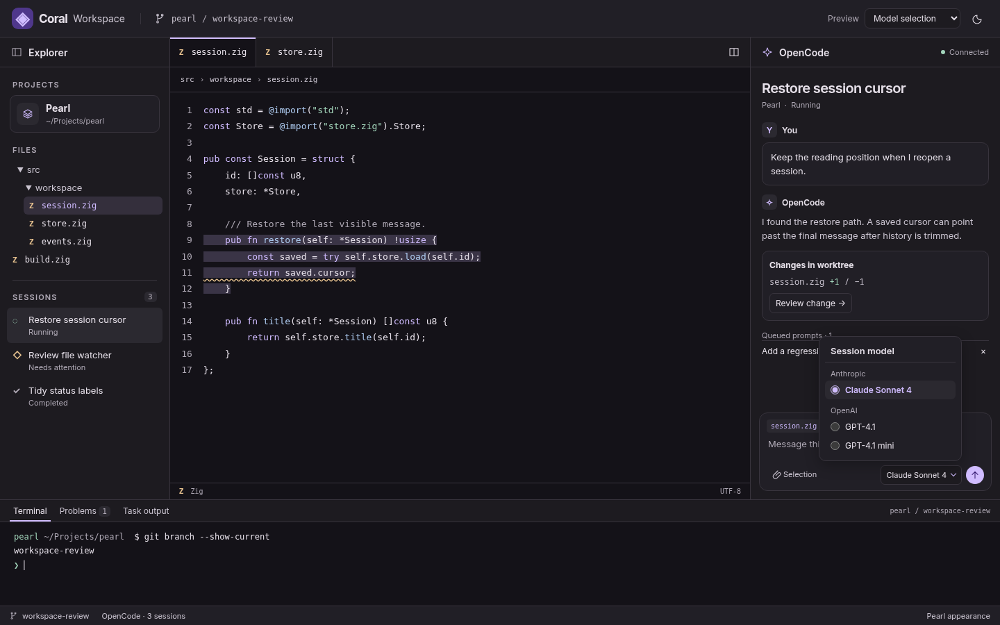
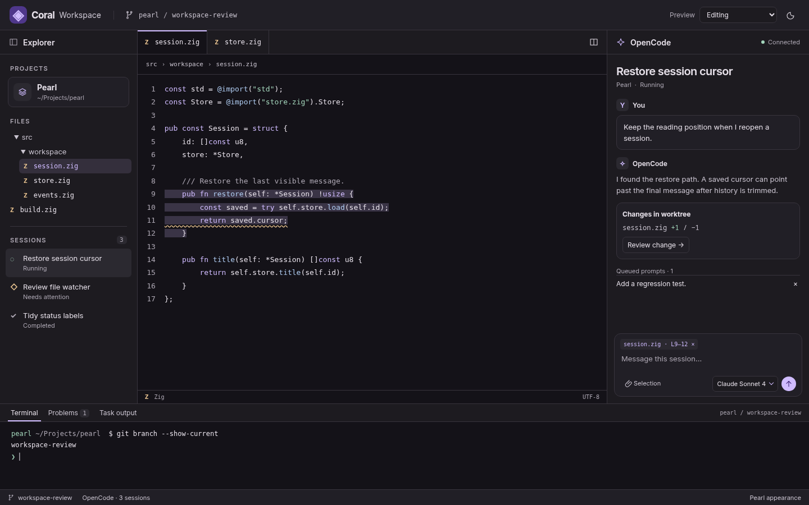
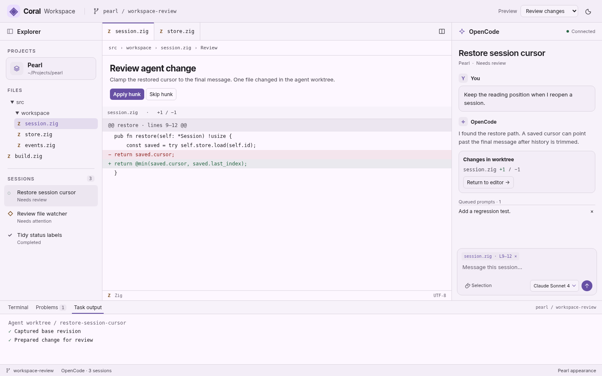
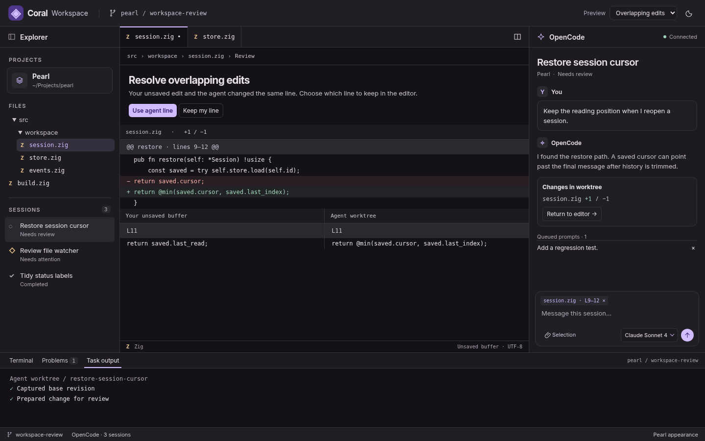

# Coral Workspace implementation plan

Build a dedicated Pearl development workspace in Zig, GTK4 and GtkSourceView 5. Share Coral’s document and appearance code with the existing editor. Give the workspace its own executable, application ID, preferences and window restore state. **Coral Workspace** is the working name. The GTK frontend owns editing and review. A separate OpenCode service owns agent execution so a session can outlive a window.

[Open the interactive design](mockups/development-workspace/index.html). The design opens with **Session model** expanded beside **Send**. Choose a model for this session, select a scene in **Preview**, switch appearance with the moon button, or select **Review file watcher** to try a permission request. The sample files, sessions and terminal output are fixtures. Scene changes reset the sample. **Preview** belongs to the design study.

[View the same model picker in Pearl light](mockups/development-workspace/model-selection-light.png).

## The four-region window

| Region | Contents and order | Sizing and behavior |
| --- | --- | --- |
| Left | Explorer heading, project list, selected project’s file tree, project-scoped sessions. Each session has a title, a glyph and a plain-language state. | Initially 245 logical px at 1440 wide. Rows stay in place when status changes. Selecting a session restores its conversation. Opening a file leaves the session selected. |
| Center | File tabs and split action, path breadcrumb, editable source, document status. The same area hosts diagnostic navigation and agent diff review. | Takes all remaining width, about 835 px in the reference. Two views may share a document, with independent carets and scroll. Review opens as a transient tab with a route back to the originating selection. |
| Right | OpenCode connection, session title and status, chronological conversation, tool or approval cards, queued prompts, then a pinned composer with removable selection attachments and the active session’s model picker immediately to the left of **Send**. | Initially 360 px. Scroll the transcript independently. A new message scrolls into view only when the reader was already at the end. Switching sessions preserves scroll, draft and attachments. |
| Bottom | Full-width dock under all three columns. Terminal, Problems and Task output are peer tabs. A slim status bar sits below. | Initially about 150 px at 900 high. Drag its horizontal divider to change the dock height. Switching dock tabs preserves each tab’s scroll. Running a task does not take keyboard focus from the editor. |

Use a 54 px title bar and 43 px pane headers. Align the Explorer, document tabs and OpenCode heading on the same baseline. Give source code the quietest, flattest surface. Reserve elevation for grouped information such as a project, an approval and the composer. Float the send button at the right edge of the composer, away from attachment removal. Display branch and project in the title bar so they remain visible during review.

**Narrow windows.** Start compressing sidebars before the editor falls below 60 monospace columns. At roughly 1050 logical px, offer a temporary Explorer drawer on the left. At roughly 800, offer OpenCode as a right drawer and keep the bottom dock accessible. Remember each manually pinned pane and restore it when width permits. At 200% text scale, use actual text measurements to trigger these transitions. The interactive study keeps its desktop arrangement for direct comparison. Verify drawer behavior in the GTK build.

**Appearance.** Consume Pearl’s committed palette and font snapshot through Coral’s appearance client. Use surface for source, low for sidebars, container for grouped controls, high for hover, primary for focus and selection, and on-primary for button text. Coral already generates the GtkSourceView scheme for editor surfaces, selection and cursor, preserving syntax hues for the active variant. Derive review colors against each surface, then verify contrast. Pair additions and removals with signs, status with words, and diagnostics with underlines. Use 4/8/12/16 px spacing, 6 px control corners, 10–12 px grouped corners and fine dividers. Honor Pearl’s reduced-motion setting. A live appearance change must preserve selections, scroll anchors and pending decisions. [Coral appearance](../subprojects/coral/src/appearance.zig) · [Pearl palette](../src/theme/theme.zig)

## From selected code to reviewed change

1. Open a project, open a file and highlight a range. **Attach selection** captures the current buffer text, canonical project-relative path, buffer version and range. Show a chip such as `session.zig · L9–12`. Clicking it reveals the captured text. A subsequent edit can mark the chip outdated and offer **Refresh**. Preserve the captured text until the user refreshes or removes it. Untitled buffers use a document ID until saved.
2. Send a prompt in the selected session. Running sessions accept follow-ups into their inbox. Show the queued text and a cancel action until delivery begins. OpenCode activity in another session updates its row without replacing the current editor or conversation.
3. If a tool requests permission, show its action, resource, working directory and requesting session in a right-pane card. **Allow once** and **Deny** submit that request ID. Disable the two buttons while the answer is in flight. A reply from another client resolves the card. A queued prompt cannot stand in for an approval.
4. Open **Review change** from the conversation. Show changed files and hunk navigation in the center. Keep the chat and terminal visible. Each hunk displays its path, base context and signed lines. **Apply hunk** puts one undoable change into the editor buffer. **Skip hunk** records a review decision. Saving remains a separate editor action.
5. If the user and agent changed the same text, show the shared base diff followed by the current unsaved text and agent version. Offer **Keep my line**, **Use agent line**, and in production **Edit resolution**. Apply only the resolved span. Revalidate the buffer revision immediately before applying. If it changed during review, recompute the comparison and keep the user’s edits.

## Native implementation

| Area | Reuse or build | First integration check |
| --- | --- | --- |
| Documents | Extract the smallest reusable boundary from Coral’s app, document and appearance modules. Keep one buffer per canonical file per worktree, with an explicit unsaved identity for new documents. Use a GtkSourceView per pane bound to that buffer. Preserve Coral’s GIO saves, encoding, newline handling, large-file behavior and dirty generations. | Edit through two views, save during typing, trigger an external modification, then close either view. The surviving view retains the correct buffer and undo history. [Coral editor](../subprojects/coral/README.md) |
| Window and explorer | GTK application window, header bar, nested horizontal GtkPaned widgets above a vertical dock split, GtkStack for workspace tools, GtkTreeListModel with GtkListView for files. Load expanded directories asynchronously. Keep GTK mutations on the main context. | Reopen two worktrees with identically named files. Tabs, selected session and terminal cwd resolve to the right worktree. |
| Language tooling | Start with Zig and ZLS. Add a project-scoped language-server process and document version tracking. Map negotiated position encoding to GtkTextIter offsets. Render published diagnostics as gutter marks, underlines and clickable Problems rows. Use a cancellable worker for parsing large responses. | A diagnostic after an emoji selects the exact span. An older diagnostic response cannot repaint a newer buffer. A missing server leaves editing usable. |
| OpenCode | One version-aware service client shared by windows. Discover or configure the local endpoint, validate identity and credentials, enumerate project sessions and hydrate the selected thread. Subscribe to the event stream. Marshal bounded batches into GTK. | With two concurrent sessions, a delta, permission request or queued message updates only its owning session. Restarting the UI reattaches to the running service. |
| Review | Capture a base tree and run writable agent sessions in separate Git worktrees. Read the resulting changes from that worktree. Compute a three-way comparison with the live editor buffer and recheck file identity before each apply. Use GtkSourceView marks/tags and read-only comparison buffers. | An unrelated staged change, an unsaved local edit and a second agent’s patch all survive accepting one hunk. |
| Dock | Use GTK4 VTE for interactive local shells, keyed by workspace. Separate the task runner’s bounded stdout/stderr log from its command, working directory and exit result. Connect Problems rows to document locations. | Resizing sends the correct terminal dimensions. A cancelled build has a final state and retained output. Switching projects cannot route keystrokes to the previous terminal. |

**Service choice.** Use the documented OpenCode service API for the first backend. Varro is the reference for project-aware parallel sessions. OpenCode already supplies ACP for editors that launch an agent. The shared service gives this workspace the session list, inbox, pending permissions and event stream it needs across windows. The published API is experimental. Pin a tested version and record an integration fixture before committing to a stable compatibility range. [Varro](https://github.com/koltyakov/varro) · [OpenCode API](https://opencode.ai/docs/api) · [OpenCode ACP](https://opencode.ai/docs/cli/acp/)

### Per-session model selection

Label the composer button with the active model’s display name. Opening it shows the chat models available to this session’s OpenCode location, grouped by provider, with the current choice checked. Show the provider whenever two entries share a name. Support keyboard selection and give the button an accessible name such as “Change model, currently …”. Changing sessions restores that session’s confirmed model and draft.

Populate the picker from `GET /api/model` for the session location. Submit the chosen model to `POST /api/session/{sessionID}/model` using the session captured when the picker opened. Show the switch as pending until OpenCode confirms it. A switch during a run takes effect on the **next model call**, which can occur within the same turn. The current call finishes with its original model. [OpenCode API](https://opencode.ai/docs/api)

Treat OpenCode as the authority for the selected model. Route confirmations and `session.model.selected` events to their owning session, including changes made by another client. After reconnecting or an ambiguous timeout, read the session state before offering a retry. If OpenCode rejects a choice, show the reason beside the picker, restore the confirmed selection and keep the draft and attachments intact.

**Ownership and restart.** Key sessions by server identity, location/worktree and server session ID. Use server message, request and inbox IDs when available. OpenCode owns delivered messages, agent status, permissions and its inbox. Store window layout, editor restore metadata, local drafts, selection snapshots, unsent requests and per-hunk review decisions transactionally under the application’s XDG state directory. Key each review decision by base, target and hunk content. Keep a recoverable copy of dirty buffers with their last known file etag. At startup restore the UI first, then reconcile with the disk and service. An unavailable server leaves documents, drafts and manual review accessible.

| Event | Behavior the user sees | Implementation rule |
| --- | --- | --- |
| Service disconnects or event consumer overflows | Connection becomes **Reconnecting**. Drafts stay editable and stale approvals become unavailable. | OpenCode’s stream is volatile. Subscribe, buffer new events, fetch authoritative session/permission/inbox snapshots, reconcile by stable ID, then process buffered changes. Refetch ambiguous state. |
| A send times out after the server may have accepted it | The prompt shows **Delivery unknown** until reconciled. | Persist the client operation before submission. Match a supported idempotency or message ID against the inbox and history. Where the pinned API cannot establish the result, offer an explicit resend. |
| Window closes during agent work | Reopening restores the active thread and read position. | Keep service lifetime independent of windows. Recover by message ID and offset with a nearest surviving message fallback. Preserve the user’s own terminal transcript or report that its local PTY ended. |
| Two sessions propose changes to the same file | Each review identifies the session and worktree. After the first apply, the other review recomputes its base comparison. | Capture exact blob identities. For an initially dirty project, identify pre-existing changes in the baseline and explicitly show any unsaved selection supplied as context. |
| File renamed, deleted, binary, or outside the project | Show the operation and available safe actions in review. | Validate canonical paths and symlink targets. Use file-level decisions for renames/deletions and a binary summary. Preserve executable bits, line endings and staged changes. For non-Git folders, offer editing and chat immediately and explain the worktree prerequisite for isolated writable sessions. |

## Delivery order and acceptance

Estimates are engineering days for one developer familiar with Pearl and GTK, assuming a local Git project, one tested OpenCode release and Zig as the first language. Re-estimate after the two integration spikes. Milestones 0–3 total 15–26 engineering days for a usable editing and session workflow. The full sequence totals 26–45 engineering days. Daily-driver review depends on milestone 4.

| Milestone | Estimate | Deliverable and exit test |
| --- | --- | --- |
| 0 · Prove the two boundaries | 2–4 days | Extract and host one Coral buffer in a second GTK window. Independently attach to a real OpenCode instance, list available chat models, switch one session’s model, send a selected snippet, queue a second prompt, answer a permission and restart the client. Record the API version, identifiers, auth method and recovery evidence. |
| 1 · Native shell | 3–5 days | Reproduce the four regions at 1440×900 and 1280×800 with real Pearl dark/light appearances. Resize all panes, switch the appearance while editing, navigate by keyboard, and reopen with the same geometry. |
| 2 · Project editing | 5–8 days | Lazy file tree, quick open, shared document tabs, splits, find, dirty recovery, VTE and ZLS diagnostics. Pass Coral’s existing document tests and add regressions for multi-view ownership and Unicode position mapping. |
| 3 · Session workflow | 5–9 days | Implement session switching, the composer model picker, selected text attachments, streaming, queued prompts, cancellation and approvals. Verify two projects and two simultaneous sessions, missed events, a timed-out send and a closed window. Check for cross-project messages and duplicate delivery. Set different models in two sessions, switch one mid-run and verify the next call uses the chosen model. Reopen both sessions and check each picker against OpenCode. Exercise a rejected switch with an unsent draft. |
| 4 · Review and conflicts | 7–12 days | Implement isolated worktrees, manifest, unified and side-by-side views, hunk apply/skip, conflict editing and undo. Verify overlapping edits, pre-existing dirty/staged files, renames, binary files and a save race. Crash between two accepted hunks and resume with correct decisions. |
| 5 · Polish and distribution | 4–7 days | Finish adaptive panes, task output, shortcuts, accessible names, localization, desktop entry and recovery messages. Package through Pearl’s existing build conventions. Verify standalone startup, offline editing and launch from the desktop. |

**Interaction and visual acceptance.** Compare GTK screenshots against all three design frames at 1× and 2×, plus 1280×800, a narrow window, light/dark and a custom Pearl accent. Check 4.5:1 text contrast and visible focus against each surface. Traverse explorer, editor, chat and dock in both directions with F6 and Shift+F6. Expose attach selection, open review, next/previous hunk and next diagnostic as named GTK actions with discoverable shortcuts. Escape restores focus to the originating control. Screen readers must announce a pending approval once and expose sender, command, resource and available choices without reading every streamed token.

**Performance acceptance.** Measure a release build on recorded hardware. Target a visible first editor frame within one second on warm launch, immediate typing during a streamed answer, and no UI-thread stall exceeding 50 ms while expanding a large tree or loading a long conversation. Profile with a 50,000-file checkout, a 2,000-message thread and two streaming sessions. Virtualize lists, page older messages, bound output buffers, and coalesce streamed deltas before changing GTK widgets. Record baseline and measured results at milestone 5. [Native benchmark results and reproduction instructions](DEVELOPMENT_WORKSPACE_PERFORMANCE.md)
