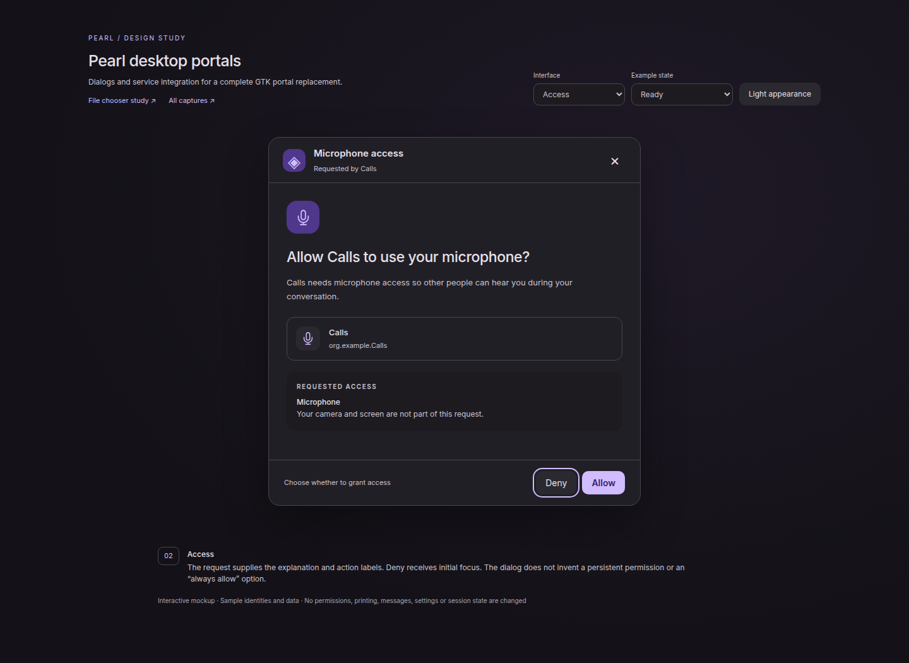
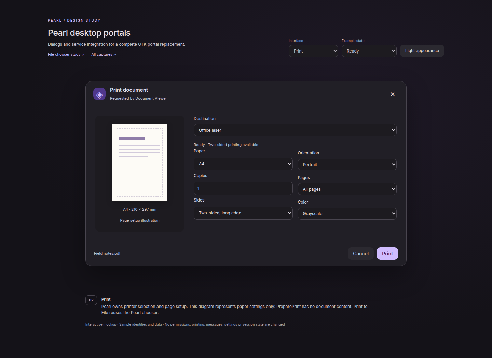
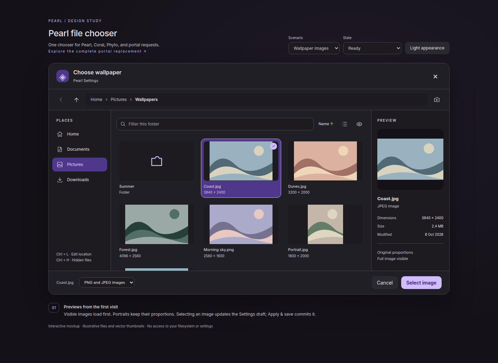
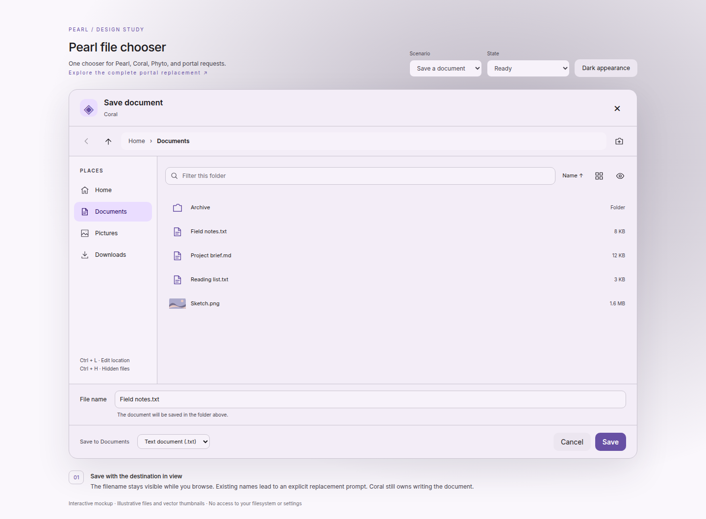
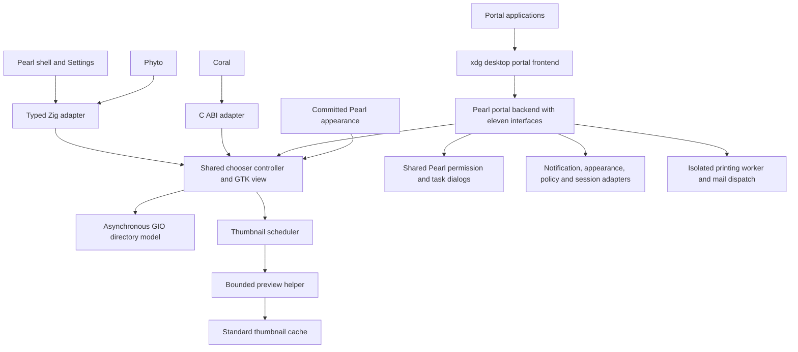

# Pearl desktop portal replacement implementation plan

Status: implementation in progress, 2026-10-12. The shared native chooser,
preview extraction, first-party migrations and an eleven-interface backend now
exist. This is a candidate implementation, not a completed GTK backend removal.
M10/M11 remain gated by the acceptance work below.

Pearl will replace every interface currently supplied by
`xdg-desktop-portal-gtk` in a Pearl session. The finished Devario Pearl image must
work with that package absent. One Pearl backend will own the eleven interfaces
listed below, with Pearl dialogs and integration with its existing services.
The central `xdg-desktop-portal` frontend, document/permission infrastructure,
and Aqueous ScreenCast/Screenshot backend remain in place. Pearl is a Wayland-only
desktop: native Wayland dialogs, exported parent handles and activation tokens
are the supported path. X11/XWayland hosting and acceptance are out of scope.

The shared file chooser and thumbnail generation remain part of this plan and
address [issue 42](https://github.com/Seafoam-Labs/pearl/issues/42). The existing
document path is retained so earlier links continue to work.

Review the [portal mockups](mockups/file-chooser/portals.html),
[file chooser mockups](mockups/file-chooser/index.html),
[capture gallery and verification](mockups/file-chooser/README.md), and the
implementation milestones below. The HTML study illustrates the native design;
production uses GTK widgets built and styled by Pearl, without embedding a web
view or wrapping `GtkFileChooserDialog`.

## Implementation record

The working tree now contains:

- `src/files/chooser.zig`, using the existing GTK/GIO Zig bindings: asynchronous directory
  browsing, monitored mounts/bookmarks, search, filters, list/grid views,
  thumbnails, breadcrumbs, sorting, keyboard navigation, folder creation, single/multiple/folder
  selection, save validation, overwrite confirmation and batch choices.
  The chooser returns selections; document writes remain with its caller.
  Per-application view preferences and the last accepted folder use bounded,
  private, atomic state storage; cancelled requests do not change that folder.
  Standard GTK and Phyto bookmarks are read without rewriting their sources.
  Appearance, private state and the native smoke driver are separate Zig modules
  under `src/files/chooser/`; the old C chooser and inline state header are removed.
- `src/files/preview/`: the extracted Phyto scheduler, policy, cache and isolated
  image/text/PDF/video workers, with `pearl-preview-helper` as a standalone host.
  The wallpaper picker uses this service instead of its former separate cache.
  glibc arena counts are bounded before the helper's existing address-space cap;
  this fixes nondeterministic GIO thread-start failures without raising the cap.
- Settings, the shell wallpaper selector, Phyto destination selection and Coral
  open/save now use the shared chooser. No production `GtkFileDialog` or
  `GtkFileChooserDialog` call remains in those source trees. All hosts, including
  the portal backend, import the native Zig chooser module directly.
- `src/portal/`: a native backend with all eleven pinned interface contracts,
  trusted-frontend checks, owned/cancellable requests, committed appearance,
  managed policy, consent dialogs and mail/notification/session adapters.
  `src/portal/portal_session.zig` connects application holds and query-end state
  to Pearl's lifecycle; sleep/idle additionally acquire owned logind FDs.
  Notifications preserve action routing across backend restarts using private,
  bus/service-owner-bound runtime state, and discard stale server IDs.
- The print backend has a custom dialog, a bounded subprocess for CUPS and file
  I/O, printer capability discovery, page setup, app-bound expiring single-use
  tokens and a shared chooser for output files. PDF/PostScript/SVG file output
  validates the requested format; device submission supports PDF/PostScript.
  File output is verified through the real PreparePrint → Print FD/token flow,
  and real libcups discovery/submission is tested against a private IPP server.
- `packaging/portal/` contains stable/Git backend recipes, descriptors, explicit
  routes, activation files, policy defaults and a DESTDIR-only installer. The
  backend packages depend on the matching Pearl runtime and own separate paths
  and bus names. Runtime recipes ship the shared helper and declare Glycin;
  backend recipes declare CUPS and mail-dispatch dependencies. Release tooling
  emits the backend recipe against the same checksum-locked source archive.
- The companion Aqueous changes are applied in the local Aqueous checkout and
  retained as `packaging/portal/aqueous-integration.patch`. Pearl session identity
  selects the matching backend before activation. Pearl presets depend on it;
  DMS/Noctalia retain GTK, and the neutral session is independent of a shell.
  Staged stable/Git tests cover selection, frozen active-session identity and
  package metadata. The installed desktop and packages have not been changed.

### Zig portal runtime and startup correction (2026-10-13)

The nine portal implementation files and the shell session adapter are now Zig.
`src/portal_main.zig` calls `src/portal/backend.zig` directly; chooser, preview and
appearance integration use Zig imports. The C implementations, private headers
and chooser C export bridge have been removed. `ffi.zig` declares external
GTK/GLib/libc/CUPS calls using the existing generated GTK/GIO object types and
target-provided libc layouts. Stable/Git identities are Zig build options.
The pinned XML generator now produces `src/portal/contracts.zig`.

Before initializing GTK, the backend calls `gtk.disablePortals()`. Otherwise GTK
can synchronously request public portal settings while the public frontend waits
for this backend to register its name. The October 13 login journal showed both
services timing out and Pearl taking 15.25 seconds to become ready, versus 0.44
seconds on October 12.

`tests/portal/test_startup.py` now runs in the portal suite. It holds a public
Settings reply pending and requires backend readiness within five seconds, both
with the default environment and with `GTK_USE_PORTAL=1`. It also activates the
real frontend and backend on demand on a private bus. The old installed backend
fails the blocked-reply test; the Zig backend passed at about 25 ms, with cold
activation at about 47 ms in the initial run. These measure the isolated backend,
not full desktop startup. The session contract fixture links the Zig adapter;
its independent C D-Bus client remains test-only.

Validation commands, from the repository root:

```sh
zig build build-portal build-chooser build-settings build-integration build-locker -Doptimize=ReleaseSafe
zig build build-portal -Dportal-variant=git --prefix zig-out/portal-git -Doptimize=ReleaseSafe
zig build test-file-previews test-release-tools -Doptimize=ReleaseSafe
zig build test-portals -Doptimize=ReleaseSafe
python3 tests/portal/test_startup.py --binary zig-out/portal-git/bin/xdg-desktop-portal-pearl --output artifacts/portal-startup-git
python3 tests/portal/test_aqueous.py --source /home/zoey/RiderProjects/Aqueous
```

The native suites need permission to create their private D-Bus/Wayland sockets
and decoder sandboxes. They do not change the active desktop's routing, package
installation, notification service, documents or thumbnail cache.
`tests/fixtures/portal/baseline.json` records the installed GTK descriptor and
XML hashes; `tests/portal/generate_contracts.py --check` checks reproducibility.
The tests exercise all eleven introspection contracts, frontend ownership,
cancellation/owner loss, explicit consent, notification replacement/actions,
literal email handoff, session monitors, inhibitor FD release, native print
preparation/token replay rejection and print-to-file. The shared chooser suite
checks actual open/save/folder results and parent-close cancellation.
The public-frontend suite verifies real GTK and Qt Wayland clients reach Pearl
(with an observed portal call, preventing silent toolkit fallback), and verifies
the real document service and FUSE mount. These are host applications using the
portal, not a substitute for sandboxed Flatpak acceptance.

The broad root unit suite has an existing unrelated failure: the Polkit event
`activity-auth-conversation-started` is missing from `src/core/log_events.zig`
(284/285 tests pass). The focused shared-preview and release-package tests pass.
Coral's existing 18 native check groups pass, including actual Save As.
Phyto's directory, context-menu and expanded preview suites pass, including
PDF/video providers, sandbox failures, cancellation and large directories.

**Remaining work before the complete replacement claim:**

1. Finish the parent-loss/live-policy race and native accessibility/scale/RTL
   acceptance matrix. Verify attachment handoffs against real supported mail
   clients, including unusual filenames; unsupported handoffs fail explicitly.
2. Validate physical printer/driver behavior and sandboxed GTK/Qt applications
   through the public frontend and document mounts. Private IPP and host-toolkit
   tests cover the implemented transports but do not certify those environments.
3. User-switch holds are owned, but Pearl exposes no user-switch action. A future
   switch action must enforce them; the current implementation does not claim
   enforcement over switches initiated outside Pearl. Logout, sleep and idle
   have their own enforcement paths.
4. Assemble the GTK-free Devario image and run fresh install, upgrade, removal,
   capture-route preservation, recovery and performance acceptance. Package
   recipes and staged session tests exist; installed-image acceptance remains.
   Do not remove GTK from the running system as part of source validation.

The [verification record](../artifacts/portal-replacement/verification.json) links
the final Wayland build and focused test logs. Coral’s 18 native groups and
Phyto’s context-menu workflows were rerun after the Wayland-only scope change.
The subsequent native Zig chooser migration also passes the portal, chooser,
Coral and Phyto checks, including filters, application choices, batch destinations
and overwrite cancellation; see the [Zig migration verification](../artifacts/portal-replacement/verification-zig-chooser.json).

The original milestones and mockups below remain the acceptance contract;
source implementation does not by itself mark a milestone complete.

## Outcome and scope

The release baseline is the eleven interfaces advertised by the installed
`/usr/share/xdg-desktop-portal/portals/gtk.portal`. Capture the target distribution's
package version, descriptor, XML interfaces and build options in M0. Require
coverage of every interface it actually enables; optional interfaces such as
Wallpaper in other upstream builds must be added to the matrix if enabled in
the release baseline. A later GTK backend update must not silently expand the
unverified compatibility claim.

| Interface | Pearl implementation | User-facing surface |
| --- | --- | --- |
| FileChooser | Shared chooser, async browsing, thumbnail/cache service | Open, save, folders and batch destinations |
| AppChooser | Installed-application selection and activation handoff | Open with an application |
| Access | Request-scoped allow/deny conversation | Permission prompt and optional choices |
| Account | Current-user profile lookup and consent | Share name and avatar confirmation |
| DynamicLauncher | Launcher preparation and noninteractive-install policy | Name/icon/target review |
| Print | Pearl print UI and isolated print transport | Printer, page setup, options and print-to-file |
| Notification | Adapter to the existing notification service | Pearl notification popups and history |
| Inhibit | Owned session inhibitors and session monitoring | Existing power/session UI with attributed holds |
| Email | Mail application dispatch and attachment handoff | Mail-app choice or actionable failure when necessary |
| Lockdown | Authoritative desktop restriction properties | Explanation at the blocked operation |
| Settings | Read-only committed appearance and change signals | Compatible applications follow Pearl appearance |

All eleven are required, including interfaces with no standalone dialog.
Replacing the GTK backend does not require removing GTK libraries: Pearl's native
widgets and image loading still use GTK. It does require removing every backend
activation and dependency on `xdg-desktop-portal-gtk` from the Pearl package closure.
Third-party applications' privately rendered dialogs remain application-owned.

Every first-party open, save, and folder-selection action uses the same chooser
component. The component owns navigation, selection, previews, and confirmation;
the calling application owns opening, writing, transferring, or applying the
returned files. Cancel leaves the caller's previous selection or document intact.

The full delivery includes the complete portal replacement and the wallpaper fix.
Applications that use the file-selection portal receive the same UI. An
application that renders its own embedded picker is outside this control.

Supported operations are single and multiple file opening, single and multiple
folder selection, saving one file, and selecting destinations for multiple named
files. PNG and JPEG preview generation is required for the wallpaper fix. Reuse
Phyto's existing supported raster formats for general selection; preserve its
optional PDF and video providers without making them mandatory dependencies.

The chooser includes bookmarks, mounted locations, breadcrumbs, an editable
location, parent/back navigation, filename filtering within the current folder,
sorting, hidden files, new-folder creation, list/grid views, and an optional
selection preview. Recursive content search, file deletion, renaming existing
files, file transfers, and a new network-connection editor remain Phyto functions.
Mounted remote locations are browsable through GIO where available.

## Existing code and migration inventory

The design baseline is Pearl revision `fbfcee6` and the local Aqueous checkout at
`640dda75`. Recheck call sites and package templates before implementation.

| Entry point | Current code | Required behavior after migration |
| --- | --- | --- |
| Settings wallpaper | `src/settings/preferences_view.zig`, `chooseWallpaper` | One local PNG/JPEG; update the draft, keep Apply/Discard and existing validation |
| Settings slideshow | Same file, `chooseFolder` | One local folder; preserve current slideshow draft |
| Settings launcher icon | `src/settings/bar_view.zig`, launcher PNG picker | One local PNG; preserve icon validation and draft revision checks |
| Shell wallpaper | `src/desktop/settings.zig`, `chooseWallpaper` | Same image chooser with layer-shell hosting and focus restoration |
| Coral Open | `subprojects/coral/src/app.zig`, open and `chosenOpen` | Multiple files; preserve document loading and duplicate-tab handling |
| Coral Save As | Same file, save and `chosenSave` | One destination; preserve encoding, save conflicts, and document lifetime |
| Phyto destinations | `subprojects/phyto/src/context_menu.zig`, `Choose` | Copy, move, and restore destinations; preserve operation ownership and cancellation |
| Portal OpenFile | New backend | Open files or folders, including multiple selection |
| Portal SaveFile and SaveFiles | New backend | Single destination or ordered batch destinations |

The shell also has a specialized wallpaper browser in
`src/desktop/wallpapers.zig`. It remains a bar surface with its current selection
and crop actions. Move it onto the shared thumbnail service after the chooser
migration so image generation and caching have one implementation.

Phyto already has the reusable pieces: `platform/thumbnails.zig` schedules work,
`preview_helper.zig` performs bounded decoding and applies embedded orientation,
`platform/preview_read.zig` handles asynchronous child output, and
`platform/thumbnail_cache.zig` limits disk use and protects foreign entries.
`preview.zig` binds subscriptions to visibility and widget lifetime. Extract
these capabilities; do not copy a second independent thumbnail stack.

Coral uses C-imported GTK APIs while Pearl and Phyto use generated GObject
bindings. The integration must explicitly bridge this difference.

## Design and mockups

The [portal study](mockups/file-chooser/portals.html) adds AppChooser, Access,
Account, DynamicLauncher and Print dialogs, plus Notification and Inhibit
integration views, Email handoff, a Lockdown explanation and a Settings appearance
specimen. Background interfaces are illustrated through the surfaces they affect;
the study does not prescribe a new technical portal dashboard in the product.





Every dialog shares caller attribution, Pearl typography and tokens, a clear
negative action, keyboard focus, Escape handling, cancellation and a narrow
layout. Permission requests default focus to the negative action. Only request
choices explicitly supported by the protocol are shown; the Access prompt does
not invent an "always allow" permission lifetime.



The window uses the committed Pearl palette, font, density, corner radii,
icon theme, custom style tokens, and reduced-motion setting. Initial mockup
colors come from `src/theme/theme.zig`: dark surface `#211f26`, primary
`#d0bcff`, and primary container `#4f378b`; the light view uses the corresponding
light palette. These are example values, not colors to hard-code in production.

| Area | Design contract |
| --- | --- |
| Header | Caller-supplied task title, caller identity where useful, Cancel/close behavior |
| Navigation | Back, parent, breadcrumb/location editor, new-folder action |
| Places | Home, XDG user directories, supported bookmarks, mounted locations; hide unavailable optional sections |
| Browser toolbar | Clearly labeled current-folder filter, sort, grid/list, hidden-file toggle |
| File view | Virtualized items, stable names and focus, placeholders replaced by thumbnails without relayout |
| Preview | Full image contained within its frame, file type, dimensions and size; hide when space is limited |
| Save fields | Persistent filename and destination context; optional application choices |
| Footer | Selection/destination summary, file-type filter, Cancel, task-specific confirmation |

Start at approximately 1040 × 680 logical pixels, bounded to the available output.
Below approximately 1040 logical pixels hide the preview pane; below 680 move Places into a
dismissible drawer and stack footer controls. At 390 pixels every action remains
reachable. Short windows scroll the file view and extra options independently
while retaining confirmation controls. Test enlarged fonts, RTL layout, and 1×,
1.5×, and 2× output scales in the native UI.



| Mockup | What it resolves |
| --- | --- |
| [Wallpaper](mockups/file-chooser/wallpaper-dark.png) | Thumbnail grid, full-image preview and local image filter |
| [Light appearance](mockups/file-chooser/wallpaper-light.png) | Shared structure with the light palette |
| [Open multiple](mockups/file-chooser/open-multiple.png) | Document list, multiple selection and count |
| [Folder](mockups/file-chooser/folder.png) | Selected child versus current-folder destination |
| [Save](mockups/file-chooser/save-light.png) | Filename and file type while browsing |
| [Replace](mockups/file-chooser/replace.png) | Explicit confirmation without writing from the chooser |
| [Portal](mockups/file-chooser/portal.png) | Requesting application and application-supplied options |
| [Batch save](mockups/file-chooser/batch.png) | Incoming names and destination selection |
| [Narrow](mockups/file-chooser/narrow.png) | Compact controls and Places drawer |
| [Loading](mockups/file-chooser/loading.png) | Stable placeholders during enumeration |
| [Empty](mockups/file-chooser/empty.png) | Empty directory with a useful next action |
| [Permission denied](mockups/file-chooser/denied.png) | Inline location failure and retry |
| [Disconnected](mockups/file-chooser/offline.png) | Mounted location unavailable |
| [Thumbnail unavailable](mockups/file-chooser/thumbnail-failed.png) | Selection remains possible when a preview fails |

The study uses illustrative vector landscapes and in-memory files. It does not
implement filesystem access, a native accessibility tree, real thumbnails, or
portal permissions. See its README for implemented interactions and limitations.

## Component architecture

Use one shared, in-process chooser UI with separate host adapters. The shell
must retain direct layer-shell ownership; a mandatory out-of-process chooser
would complicate its overlay focus handling. The portal backend is a separate
process using the same library and a normal application window.



Proposed source layout:

| Path | Responsibility |
| --- | --- |
| `src/files/model.zig` | Modes, validated requests, selection and navigation state, completion |
| `src/files/filters.zig` | MIME and glob rules, filter identity and matching |
| `src/files/directory.zig` | GIO enumeration, monitoring, sorting, mounted locations and metadata |
| `src/files/chooser.zig` | Controller, accepted/cancelled/failed results, action dispatch |
| `src/files/view.zig` | Shared themed GTK layout and accessible controls |
| `src/files/host.zig` | Normal-window host contract; shell supplies its layer-shell hooks |
| `src/files/appearance.zig` | Read-only appearance adapter and widget-scoped CSS |
| `src/files/state.zig` | Bounded chooser UI state and bookmark integration |
| `src/files/c_api.zig` and `include/pearl-file-chooser.h` | Opaque handle and stable C callback types for Coral |
| `src/files/thumbnails/` | Extracted scheduler, worker protocol, decoder and cache policy |
| `src/file_preview_main.zig` | Display-independent preview helper executable |
| `src/portal/file_chooser.zig` | File-selection D-Bus adapter |
| `src/portal/app_chooser.zig`, `access.zig`, `account.zig`, `dynamic_launcher.zig` | Remaining selection and permission interfaces |
| `src/portal/print.zig`, `src/portal/print_worker.zig` | Print preparation/tokens, isolated job transport |
| `src/portal/notification.zig`, `inhibit.zig`, `email.zig` | Service and application handoff adapters |
| `src/portal/settings.zig`, `lockdown.zig` | Appearance properties, restrictions and change signals |
| `src/portal/request.zig`, `session.zig`, `identity.zig` | Shared ownership, cancellation, limits and trusted caller context |
| `src/portal/dialogs.zig`, `resources/portal-dialogs.css` | Shared Pearl dialog structure and theme |
| `src/portal/main.zig` | Backend activation, interface registration, lifetime and shutdown |
| `resources/file-chooser.css` and `resources/file-chooser-layout.css` | Tokenized appearance and structural layout |
| `build/files.zig` | Shared module/static-library build helper used by all consumers |

Export a typed Zig interface for Pearl and Phyto. Build the C adapter with the
same generated binding modules and expose only opaque handles, GTK/GIO C
pointers, enums, explicit lengths, and callbacks across its ABI. Coral links
that adapter; it does not cast Zig slice layouts or generated wrapper structs.
Use each consumer's existing GTK main context. No new event loop or GTK
initialization is introduced by opening a chooser.

Keep layer-shell calls in the shell host adapter so Coral and the portal host
do not acquire a shell-only linking requirement. Translate shared UI strings
through the existing localization conventions, including plural selection counts
and mnemonic labels. Caller-provided labels remain caller-owned translations.

The static shared build helper must support both the root build and the existing
independent subproject builds, using the same pinned dependencies. Compile and
link a minimal Coral integration in the first milestone to resolve this seam
before building the full UI.

## Request and result contract

This is the proposed internal contract, independent of the portal wire format:

```text
Request
  mode: open_files | select_folders | save_file | save_files
  multiple: boolean (open/select only)
  title, accept_label, caller_identity
  parent: GTK window or host-provided foreign-window relationship
  modal, initial_folder, initial_file, suggested_name
  file_filters[], current_filter, application_choices[]
  locations: local_only | gio_supported
  preview_policy: images | supported | disabled
  save_names[] (ordered basenames, save_files only)
  persistence_key (fixed first-party key or authenticated portal app ID)
  host hooks, appearance source, cancellable

Result
  accepted: owned GFiles/URIs[], selected_filter, choice_values[]
  cancelled: no selection
  failed: typed failure (startup, unavailable, invalid request)
```

Deep-copy request data before returning the request handle. Retain the necessary
GObjects and disconnect callbacks when the parent dies. The handle supports
idempotent cancel; completion fires once on the owning main context. Returned
objects have explicit reference ownership. The C wrapper supplies one result-free
function and documents ownership in the header.

Use bounded inputs: initially 64 filters, 64 rules per filter, 16 application
choices with 64 values each, 1024 selected files or batch names, and 1 MiB total
request metadata. Reject over-limit requests with a typed error; do not silently
truncate. Display strings are escaped as text. Preserve filesystem byte names
and derive safe display names through GIO. The chooser must not impose the
wallpaper preference's 1024-byte UTF-8 limit on all documents; that validation
remains in the wallpaper caller.

Suggested state machine:

```text
created → enumerating → ready → validating → accepted
                ↘ location error → retry / navigate
                         validating → overwrite confirmation → validating
any nonterminal state → cancelled / failed
```

Each navigation and selection-dependent preview gets a generation number.
Late callbacks may release their own resources but cannot update a newer view
or complete a terminated request. Cancel outstanding enumeration and thumbnail
subscriptions on navigation, closure, lock/session teardown where applicable,
or parent destruction. Keep the application alive until children are reaped.
No user-selection timeout; separate bounded timeouts apply only to IO jobs.

## Selection and navigation behavior

Single-click selects. Double-click or Enter opens a directory; activating a file
accepts it only when the mode permits. Ctrl-click toggles selection and Shift
selects a range. Ctrl+A selects eligible visible entries in multiple mode.
Selection is cleared on directory changes; changing filters removes hidden
selections and updates the count. Disallow mixed file/folder acceptance for
file-opening mode.

Folder mode accepts either the selected child directory or the current directory
when nothing is selected. Label the destination in the footer. Multiple-folder
mode requires an explicit selection and returns those folders only. Local-only
callers can see why a nonlocal location cannot be selected. Network mounts use
GIO cancellation and standard mount operations; no credentials are stored by
the chooser. Initial-location failures show a message and a usable fallback,
not an empty unexplained list.

Precedence for the initial location is a usable explicit file/folder, then the
caller's last accepted location, then its appropriate XDG directory, then Home.
Opening a file location reveals and selects it after enumeration. Keep directory
enumeration asynchronous in batches, merge updates by stable file identity, and
retain focus through monitor refreshes. Use GTK list/grid factories with recycled
rows. Metadata and thumbnails are fetched on demand for visible entries.

Symlinked folders may be navigated with cancellation and loop detection. Return
the chosen GFile identity to the caller; caller IO remains authoritative. Keep
Phyto's current no-symlink preview policy initially and display a normal icon for
such entries. Never decode FIFOs, device nodes, or sockets as images. Mounted
remote files may be selected, but automatic previews initially require a native
regular file and the existing size limits; they never trigger background network
downloads.

New Folder validates a basename and explicitly creates it with GIO; report
existing-name, permission, and disconnected-location errors in the dialog.
Cancelling the main chooser does not undo a folder the user explicitly created.
The UI must not imply that every navigation-side action is transactional.

Keyboard contract: Ctrl+L edits the location, Alt+Up goes to the parent, Alt+Left
goes back, Ctrl+F focuses the current-folder filter, Ctrl+H toggles hidden files,
F5 refreshes, and Escape closes the innermost prompt/drawer before cancelling
the chooser. Arrow keys navigate items; Space selects without opening. Restore
focus to the originating control on completion. Native accessible names,
selection states, list position, loading and error announcements are required.

## Save and replacement behavior

For Save As, keep the user's filename through navigation and filter changes.
Reject empty names, NUL, separators, `.` and `..`; resolve the name relative to
the displayed destination. Do not silently append or rewrite extensions. A
caller may request an extension suggestion, which is visible before acceptance.
An existing directory with the entered name offers navigation, not replacement.

Check destination availability asynchronously before acceptance. If a file
exists, show its name and destination in a modal replacement prompt with Cancel
focused initially. On confirmation recheck the destination identity; if it
changed, return to validation and show the conflict again. The chooser never
creates, truncates, or writes the selected document. The caller must still use
its existing atomic-save/conflict checks because confirmation cannot eliminate
filesystem races. Coral's modified-document and save-error flows stay intact.

Batch save displays every requested basename in order. Default conflict policy
is to produce unique names with a visible numbered suffix, including conflicts
between names within the batch. Show original-to-final name changes before
confirmation. Recheck immediately before returning; preserve input order and
never claim that the names are reserved. Invalid names fail the request rather
than escaping the chosen folder. The browser mockup illustrates the batch footer;
the native collision-review list is part of implementation acceptance.

## Thumbnail generation and cache

Extract Phyto's bounded decoder and scheduler behind a caller-independent API.
Use an installed helper at `/usr/lib/pearl/pearl-file-preview`, with an injected
absolute path for tests and the appropriate Git variant. Resolve from the build
identity, not `PATH`. Phyto's existing `/proc/self/exe --preview-helper` route
becomes a compatibility adapter during migration; remove it only after its tests
and package consumers use the shared helper.

First load a valid cached image, then enqueue a decoder when necessary. Produce
pixels in the helper, create textures on the GTK main context, and deliver the
result to visible subscribers. Bound encoded bytes, source dimensions, output
dimensions, child output, execution time, and queue size. Treat subprocess
isolation and resource limits separately from sandboxing; retain the existing
decoder protections and optional PDF/video sandbox policy.

Initial limits carry over from Phyto: two jobs, 128 queued requests, 64 MiB of
decoded texture memory, 50 MiB raster input, 64 million source pixels, and a
2048-pixel maximum rendered edge. Grid jobs use a five-second timeout; explicit
large previews may use ten seconds. Use per-instance scheduling with an injected
application/lifetime context instead of Phyto's process-global singleton state.
The portal process also has an aggregate budget so opening several requests
does not multiply its worker count or memory allowance.

Preserve aspect ratio with a contained `GtkPicture`, apply embedded orientation,
and use transparent-image checkerboards only as background decoration. Requeue
at an appropriate resolution when the output scale changes. Prioritize the
selected preview and visible cells; scrolling out of view detaches listeners
and cancels jobs with no consumers. Preview failures never prevent an otherwise
valid file selection.

The cache follows the [Thumbnail Managing Standard](https://specifications.freedesktop.org/thumbnail/latest/):
URI-based names, standard size directories, and source metadata for validity.
Preserve Phyto's finer modification-time and source-size checks, atomic writes,
private permissions, and avoidance of thumbnailing the cache itself. Failure
entries apply to a particular source version; transient IO failures are retriable.

Keep the existing `Phyto::` validity metadata readable. Establish a shared
`Pearl::` metadata version for new writes without invalidating standard external
thumbnails. Share the existing bounded ownership ledger under a compatible
locking strategy during migration; never have two independent pruners claim the
same cache entry. Keep the 256 MiB owned disk budget, delete only entries whose
ownership/hash still match, and do not wipe thumbnails created by other apps.
Failure-cache namespaces and old ledger handling require migration tests.
Cache write failure is nonfatal: display generated pixels and continue.

## Appearance and saved UI state

Factor the existing committed appearance rendering from
`src/settings/appearance.zig` and `Window.style` into a reusable read-only
adapter. In-process shell/Settings callers provide their committed snapshot.
Coral, Phyto, and the portal host use the same read-only appearance transport
already used by Settings, without becoming draft editors. Verify subscription
lifecycle and reconnect behavior in the initial architecture milestone.

Apply CSS to the chooser root only. Observe palette, font, density, style-token,
icon, and motion revisions without rebuilding focused inputs or changing the
selection. Support Pearl's GTK appearance mode as well as static and Material
palettes. When the shell is unavailable, use the last usable committed snapshot
or Pearl defaults; the chooser must remain usable independently of the shell.
Never turn a theme transport failure into a failed file-selection request.

Store view mode, sort, hidden-file state, preview-pane preference, and last
accepted location in a bounded chooser state file under
`$XDG_STATE_HOME/pearl/file-chooser.ini`. Use fixed operation keys for first-party
callers and portal-authenticated app IDs for external callers; titles never
become state keys. Save last location on acceptance, not on cancellation. Bound
the per-caller history to 128 entries with atomic locked updates. Do not persist
selected filenames, request titles, or application choice values by default.

Initially consume standard GTK bookmark locations and Phyto bookmarks through
read-only adapters, deduplicating by GFile identity; bookmark editing remains
in Phyto. Handle missing bookmark files and mounts gracefully. Do not change
Pearl's main preferences schema merely to remember chooser geometry.

## Portal backend and Aqueous integration

The local Aqueous backend provides ScreenCast and Screenshot. Its current
`packaging/aqueous-portals.conf` uses `default=gtk`; the `aqueous-portal-picker`
described in `packaging/portal/README.md` selects screen-sharing sources.
File selection therefore needs a new backend, not an extension of that picker.

Implement a backend named `pearl` exposing all eleven baseline interfaces
at the standard backend object path,
with bus name `org.freedesktop.impl.portal.desktop.pearl`. Run it as
`/usr/lib/pearl/xdg-desktop-portal-pearl`. Its request controller instantiates the
shared chooser and dialog components. It must never delegate to the GTK portal
service or invoke its own public portal route recursively. Lower-level GIO,
printing and session APIs remain available to implement actual operations.

Map OpenFile, SaveFile, and SaveFiles to the shared modes. Carry filters, the
current filter, labels, initial locations, and application choices through the
request and response. Backend results use local `file://` URIs; translate mounted
remote locations to usable local paths where possible and reject selections
that cannot be represented. Preserve batch result order. Follow the published
[backend FileChooser contract](https://flatpak.github.io/xdg-desktop-portal/docs/doc-org.freedesktop.impl.portal.FileChooser.html).

The public portal frontend remains responsible for application identification,
document export, and sandbox access. Do not grant access independently or return
remote URIs directly to a sandboxed caller. Follow the public interface's
filter, choice, and byte-path semantics, including case-sensitive glob patterns
and boolean choices; advertise only protocol features covered by conformance
tests. See the [public FileChooser contract](https://flatpak.github.io/xdg-desktop-portal/docs/doc-org.freedesktop.portal.FileChooser.html).

Bind each backend request to its sender and handle; clean it up on
[Request.Close](https://flatpak.github.io/xdg-desktop-portal/docs/doc-org.freedesktop.impl.portal.Request.html),
parent destruction where observable, router disconnect, or session teardown.
Allow one active chooser per app/parent and at most eight active requests in the
backend initially; return a defined failure for excess requests rather than
silently replacing another window. These are backend implementation limits,
not portal protocol requirements. Do not add a timeout while a user is choosing.
Test completion-versus-cancel races and exactly-once method replies.

Import the parent relationship using the documented
[window identifier format](https://flatpak.github.io/xdg-desktop-portal/docs/window-identifiers.html).
Prototype Wayland foreign-parent support before committing to the hosting code.
If the pinned GTK bindings do not expose the needed API, add a small C bridge
using the supported underlying GDK/protocol integration. An invalid handle must
not attach to an arbitrary application. Use a normal chooser window for portal
requests, not a global exclusive overlay. Resolve display identity through
installed application metadata; unknown IDs get a neutral label. Never render
caller text as trusted markup.

### Shared backend contract

Pin the backend XML and advertised versions from the release environment in
`tests/fixtures/portal/`. Each interface needs real methods, property values,
signals, failure behavior and lifecycle tests before it is listed in
`pearl.portal`. Generate a coverage report comparing the baseline descriptor with
the Pearl descriptor and actual D-Bus introspection. Interface names alone do not
count as implementation. Support known optional fields and ignore unknown fields
only where the protocol permits it; malformed signatures get defined failures.

Use one D-Bus activation name with independent interface modules. The shared
request registry owns the router's unique sender, object handles, app identity,
parent, cancellables and terminal reply. Resolve the current trusted portal
frontend owner rather than accepting arbitrary calls that claim an `app_id`.
In-process first-party callers use the typed library, not this trust boundary.
When the frontend owner changes, cancel its outstanding requests and sessions.
Do not send file paths, account data or decision results to a replacement sender.

Apply the previously specified active-dialog limit across interactive interfaces.
Background operations have their own bounded registries: start with 1024 active
notification mappings, 128 inhibitor handles and 64 monitor sessions per backend;
return defined errors at capacity rather than evicting active ownership records.
These provisional implementation limits must be exercised under load in M0/M8.
Separate timeout-bounded worker operations from untimed user interaction.

Do not collect all services into the file chooser controller. Notification,
policy and appearance requests must continue while a print dialog is open or a
preview helper fails. User-visible errors name the operation and a useful next
action; diagnostic logs use existing redaction and omit message bodies, document
contents, recipients and account details.

### AppChooser

Implement ChooseApplication and UpdateChoices with stable desktop IDs, icons,
search, a selected row and confirmation. Preserve selection when the permitted
choices are updated, unless the selected application disappears. Respect the
request's proposed last choice and activation context. Return a selection for
the frontend to launch; do not independently launch the target and cause a
duplicate open. The [AppChooser interface](https://flatpak.github.io/xdg-desktop-portal/docs/doc-org.freedesktop.impl.portal.AppChooser.html)
defines the handoff, including activation tokens.

Build on Phyto's installed-application model after separating it from its window
owner. Validate desktop IDs against installed, launchable entries. Escape labels
and handle missing icons. Present empty/no-match states and an unavailable-app
error. The initial dialog changes no default application associations; avoid an
"always use" checkbox without an implemented preference contract. Native tests
must cover a choice removed during confirmation and frontend-driven updates.

### Access and Account

Access shows the requesting application, title, explanation, icon, supplied
choices and explicit negative/positive actions. Preserve the request's labels
and return only its defined choice values. Close/Escape/caller death deny or
cancel without granting. Do not invent persistence for decisions: the public
frontend and permission infrastructure own that policy. See the
[Access contract](https://flatpak.github.io/xdg-desktop-portal/docs/doc-org.freedesktop.impl.portal.Access.html).
This does not replace Pearl's existing Polkit authentication agent.

Account resolves only the current session user's profile, displays the exact
name/avatar to be shared, and returns it after explicit consent. Use a bounded,
sanitized AccountsService lookup with current-user system metadata as fallback;
an unavailable avatar has a neutral preview and a valid empty/missing-image
representation as permitted by the pinned interface. Never reuse greeter account
enumeration to disclose all users. Keep avatar decoding on the shared bounded
image path. Follow the [Account response contract](https://flatpak.github.io/xdg-desktop-portal/docs/doc-org.freedesktop.impl.portal.Account.html).

Tests cover allow/share, deny, Escape, missing data, malformed avatar, long caller
text, supplied choice controls, policy changes while open, parent destruction,
and no user-information response before consent.

### DynamicLauncher

Implement PrepareInstall with launcher name, bounded icon preview and web target
when applicable. Respect editable-name/icon options and supported launcher types.
Use the shared image chooser if changing the icon is allowed. Validate and
display the web target as text; do not fetch or execute it during preview.
Support RequestInstallToken with an explicit app-ID policy: unknown applications
are denied noninteractive installation. The public frontend retains its token
and desktop-file installation responsibilities. See the
[DynamicLauncher backend contract](https://flatpak.github.io/xdg-desktop-portal/docs/doc-org.freedesktop.impl.portal.DynamicLauncher.html).

Return the approved name/icon rather than writing an arbitrary desktop entry
from caller text. Test malformed serialized icons, forbidden types, fixed-name
requests, cancellation, duplicate/replayed requests, and allowed/denied token
requests. Confirm successful frontend installation appears in Pearl's application
index and follows the normal removal path.

### Print

Implement PreparePrint and Print, including settings/page-setup dictionaries,
file-descriptor input and prepared-job tokens. PreparePrint has no document
contents, so its preview illustrates paper setup rather than a fabricated live
document. Print with a valid prepared token uses those settings; a direct Print
request gets a Pearl dialog. Preserve the frontend's supported-output-format
contract. See the [Print backend interface](https://flatpak.github.io/xdg-desktop-portal/docs/doc-org.freedesktop.impl.portal.Print.html).

Use a separate display-independent printing worker with CUPS client APIs for
discovery, capabilities and job submission. Do not invoke `GtkPrintUnixDialog`
or launch GTK's portal. The parent validates a bounded IPC schema; the worker
handles blocking printer operations, passed descriptors and spool files. Record
supported formats and required conversion dependencies from the pinned stack.
Unsupported formats are reported before confirmation; never silently discard
page ranges, duplex, orientation, media or color settings.

The dialog provides destination, paper, orientation, copies, page selection,
duplex/color capabilities and advanced printer options. "Current page" and
"Selection" appear only when the caller offers them. Printer loss or capability
changes invalidate stale controls. Print to File opens the shared Pearl save
chooser, includes replacement confirmation and returns to the print dialog on
cancel. Retain exact output-format settings through this nested request.

Prepared tokens are random, app-scoped, bounded, expire after a documented
interval (propose ten minutes), and are consumed only according to the pinned
job contract. Reject cross-app/replayed tokens; require re-preparation after
expiry. Spool copies use private permissions and are removed on worker exit,
failure and cancellation. Never treat a successful dialog as a submitted job.
Report submission failure separately; a successful queue handoff does not claim
the physical document has finished printing.

Gate this milestone with a private CUPS/IPP fixture: PreparePrint→Print, direct
Print, print-to-file, supported PDF/PS/SVG paths as applicable, no printers,
authentication-needed/offline printers, paper/duplex options, invalid descriptors,
oversized input, token isolation/expiry and worker death. Finish with a real
printer smoke test and a real application's print-to-file output. Print is a
required milestone for GTK-backend removal, not a deferred placeholder.

### Settings and Lockdown

Settings reads committed Pearl appearance and implements Read, ReadAll and
SettingChanged. Map color scheme, accent color, contrast and reduced motion with
their published types; retain the last valid snapshot during reconnect and emit
only real changes. Inventory compatibility namespaces from GTK's backend and
the supported toolkit clients, implementing needed font/animation/accessibility
keys through a bounded schema map rather than blindly exporting configuration.
Unknown keys get the specified error. See the
[Settings interface](https://flatpak.github.io/xdg-desktop-portal/docs/doc-org.freedesktop.impl.portal.Settings.html).

Lockdown exposes the pinned restriction properties for printing, saving,
application handlers, location, camera, microphone and sound output. Introduce
a shared policy reader for administrator-owned `/etc/pearl/portal-policy.conf`,
defaulting to unrestricted only when no policy is configured. Validate updates
atomically, retain the last valid policy on a malformed update, and log the
configuration error. Ordinary request options cannot override it. Honor any
existing managed lockdown source during migration with explicit precedence;
do not silently turn its restrictions off when removing GTK. Match the pinned
D-Bus signatures and authorize property writes instead of accepting arbitrary
session-bus mutation. See the
[Lockdown interface](https://flatpak.github.io/xdg-desktop-portal/docs/doc-org.freedesktop.impl.portal.Lockdown.html).

Apply the same policy to all relevant backend operations before showing a dialog
and again before acceptance. A restriction arriving while a dialog is open blocks
its positive action. These desktop restrictions complement the existing portal
permission store; they do not replace it. The mockup shows a disabled operation
with an explanation, not an editable policy switch for ordinary applications.

Tests cover exact value types, namespace matching, live theme changes, startup
without the shell, reconnection, malformed policy, read-only callers and every
restricted operation. Verify a real sandboxed GTK app and a Qt portal client
observe appearance changes with GTK's backend absent.

### Notification

Adapt portal notifications to Pearl's existing `org.freedesktop.Notifications`
service, preserving application identity, replacement/withdrawal IDs, action
targets, priority, icons, activation and supported options. Key mappings by
`(app_id, notification_id)` and validate sender ownership; one application cannot
withdraw another's notification. Forward actions and activation through the
portal contract. Advertise the baseline version and only options that survive
the adapter, including the appropriate file-descriptor/icon handling for that
version. See the [Notification backend interface](https://flatpak.github.io/xdg-desktop-portal/docs/doc-org.freedesktop.impl.portal.Notification.html).

Keep one renderer and one history: existing DND, notification filters, lock-screen
redaction and history rules still apply. Persist enough bounded mapping state
where needed to handle backend restart without duplicate notifications; reconcile
notification-service ownership changes before reusing numeric IDs. Service loss
must not claim successful delivery. Tests cover actions, replacements, close
signals, withdrawal, restart, expired entries, DND and two apps reusing one ID.

### Inhibit

Implement Inhibit, CreateMonitor, QueryEndResponse and StateChanged, with
request/session closure. Introduce per-owner holds into Pearl's lifecycle service
instead of toggling its current single `idle_held` flag. Map sleep/idle holds to
the verified session/logind mechanisms; integrate logout/user-switch holds with
the actual Pearl/Aqueous session coordinator. A shutdown inhibitor alone is not
proof that logout or user switching is inhibited. Release file descriptors and
holds on handle closure, frontend loss and service restart reconciliation. Follow
the [Inhibit interface](https://flatpak.github.io/xdg-desktop-portal/docs/doc-org.freedesktop.impl.portal.Inhibit.html).

Show attributed reasons in the existing power/session surface without creating
a confirmation dialog for every background hold. Retain manual idle pause as an
independent owner. Lock and session-state monitoring must reflect the verified
session; model Running/Query End/Ending and acknowledgement deadlines faithfully.
Prototype the Aqueous session-manager connection in M0; inability to honor a
baseline flag is a release blocker, not a reason to return fake success.
Test two simultaneous clients, owner death, session switching, lock/unlock,
suspend/resume, end-session acknowledgement and the actual inhibited behavior.

### Email

Implement ComposeEmail with recipients, CC/BCC, subject, body, attachments and
activation context. Use the configured mail application through a validated
GIO/desktop-entry dispatch or an inspected `xdg-email` adapter where attachment
support requires it. Pass structured argument vectors, encode URI fields and
never interpolate shell text. Do not drop attachments or headers to make an
unsupported client appear successful. See the
[Email interface](https://flatpak.github.io/xdg-desktop-portal/docs/doc-org.freedesktop.impl.portal.Email.html).

The normal flow opens the application's composer. Pearl uses its app-choice UI
when no suitable default exists and provides an actionable error if no capable
client is installed. Return success for a successful composition handoff, never
for delivery of the message. This operation does not send mail. Test attachment
lifetime/readability, unusual filenames, encoded recipients/body, missing client,
launch failure and cancellation without launching anything. Real-client tests
stop at the composer and do not send messages.

### Routing when switching shells

Current launchers export `XDG_CURRENT_DESKTOP=Aqueous`, shared with other shells.
Installing Pearl must not change every Aqueous session's file chooser.
Introduce a Pearl-specific desktop identifier, proposing `Pearl:Aqueous` (and
an isolated Git identifier), selected before user-service/portal activation.
Install `pearl-portals.conf` in the vendor data directory:

```ini
[preferred]
default=pearl
org.freedesktop.impl.portal.FileChooser=pearl
org.freedesktop.impl.portal.AppChooser=pearl
org.freedesktop.impl.portal.Access=pearl
org.freedesktop.impl.portal.Account=pearl
org.freedesktop.impl.portal.DynamicLauncher=pearl
org.freedesktop.impl.portal.Print=pearl
org.freedesktop.impl.portal.Notification=pearl
org.freedesktop.impl.portal.Inhibit=pearl
org.freedesktop.impl.portal.Email=pearl
org.freedesktop.impl.portal.Lockdown=pearl
org.freedesktop.impl.portal.Settings=pearl
org.freedesktop.impl.portal.ScreenCast=aqueous
org.freedesktop.impl.portal.Screenshot=aqueous
```

Desktop-specific files and user overrides follow
[portal configuration precedence](https://flatpak.github.io/xdg-desktop-portal/docs/portals.conf.html).
Keep Aqueous's generic profile for its other shells. Existing user/admin overrides
continue to win. Do not rewrite a user's portal file or restart active capture
services from package installation.

Do not include `gtk` as a secondary provider, `default=gtk`, or a wildcard fallback
in the shipped Pearl profile. `default=pearl` is not a claim that Pearl implements
every interface in the portal specification: advertise only supported baseline
interfaces and retain explicit routes for Aqueous. Interfaces absent from both
the GTK baseline and Aqueous, such as RemoteDesktop or GlobalShortcuts, are separate
features; they cannot be marked implemented by routing configuration alone.

This requires coordinated Aqueous changes in the session selection/env setup,
launchers, desktop entries, portal package fixtures, and tests. Audit exact
`XDG_CURRENT_DESKTOP=Aqueous` comparisons in service conditions: a colon-separated
identity must not stop intended services. Import the selected identity into the
systemd user and D-Bus activation environments before starting the portal.
Cover Welcome-selected Pearl, greeter entry, UWSM launch, direct launch, stable,
and Git sessions. Session switching takes effect on next login. This is a release
gate; do not install the global route as a temporary shortcut.

The Aqueous cross-repository work is specified here and remains pending. No
Aqueous source or active desktop configuration is changed by this plan.

## Build and packaging

Build the shared code once per consuming executable's build graph. Add dedicated
root steps for chooser unit tests, a native chooser harness, preview helper, and
portal backend. Continue supporting the root release build and standalone Phyto
and Coral builds. Check source-archive manifests so extracted files and the C
header are included in release archives.

Package the backend, helper and CSS/resources in the Pearl runtime package.
The normal root build and `packaging/install.sh` include the backend executable,
`pearl.portal`, D-Bus activation service, user unit, vendor portal profile and
backed-up policy configuration. Pearl depends on `xdg-desktop-portal`, `libcups`
and `xdg-utils`; there is no separate Pearl backend package or build job.
Stable and Git packages each own their matching backend identity.
`xdg-desktop-portal-gtk` must be absent from a fresh Pearl-only install and from
its transitive dependency closure. Keep `xdg-desktop-portal` and the existing
document/permission services required by it.

There is a concrete transitive dependency to remove: Aqueous's
`packaging/devario/aqueous-devario/PKGBUILD`,
`packaging/arch/aqueous-desktop/PKGBUILD`, and
`packaging/arch/aqueous-desktop-git/PKGBUILD` currently pull in the GTK backend
through session/desktop packages. Move backend requirements into the respective
shell presets: the Pearl preset requires `pearl` (or `pearl-git`), which includes
its backend; other shells retain their appropriate provider. Audit generated
metadata, installer and ISO package
lists as well as direct Pearl recipes.

Do not declare a global package conflict or fake `provides=xdg-desktop-portal-gtk`.
Users can retain GTK's backend for another desktop; it must never be activated
by the Pearl profile. Upgrades replace the Pearl dependency, report stale explicit
GTK overrides, and make the old backend removable without breaking dependencies.
No running backend is uninstalled by this documentation change.

Update `packaging/install.sh`, release-source/package scripts, Arch release,
Git and Intel-Git recipes, Devario recipes, generated `.SRCINFO` where applicable,
and package-content tests. Stable and Git helpers/resources require independent
paths; the selected session must route to exactly one backend identity. Define
Git backend/config names together with Aqueous's existing Git session identity
and test coinstallation rather than relying on incidental package conflicts.

Image decoding uses the existing GTK/GIO/GdkPixbuf stack. Verify its loader
dependencies in a clean Devario image. No standalone thumbnail daemon is required
by this design. GVfs remains the optional capability for remote mounts; retain
the existing optional PDF/video/sandbox packages and their user-visible fallback.
Add any required foreign-window bridge library explicitly after the hosting
prototype establishes the dependency.

The portal package includes the print worker and required CUPS client library;
use the distribution's `libcups` package where that is the provider. Printer
service availability and driver/filter packages are environmental capabilities,
not reasons to retain GTK's portal. Account metadata uses AccountsService when
available with a current-user fallback. Audit any new account, mail-dispatch,
printing conversion and policy dependencies in the isolated image; none may
reintroduce the GTK portal package. A headless backend activation must serve
Settings and Lockdown without opening a window.

## Implementation milestones

Each milestone has a reviewable implementation and its own acceptance evidence.
The complete feature includes M0 through M11. M6–M8 are implementation work,
not optional follow-ups after the GTK backend is removed.

| Milestone | Work | Completion gate |
| --- | --- | --- |
| M0 Contracts and hosting | Pin all eleven interface XMLs/versions, shared registry and resource limits; chooser ABI/hosts; appearance, session-monitor and print-transport proofs | Build/hosting seams work; every baseline interface mapped to a module and tests; no unresolved session flag or required print-format gap |
| M1 Shared previews | Extract policy, worker, scheduler and cache with compatibility adapters | Existing Phyto preview tests pass; two consumers share cache safely; orphan workers and foreign-cache deletion absent |
| M2 Browsing and UI | Async directory model, places, filters, list/grid, multi-selection, keyboard, responsive themed view and folder creation | Native harness exercises cold thumbnails and all UI states at supported scales |
| M3 Save semantics | Single save, overwrite identity checks, batch conflicts and application choices | No file writes by chooser; cancellation and changed-destination tests pass |
| M4 First-party migration | Replace every inventoried call, wire lifetime/focus, move bar wallpaper previews to shared service | Settings draft, Coral save/open and Phyto transfer regressions pass; production chooser calls removed |
| M5 File portal and shared backend | Activation, request ownership, OpenFile/SaveFile/SaveFiles, URI normalization, options and parenting | Private-bus tests and real sandboxed open/save pass; other interfaces can register independently |
| M6 Appearance and policy | Settings snapshots/signals, compatibility namespaces, Lockdown source and cross-interface enforcement | Live appearance works without GTK backend; each restriction blocks its operation and cannot be bypassed by request options |
| M7 Dialog interfaces | AppChooser, Access, Account and DynamicLauncher; shared caller attribution and cancellation | Protocol replies and native dialogs pass consent, update, token-policy, parent-loss and restricted-state tests |
| M8 Service adapters | Notification mapping/actions, Inhibit holds/monitors, Email composition handoff | Existing Pearl services retain behavior; real inhibitors, notification actions and mail composer work with GTK backend absent |
| M9 Printing | PreparePrint/Print, isolated worker, capability options, tokens and print-to-file | Private CUPS fixtures, real printer smoke and real application output pass; no GTK print-dialog fallback |
| M10 Session and package replacement | Aqueous session identities, explicit routing, preset dependency split, Devario image and stable/Git coexistence | All eleven routes select Pearl; GTK backend absent from Pearl package closure; other desktops and capture routes remain functional |
| M11 Release acceptance | Protocol parity, native visuals/accessibility, performance, fresh install, upgrade/removal and recovery | Full matrix passes with no GTK descriptor, executable, unit or activation service available |

Dependencies: M1/M2 follow M0, M3 follows browsing, and M4 requires M1–M3.
M5 establishes the shared backend and file route; M6–M9 build its remaining
interfaces. M7/M9 reuse the chooser for nested image/output-file requests. M8
requires the session-service seam proven in M0. M10 requires all interface
milestones plus coordinated Aqueous changes; M11 validates the assembled image.
The first-party chooser may be reviewed early, but no release claims complete
replacement before all eleven interfaces and package removal pass.

## Verification and acceptance matrix

Proposed test additions are `src/files/tests.zig`,
`tests/integration/test_file_chooser.py`,
`tests/integration/test_file_chooser_portal.py`, and
`tests/test_file_chooser_package.py`, plus existing caller suites. Name final
build targets consistently with repository conventions during implementation.

Add `tests/portal/test_contracts.py`, `test_dialogs.py`, `test_services.py`,
`test_print.py`, and `test_routing.py`; name native tests consistently with the
repository harness during implementation. Add a machine-readable baseline
manifest with per-interface versions, methods, properties, signals, options,
route and evidence. Capture actual introspection and router logs on the target
image. Mockup screenshots never satisfy protocol coverage.

| Area | Required cases and observable result |
| --- | --- |
| Selection | Single/multiple files and folders, modifiers, filters, location edits, non-UTF-8 filesystem names, long display labels; exact intended GFiles returned |
| Lifecycle | Navigate rapidly, close parent during enumeration/decode, cancel then complete, repeated close, application shutdown; one terminal result and no dangling callbacks/workers |
| Thumbnail correctness | Empty cache, warm cache, portrait/landscape, orientation, alpha, corrupt/truncated/oversized sources, source replacement and deletion; undistorted images or selectable fallback |
| Cache | Read-only/full cache, stale metadata, concurrent helpers, symlink entries, foreign thumbnail overwrite, cache-budget prune and old Phyto ledger; no unrelated deletion |
| Save | New name, existing file, directory collision, replacement cancelled, destination changes during confirmation, unwritable folder, batch duplicate names; chooser never writes document content |
| Remote locations | GVfs absent, mounted share, disconnect mid-enumeration, cancellation, unsupported portal normalization; correct local-only restrictions and error state |
| Settings | Wallpaper PNG/JPEG and launcher PNG limits, slideshow folder, Apply/Discard, stale draft, parent close, shell overlay focus restoration |
| Coral | Multi-open, duplicate document, modified document Save As, encoding, failed save, close-during-selection and file conflict behavior |
| Phyto | Copy/move/restore destinations, closed owner, operation errors; existing preview and provider suites remain green |
| Portal | All methods and choices, filters, byte paths, valid/invalid parents, concurrent apps, Request.Close, router death, ordered batch results, document access granted only after acceptance |
| AppChooser | Candidate updates, absent app, no matches, activation tokens, cancel; no duplicate launch or unintended default change |
| Access and Account | Negative default focus, choices, allow/share, cancel, policy arriving mid-dialog, unavailable avatar and user metadata; no disclosure before acceptance |
| DynamicLauncher | Editable/fixed fields, serialized icons, target text, unsupported type, interactive approval, trusted/untrusted noninteractive token policy and frontend install |
| Print | Prepared/direct jobs, app-scoped tokens, descriptors, capability changes, copies/ranges/media/duplex/color, print-to-file replacement, format handling, no printers and failed spool |
| Settings and Lockdown | Typed Read/ReadAll results, change signals, unknown keys, committed source loss, compatibility namespaces, every restriction and unauthorized mutation |
| Notification | Stable app/ID mapping, replacement/removal, actions/activation, icon descriptors, DND/history/lock behavior and service/backend restart |
| Inhibit | All baseline flags, independent owners, manual idle coexistence, real behavior, closed request/session, frontend loss, lock and end-session monitor acknowledgement |
| Email | Default and no-default handoff, address/CC/BCC/body preservation, attachment lifetime, unsupported client, encoded data and failure; no email sent by tests |
| Appearance | Dark/light, Material/custom tokens, GTK mode, live revisions, shell unavailable, large fonts, reduced motion, RTL, keyboard-only and screen-reader traversal |
| Packaging | Source archive build, clean install, stable/Git coexistence, exact backend activation, other-shell login, user override, greeter/UWSM/direct launch, unchanged capture routes |
| Complete replacement | GTK package absent from dependency closure and filesystem; eleven descriptor entries match implemented methods/signals; no GTK activation or public-portal recursion in any scenario |

Use isolated XDG config/state/cache/runtime directories, a private D-Bus session,
and the existing private Aqueous integration harness. Tests must not change the
developer's active portal routing or thumbnail cache.

For the removal gate, build a clean Devario Pearl image without the GTK backend
package rather than merely stopping its unit. Confirm no installed descriptor,
binary or activation file can satisfy a missed route. Exercise each public API
through the frontend, not only direct backend calls, with the coverage manifest
as the case inventory. Trace bus activation and reject any attempt to start
`org.freedesktop.impl.portal.desktop.gtk`. Run one mixed-desktop image separately:
GTK may be installed for another shell but Pearl must still select its own
providers. Test an upgrade from a GTK-dependent image and package removal after
the shell-preset dependency migration.

Performance acceptance uses a deterministic 10,000-entry directory fixture and
a recorded reference machine/build. Set a provisional target of first usable
entries within 500 ms on local SSD, no thumbnail-induced GTK main-loop stall over
100 ms, bounded queue/worker/memory values, and no whole-directory decoding before
interaction. Report cold/warm timings and actual loop gaps; revisit the target
only with measured evidence. Large or slow folders stay cancellable and indicate
loading. Verify that steady scrolling does not continually restart already
completed preview work.

Required native captures: dark/light image grids with a portrait, multiple-file
list, folder choice, Save As, replacement, batch collision review, portal
application choices, narrow layout, loading, permission failure, and a scaled
output. The mockup captures are design references and cannot satisfy these native
acceptance checks.

Also capture AppChooser, Access allow/deny, Account, DynamicLauncher, Print and
print-to-file/error states, themed application appearance, portal notification
actions, session holds, no-default mail handoff and policy-blocked operations.
Cover dark/light and narrow forms of every interactive dialog. Notification,
inhibition and appearance evidence must come from the existing native surfaces
or real clients, not a fabricated backend dashboard.

## Release gates and recovery

The main risks are shared-module coupling, Coral ABI/lifetime errors, overlay
focus regressions, cache migration races, foreign-window parenting, printing
compatibility, session inhibition semantics and identity changes affecting
services. M0 resolves the build/hosting/service seams early;
caller and package tests gate migration and routing independently.

Do not remove the old first-party call paths until each caller's replacement
passes its regression suite. During development a build-time switch can compare
implementations; production must not silently return to GTK after a runtime
error. Show a clear retryable failure and leave the caller unchanged. The normal
installation has no GTK backend fallback. Operational rollback is an explicit
administrator action: install a compatible provider and change vendor/user
routing for the affected session, or roll back the complete matched package set.
It must not happen automatically after denial, cancellation, policy rejection
or a backend crash, and must not be a hidden runtime dependency.

Before release update `docs/SETTINGS_FRONTEND_API.md`, `docs/DESKTOP.md`,
`docs/TESTING.md`, `docs/RELEASE.md`, relevant Coral/Phyto docs, and Aqueous portal
and session documentation. Record revision hashes and native evidence under
`artifacts/file-chooser/` for the chooser and `artifacts/portal-replacement/` for
interface/package evidence. Link issue 42 to the cold-cache and aspect-ratio
checks. Completion requires a fresh Devario Pearl session with all eleven
interfaces working, the GTK backend physically absent, no transitive requirement
for it, consistent first-party selections, and working Aqueous capture routes.

## Follow-on plan: Pearl capture source picker

Status: implemented in the Pearl and Aqueous worktrees. Automated validation
passes in private Wayland/D-Bus/PipeWire sessions; nothing was installed or
activated in the running desktop. See the implementation record below.

Move the capture source picker used by Pearl sessions into the Pearl runtime
package. Implement it in Zig with the existing GTK/GIO/GLib bindings and Pearl's
committed appearance settings. Aqueous continues to provide ScreenCast,
Screenshot and PipeWire streaming. This work changes the source-selection UI
and its dispatch, without adding a separate package.

### Existing integration and scope

The integration points verified in the current checkouts are:

- Aqueous `welcome/src/portal_picker.zig`: standalone picker, newline-separated
  sources on stdin, one selected original source line on stdout, no output on
  cancellation. It currently bounds input to 1 MiB and rejects embedded NUL.
- Aqueous `packaging/components/session-runtime.sh`, `action chooser`: dispatches
  using `active_selection`; Pearl currently reaches the generic picker branch.
- Aqueous `packaging/git/desktop-stage.sh`: transforms session paths and currently
  retains the Aqueous picker for Git Pearl sessions too.
- Pearl `src/portal/appearance.zig`: observes committed appearance and generates
  portal styling, with a C callback into the existing backend.
- Pearl `packaging/install.sh` and `packaging/portal/install.sh`: already bundle
  the Pearl portal backend and preview helper in the Pearl runtime package.

The dmenu chooser protocol supplies labels, not trusted application identity,
parent handles, preview frames or structured source types. The first version
will display the supplied choices without inventing application attribution,
monitor/window categories, thumbnails, region selection or additional capture
permissions. Check the pinned backend before promising any richer interaction.
The `aqueous-shell-action screenshot` hotkey path using slurp/grim is a separate
interaction and is outside this picker migration.

Retain `aqueous-portal-picker` for shell-free sessions and any other existing
consumers, including the current Git DMS fallback. Stable DMS and Noctalia keep
their current chooser dispatch. ScreenCast/Screenshot portal routing continues
to select `aqueous` or `aqueous-git`.

### Implementation

The Pearl implementation uses these files:

| File | Responsibility |
| --- | --- |
| `src/capture_picker_main.zig` | Wayland-only executable entry point and exit status |
| `src/capture/picker.zig` | Window, single selection, keyboard controls and completion |
| `src/capture/sources.zig` | Bounded source input and exact selection output |
| `src/ui/appearance_observer.zig` | Shared committed appearance observer and CSS generation |
| `resources/capture-picker.css` | Layout rules using shared Pearl appearance tokens |
| `tests/capture_picker/` | Protocol, lifecycle and private Wayland tests |

Build `pearl-capture-picker` as a short-lived process for each request. It must
work while the Pearl shell process is unavailable, using committed appearance
and a deterministic fallback. Do not introduce a new D-Bus service or route this
through the public FileChooser portal.

Extract the reusable appearance observer/CSS generation from
`src/portal/appearance.zig` into a typed Zig module. Keep the existing C-facing
portal adapter thin and preserve its behavior. Both the portal and the picker
consume the same theme data, fonts, style tokens, reduced-motion preference,
GTK appearance mode and committed-change notifications. Do not duplicate theme
parsing or hard-code a second Pearl palette.

Keep source bytes separate from display text. Preserve order and use selection
indices; presentation changes must never alter the value returned to Aqueous.
Render labels as plain text, disable markup, and safely display long or unusual
labels. Retain the 1 MiB total limit and NUL rejection, with at most 4,096 sources; reject invalid UTF-8
without opening the dialog. Handle a final line without a newline, blank lines,
duplicate labels and allocation/read errors explicitly. Never evaluate input as
a command or write source labels to diagnostic logs.

The completion contract is:

- Explicit Share writes exactly the selected original line plus one newline,
  once. A single available source still requires confirmation.
- Cancel, Escape and window close produce empty stdout and exit successfully.
- Empty input produces no dialog and no selection. Malformed input, inability to
  open a Wayland display, and I/O/startup failures produce empty stdout and a
  nonzero status; diagnostics go to stderr.
- Broken stdout, signals, display loss and parent/backend termination must not
  leave a chooser behind or emit a fallback selection.
- Concurrent invocations have independent input and state. No global selection
  or application singleton may mix requests or reuse an earlier approval.

Inspect the pinned backend's process creation, stdin closure, exit-status
handling and Request.Close behavior first. Parent-process death alone does not
prove that an individual portal request was cancelled. Add an isolated test
for cancellation while the picker is open. If the existing adapter cannot
propagate that cancellation, document and implement the smallest required
Aqueous backend lifecycle change as a prerequisite; do not claim that the picker
can infer a request handle it never receives.

### UI and review mockup

Use a compact Pearl window with a scrollable single-selection list, clear focus
and a stable footer. Proposed initial layout:

```text
+--------------------------------------------------+
| Share a source                                   |
| Choose the source you want to share.              |
|                                                  |
|  ( ) DP-1                                        |
|  ( ) HDMI-A-1                                    |
|                                                  |
|                       [ Cancel ] [ Share source ] |
+--------------------------------------------------+
```

Labels in this wireframe are illustrative backend input. Use neutral source
icons unless the protocol explicitly identifies a source type. Start with no
selection and Share disabled. Selecting a row enables Share; selecting or
double-clicking a row must not immediately start sharing. Support arrow-key
navigation, visible focus, Tab/Shift-Tab, explicit button activation and Escape.
Keep cancellation easy to reach. There is no approval timeout or remembered
source that silently starts capture.

The window must reflow at narrow widths, scroll long lists, expose full labels
accessibly and remain usable with large fonts and RTL layout. Review light and
dark appearance, custom accent, GTK appearance mode, reduced motion and live
committed theme changes. Capture native screenshots for default, selected,
long-list and narrow states. These UI captures supplement protocol tests.

### Aqueous dispatch and packaging

1. Add a dedicated `pearl)` branch to `action chooser` using a configured private
   executable path. Stable uses `/usr/lib/pearl/pearl-capture-picker`; Git uses
   `/usr/lib/pearl-git/pearl-capture-picker`. Extend the existing Git staging
   transformation explicitly and retain custom install-prefix handling.
2. Resolve the shell from the active-session snapshot, so changing the Welcome
   selection affects the next login rather than an already-running session.
   A missing Pearl picker fails the request with empty stdout and a diagnostic;
   it must not silently select a source or use another shell's picker.
3. Preserve custom user portal configuration. Update recognized generated
   defaults only where needed; keep `chooser_type=dmenu` and the existing
   `aqueous-shell-action chooser` dispatch entry. Installation does not restart
   services or interrupt a running stream.
4. Add a focused `build-capture-picker` target and include the executable in the
   normal Pearl build. Install it through the existing Pearl packaging helper;
   stable/Git paths and application IDs must be distinct. Intel Git shares the
   Git identity, consistent with the rest of Pearl packaging.
5. Update all four Pearl recipes, metadata as needed, release archive/payload
   checks and package fixtures. No additional package or D-Bus service is
   introduced. Any newly required dependency must be declared in the Pearl
   recipe rather than supplied accidentally by Aqueous Welcome.
6. Update Aqueous session/component and Git staging tests, portal documentation,
   and the retained integration patch in Pearl. Keep the generic picker owned
   by the Aqueous portal package for its remaining consumers.

### Implementation sequence and acceptance

| Step | Deliverable | Exit criterion |
| --- | --- | --- |
| P0: backend contract | Trace the pinned chooser subprocess and request lifecycle; record input/output, cancellation and capability limits | Real backend selection and cancellation behavior is understood; any required adapter fix is identified |
| P1: Zig protocol and window | Bounded parser, exact output, independent invocation and accessible picker | Selection/cancel/error tests pass with no unintended stdout or auto-sharing |
| P2: shared appearance | Typed appearance module and Pearl-styled capture picker | Native light/dark/custom/GTK-mode views pass; existing portal appearance behavior remains intact |
| P3: build and session integration | Bundled stable/Git executable and Pearl-only Aqueous dispatch | Package ownership, variant paths and active-session dispatch tests pass; other shells retain their choosers |
| P4: end-to-end acceptance | Private portal/frontend/compositor tests and staged upgrade | Intended source streams successfully; cancellation never streams; cleanup, overrides and upgrade cases pass |

Required verification:

- Parser and output cases: empty input, one/many sources, duplicate labels,
  Unicode, whitespace, missing trailing newline, NUL/invalid UTF-8, oversized
  input and broken output. Compare exact bytes, not just displayed labels.
- Lifecycle: Cancel, Escape, window close, explicit Share, double activation,
  concurrent requests, backend death, caller cancellation and Wayland loss.
  Confirm one terminal result and no surviving picker process.
- Native UI: keyboard-only use, accessible names/selection state, large text,
  RTL, narrow windows, multiple scales, appearance changes and shell absent.
- Dispatch: stable Pearl, Git Pearl, Intel Git package identity, shell-free,
  stable/Git DMS and Noctalia, next-login selection changes, custom prefixes,
  missing executable and administrator/user chooser overrides.
- Packaging: run the real package functions with fixtures and stage real built
  binaries; verify private executable paths, stable/Git coexistence and source
  archive inclusion. No separate picker package, routing changes or service
  enablement should appear in the payload.
- Capture integration: use isolated XDG directories, private D-Bus and a private
  Wayland compositor with distinguishable outputs. Request ScreenCast through
  the public frontend, verify the Pearl picker actually ran, choose each source
  and verify the corresponding PipeWire frames. Cancellation must produce no
  usable stream. Check Screenshot routing as a regression without claiming it
  uses this chooser unless P0 establishes that behavior.
- Upgrade/recovery: upgrade Pearl before or together with the Aqueous dispatcher
  update; set the Aqueous Pearl preset's minimum dependency to the actual first
  release containing the picker. Preserve existing overrides and streams. If a
  rollback is needed, restore a matched Pearl/session package pair; do not use
  automatic fallback to mask a broken installation.

For Seafoam-Labs, publish updated Pearl variants first, then the Aqueous package
base containing the session dispatcher (`aqueous-devario`, `aqueous-desktop` or
`aqueous-desktop-git` for the relevant channel). Publish coherent split outputs
and update `devario-desktop` if its exact component pins change. The capture
engine needs no functional rewrite; any backend lifecycle fix discovered in P0
must be shipped and verified with the matching Aqueous portal package.


### Capture picker implementation record

Implemented and checked on 2026-10-12:

- The production picker uses Zig and the existing GTK bindings. Its private
  stable/Git paths are owned by Pearl; the ordinary build installs it. Explicit
  confirmation returns an unchanged source label, with cancellation producing
  no selection. Test controls exist only in instrumented builds, which fail the
  installer's identity check.
- The portal and picker share `src/ui/appearance_observer.zig`; the existing C
  portal entry points are thin adapters. Native captures cover dark, light,
  GTK mode, large text/RTL, long lists and a small-output narrow layout.
- Aqueous dispatches only Pearl sessions to the new picker. Active-session
  identity, stable/Git paths, custom user chooser configuration and the other
  shells' providers are retained.
- Inspection of pinned xdg-desktop-portal-wlr 0.8.4 found a synchronous chooser
  wait and a leaked completed CreateSession request object. The existing Aqueous
  upstream patch now handles dmenu selection asynchronously, drains bounded
  pipes, authorizes request closure, terminates chooser process groups on
  cancellation, and observes frontend owner loss. Session closure invalidates
  pending selection safely. Existing opt-in persistence and custom choosers
  returning a line without its final newline remain supported.
- To avoid inventing a future release number, Pearl provides the versioned
  `pearl-capture-picker=1` capability (Git: `pearl-capture-picker-git=1`). Aqueous's
  Pearl preset requires that capability alongside Pearl. These are virtual
  package capabilities, not separate package jobs.

The companion changes are applied to `/home/zoey/RiderProjects/Aqueous` and saved
in [aqueous-capture-picker.patch](../packaging/portal/aqueous-capture-picker.patch).
That patch applies after the earlier portal integration/bundling changes. Both
it and the embedded upstream patch were checked against their source baselines
with zero fuzz and byte-for-byte comparison to the tested trees.

Validation evidence is in
[verification.json](../artifacts/capture-picker/verification.json). The default
Pearl build passed all 44 build steps; parser tests, all four Pearl package
fixtures, stable/Git portal staging, Aqueous component and Git desktop checks,
and Devario metadata checks passed. Existing portal contract and real GTK/Qt
file-dialog frontend regressions also passed after the shared appearance
refactor.

The capture test uses the actual public portal frontend, the patched Aqueous
backend and private PipeWire. Two independently colored animated headless
outputs were selected through Pearl and their received frame pixels checked.
It also verifies cancellation, unauthorized backend Close rejection, session
closure, frontend death, custom chooser compatibility and failed chooser
rejection. Screenshot remains advertised through the existing Aqueous route.

Native screenshots:
[dark](../artifacts/capture-picker/native/dark.png),
[light](../artifacts/capture-picker/native/light.png),
[narrow](../artifacts/capture-picker/native/narrow.png),
[large text and RTL](../artifacts/capture-picker/native/rtl.png),
[GTK appearance](../artifacts/capture-picker/native/gtk.png).

Reproduction, using Zig 0.16.0 and the existing private compositor fixture:

```sh
zig build build-portal test-capture-picker test-release-tools -Doptimize=ReleaseSafe
zig build build-portal -Dportal-variant=git -Doptimize=ReleaseSafe --prefix zig-out/portal-git
zig build build-capture-picker -Dcapture-picker-test-hooks=true -Doptimize=ReleaseSafe --prefix zig-out/capture-test
python3 tests/capture_picker/test_native.py
python3 tests/capture_picker/test_portal.py --backend /path/to/rebuilt/xdg-desktop-portal-aqueous
python3 tests/portal/test_package.py
python3 tests/portal/test_aqueous.py --source /path/to/Aqueous
```

The public capture test additionally requires PyGObject, Pillow, PipeWire's
`pw-link` and GStreamer's PipeWire/video conversion/PNG elements. Native UI checks
use `grim`, `wtype`, `wlrctl` and `wlr-randr`. Tests use private runtime directories
and do not start a second backend on the user's session bus.

Rebuild Pearl and the matching Aqueous package base from revisions containing
these changes, publishing coherent split outputs; update `devario-desktop` if
its exact component pins change. Existing tag-pinned recipes must target the
new source revision before release. No picker package or new portal service
needs to be added. Physical-output/browser/Flatpak deployment and screen-reader
speech remain release acceptance checks; the automated evidence is headless.
