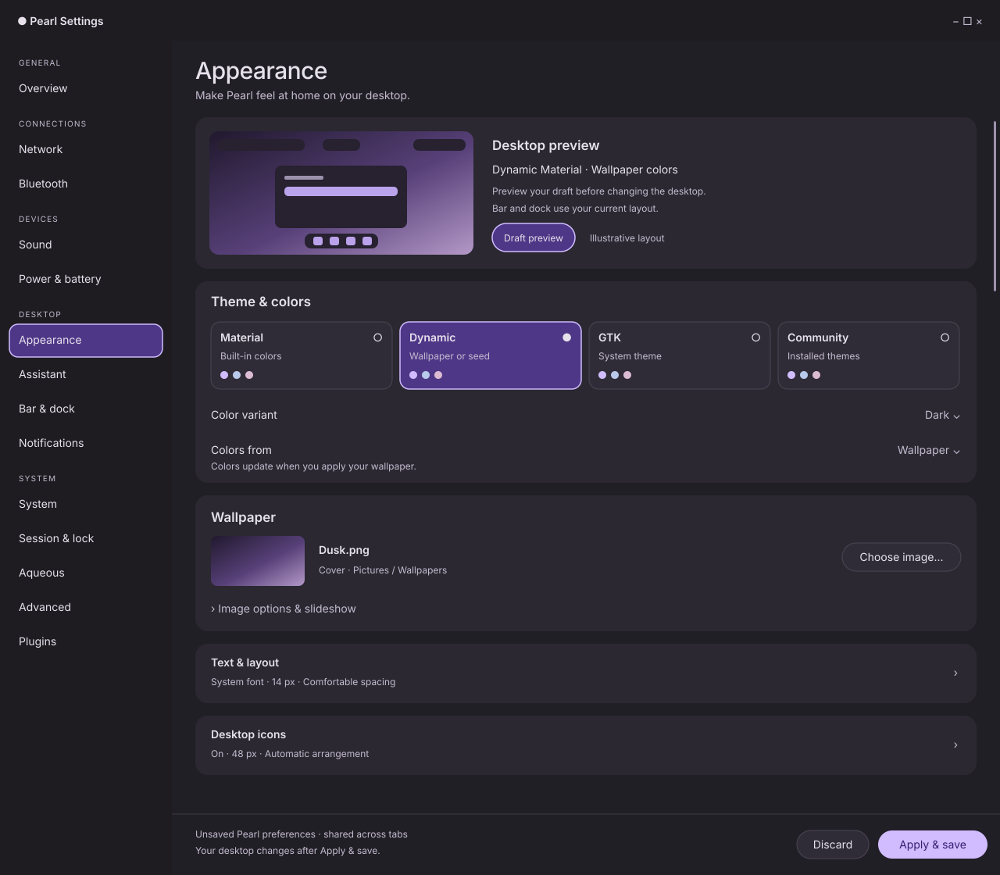

# Appearance redesign mockups

Proposed Appearance layout using the existing Pearl Settings visual language:
a desktop draft preview, selectable theme cards, prominent wallpaper controls,
and expandable sections for the remaining preferences.
See the [implementation plan](../../APPEARANCE_REDESIGN_PLAN.md) for the complete
control inventory, behavior and native validation criteria.

| View | Preview | Editable vector |
| --- | --- | --- |
| Dark desktop | [desktop.png](desktop.png) | [desktop.svg](desktop.svg) |
| Light desktop | [light.png](light.png) | [light.svg](light.svg) |
| Narrow window at 390 px | [narrow.png](narrow.png) | [narrow.svg](narrow.svg) |
| Lower sections with text and desktop icons expanded | [details.png](details.png) | [details.svg](details.svg) |



The first three views show the top of a scrolling page with the shared footer
fixed below it. The details view illustrates the lower portion with two sections
expanded. Additional controls are specified in the plan. Sidebar icons are
omitted from these drawings; retain the application's existing icons in native
implementation. Dusk.png, its path and the miniature desktop are illustrative
sample content. Swatches on mode cards are decorative, not generated palettes.

These are static design assets, not screenshots of implemented GTK controls.
They do not edit preferences or exercise input, persistence or accessibility.
The dark/light captures illustrate each committed window variant; changing a
draft variant in the actual app must not recolor the whole settings window.

## Reproduce

The [generator](generate.zig) is written in Zig. SVG is a vector asset format;
there is no new HTML, JavaScript or non-Zig application implementation.
From the repository root, with Zig 0.16 and librsvg installed:

```sh
zig run docs/mockups/appearance/generate.zig
for view in desktop light narrow details; do
  rsvg-convert "docs/mockups/appearance/$view.svg" -o "docs/mockups/appearance/$view.png"
done
```

Keep changes in the generator so regeneration preserves them. All four SVGs were
rendered with `rsvg-convert` and visually reviewed for text readability, card
alignment, selection state, narrow layout and footer clearance. The native
implementation now has separate [screenshots and validation evidence](../../../artifacts/appearance-redesign/README.md).
