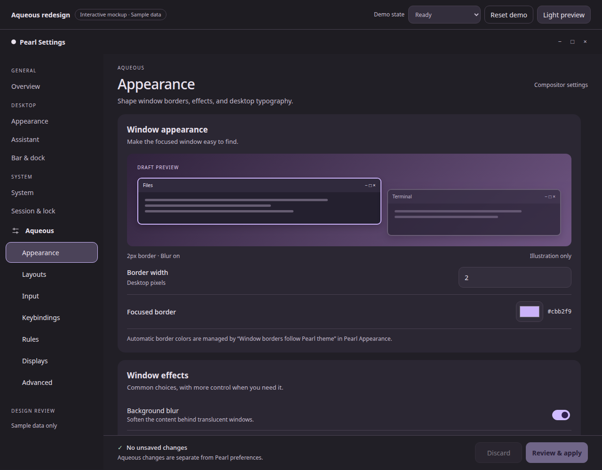

# Aqueous interactive design mockup

Open **[index.html](index.html)** directly in a browser. No server, build,
installation, or network connection is required.

The mockup covers **Appearance, Layouts, Input, Keybindings, Rules, Displays,
and Advanced**, using the rounded cards, clear hierarchy, expandable details,
and fixed footer of the updated Appearance, Assistant and System pages.
The [implementation plan](../../AQUEOUS_LAYOUT_REDESIGN_PLAN.md) specifies the
complete production control inventory, implementation sequence and acceptance
criteria.



## Try it

1. Change Appearance's **Border width**, visit **Input**, and change **Keyboard
   layout**. Return: both edits remain. **Review & apply** lists both sections.
   Continue editing cancels; applying establishes a new sample baseline.
   **Discard** discloses all affected sections before restoring that baseline.
2. Select Layouts' visible mode cards and change gaps. The illustration responds
   to the draft. Expand secondary options, navigate away and return: disclosure
   state is retained.
3. Search Keybindings by action, category or chord. Add/edit/delete custom
   shortcuts. A duplicate sample chord blocks Apply. Commands are never executed;
   real shortcut grabbing and recording are outside this browser prototype.
4. Add or edit a rule, then compare Cancel with **Save rule to draft**. Delete
   is available in the editor. Move earlier/later requires a clean draft;
   the move must be applied or discarded before editing any other section.
5. Select either display, change scale, HDR or relative placement, and apply.
   The shared review includes edits on other tabs. **Keep changes** saves the
   entire sample draft; Revert, Escape and the 15-second timeout retain edits.
   The last enabled display cannot be disabled.
6. Use **Demo state** for disconnected, external-conflict, preview-unavailable,
   failed-apply and unknown-outcome examples. Advanced has validation feedback,
   raw/request editing and explicit conflict review. Unknown receipts stay
   blocked even after Discard or Refresh.
7. Toggle **Light preview**, shrink the window to 390 px, and use **Sections**
   to switch pages. The body scrolls above the footer. Native HTML controls and
   dialogs support keyboard input, focus indication and Escape cancellation.

Optional initial state: `?theme=light`, `?state=unavailable`, or a section hash,
for example `#displays` or `#advanced`.

## Scope

All values are sample data held in memory. Reset demo or reloading restores
fixture defaults. The file has no configuration access, compositor connection,
command execution, network requests or storage persistence.

The user explicitly authorized HTML for interactive mockups. HTML/CSS and the
small embedded browser interaction layer are confined to this design artifact;
production implementation remains Zig/GTK.

The mockup contains representative controls rather than all 221 scalar fields.
Layout/window drawings are illustrative. Display placement supports the four
relative sides and alignment; actual screen dragging, exact geometry, custom
modes, mirroring, profiles and offline declarations remain in the existing
production editor and [detailed display proposal](../aqueous-displays/README.md).
The sample rule form covers application/title matchers, floating and workspace;
the full native rule builder remains in scope in the plan.

Advanced uses one illustrative raw text buffer with a source label, plus a JSON
request buffer. It retains invalid JSON and raw text; raw/request edits cannot
be applied because canonical helper validation is unavailable. The prototype
never claims to validate TOML, merge actual sources or resolve real receipts.

The 15-second countdown is a simulation. Production must use the compositor's
lease, presentation acknowledgement, deadline and terminal rollback state.
Simulated Keep does not imply production DRM preview support. Backend field
ranges, choices, capabilities and source ownership remain authoritative in the
native implementation.

The surrounding Settings labels provide context; the seven Aqueous pages are
the navigable scope. The Demo state and theme/reset controls are review tools,
not proposed production preferences.

## Captures

| View | Preview |
| --- | --- |
| Appearance | [Dark desktop](Appearance.png) |
| Layouts | [Layout choices and spacing](Layouts.png) |
| Input | [Keyboard and pointer](Input.png) |
| Keybindings | [Search and shortcuts](Keybindings.png) |
| Rules | [Ordered rule cards](Rules.png) |
| Displays | [Arrangement and selected screen](Displays.png) |
| Advanced | [Status and recovery](Advanced.png) |
| Light | [Light appearance](light.png) |
| Narrow | [390 px appearance](narrow.png) |
| Shared review | [Changes across sections](review.png) |
| Display preview | [Keep and Revert](preview.png) |
| Capability gate | [Preview unavailable](unavailable.png) |

These are browser screenshots of the interactive proposal, not production GTK
screenshots. The full implementation plan preserves the existing native shell,
Aqueous sublist, narrow Sections popover and independent Pearl/Aqueous drafts.

## Validation

[verify.py](verify.py) uses Python only as a Playwright validation harness:

```sh
python3 docs/mockups/aqueous-layout/verify.py
```

It requires Playwright and local Chromium at `/usr/bin/chromium`. It exercises
actual browser inputs for every route, shared drafts, review/cancel/apply/discard,
numeric validation, shortcut filtering/collisions, custom shortcuts, rule forms
and move gating, display selection/last-screen protection/preview timeout/Keep,
blocked and failed states, raw JSON retention and explicit conflict choice.
It captures dark/light/narrow views and checks 390 px overflow and footer bounds
on every page, plus a short window. See [verification.json](verification.json)
for the recorded results. All 53 checks passed in Chromium, with no browser
JavaScript errors.

Browser interaction checks do not establish production backend, physical
hardware, full assistive-technology or native GTK correctness. Those checks are
specified separately in the implementation plan.
