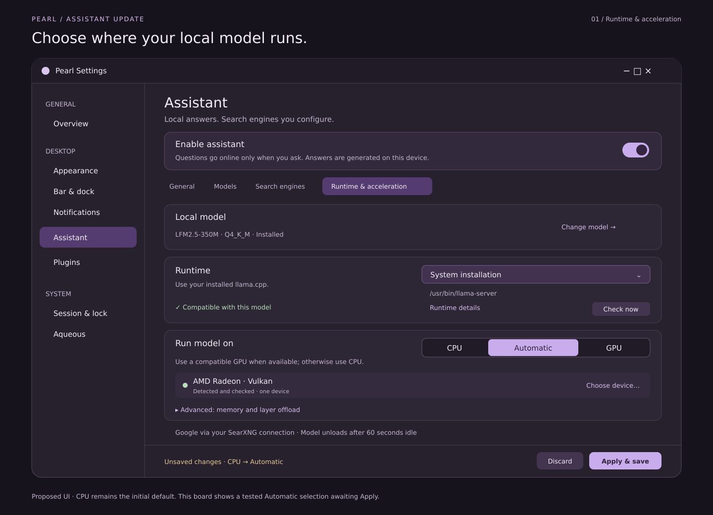
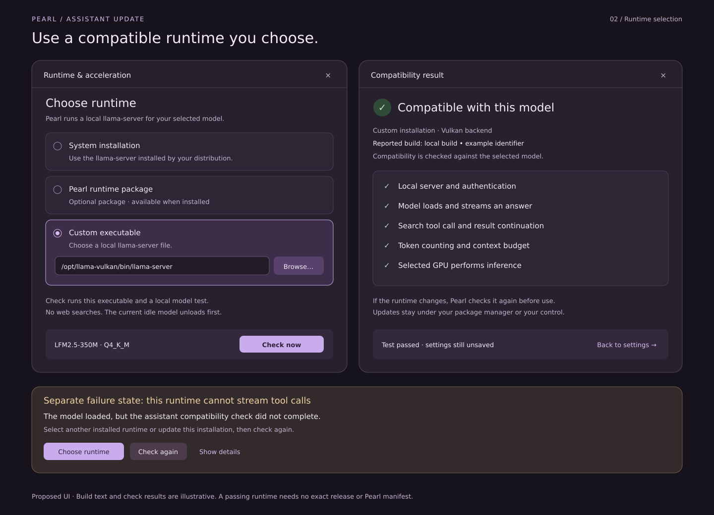
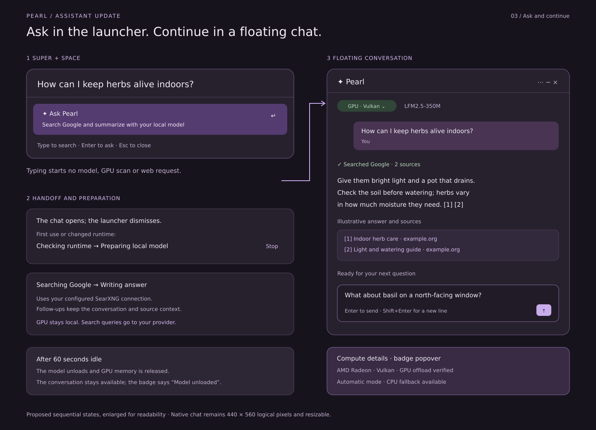
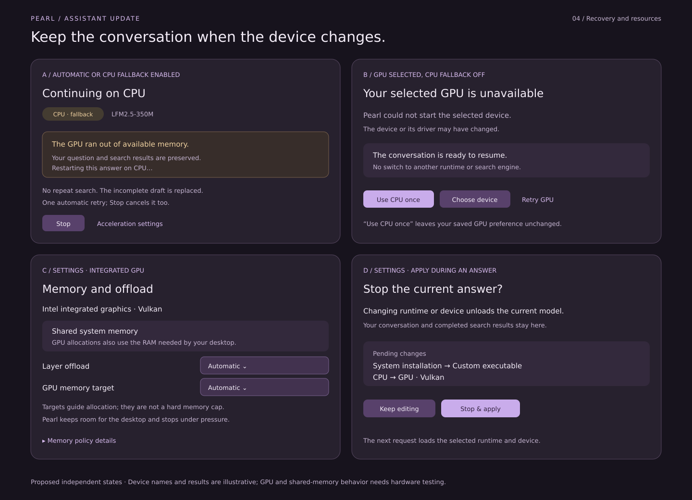

# Assistant GPU and runtime mockups

Visual companion to the [GPU and runtime update plan](../../ASSISTANT_GPU_RUNTIME_PLAN.md).
These are proposed native GTK interactions, not screenshots of implemented GPU
support. They extend the existing assistant design and use Pearl's dark purple
palette. Production widgets follow the user's active theme.

## Runtime and acceleration settings



The assistant is enabled, its model is installed and Google is configured through
the user's SearXNG connection. CPU is the initial default. The user has checked
the system runtime and selected Automatic; that change is still a draft until
Apply. Automatic uses a compatible GPU with enough memory and otherwise CPU.
Explicit GPU mode reveals device/backend selection and a CPU fallback toggle.
Model selection remains independent of runtime and device selection.

## Runtime selection and compatibility



The left and right windows are sequential states. Select System installation,
Pearl runtime package or a custom executable, then explicitly test. Checks use a
local fixture and the selected model without making web searches. Reported build
information is descriptive; any version that meets the contract may pass. The
example build identifier deliberately does not designate a required release.
The failure card shows a missing capability, with a choice of another installed
runtime or a repeat check after updating it.

## Launcher and floating conversation



The launcher and chat depict sequential states, enlarged for the board. The
native chat remains 440 × 560 logical pixels by default, with a 320-pixel minimum
width. Only submitting the question begins preparation and network activity.
The GPU badge reflects verified offload; its popover exposes device/backend
details. Idle unload releases the model while preserving conversation history.
The input shows a drafted follow-up. While generating, Stop remains available.

Device names, check outcomes, the sample answer and example.org citations are
illustrative. They are not hardware compatibility claims or live search results.

## Recovery and shared memory



Each card is an independent state. An allowed CPU retry preserves evidence and
replaces the incomplete answer without repeating searches. Explicit GPU mode
with fallback disabled offers Use CPU once, Choose device or Retry GPU. Shared
GPU memory is labeled as system RAM; allocation targets are not hard caps.
Applying a runtime change during generation requires Stop & apply, while Keep
editing leaves the answer running.

## Editable assets and validation

SVG sources: [settings.svg](settings.svg), [runtime.svg](runtime.svg),
[conversation.svg](conversation.svg), [recovery.svg](recovery.svg).

SVGs are static vector design assets. No web UI or non-Zig application logic is
introduced. Regenerate the PNG previews from the repository root:

```sh
for name in settings runtime conversation recovery; do
  rsvg-convert "docs/mockups/assistant-gpu/$name.svg" \
    -o "docs/mockups/assistant-gpu/$name.png"
done
```

Validate XML, render all boards and inspect the PNGs for clipping and legibility.
Runtime behavior, accessibility, keyboard handling and GPU performance require
the implementation tests specified in the plan.
