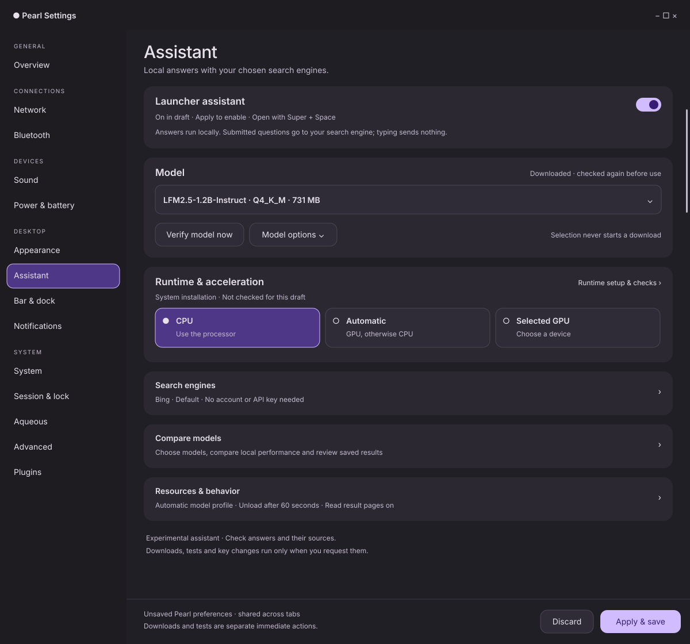

# Assistant layout mockups

Proposed Settings → Assistant layout following the implemented Appearance,
Sound, and Power & battery pages. Primary choices stay visible; setup, search
engines, model comparisons, and resources use compact expandable sections.
The [implementation plan](../../ASSISTANT_LAYOUT_REDESIGN_PLAN.md) contains the
complete control inventory, state rules, implementation sequence, and acceptance
criteria.

| View | Preview | Editable vector |
| --- | --- | --- |
| Dark desktop overview | [desktop.png](desktop.png) | [desktop.svg](desktop.svg) |
| Light desktop overview | [light.png](light.png) | [light.svg](light.svg) |
| Narrow window at 390 px | [narrow.png](narrow.png) | [narrow.svg](narrow.svg) |
| Expanded runtime, engines and resources | [details.png](details.png) | [details.svg](details.svg) |
| Model comparison and saved results | [comparison.png](comparison.png) | [comparison.svg](comparison.svg) |
| Independent setup and recovery states | [states.png](states.png) | [states.svg](states.svg) |



The overview shows an unsaved enabled draft, a downloaded model, and an unchecked
system runtime. Downloaded does not imply verified. CPU is selected; the three
compute tiles follow the native radio treatment used in Appearance. All sample
states, paths, and comparison numbers are illustrative.

The narrow image shows the top of a scrolling page; Resources follows Compare
models below the visible body. The expanded and comparison views show alternate
scroll positions/expanded content within the same page. The state board is a
collection of independent examples, not six concurrent alerts. The actual
active-answer confirmation remains a dialog. Sidebar icons are omitted from the
drawings; retain Pearl's existing icons in implementation.

These are static design assets, not implemented GTK controls. Full conditional
engine fields, GPU details, resource editors, model options, and additional
comparison controls are specified in the plan even where not drawn. The current
launcher and floating conversation are outside this settings-layout proposal.

The layout now has a native implementation. Review its
[screenshots and validation evidence](../../../artifacts/assistant-layout/README.md)
separately from these original design drawings.

## Reproduce

The [generator](generate.zig) is Zig. SVG is an editable vector asset format and
PNG is its rendered preview; no new web UI or non-Zig application logic is added.
From the repository root with Zig 0.16 and librsvg installed:

```sh
zig run docs/mockups/assistant-layout/generate.zig
for view in desktop light narrow details comparison states; do
  rsvg-convert "docs/mockups/assistant-layout/$view.svg" \
    -o "docs/mockups/assistant-layout/$view.png"
done
```

If the default global Zig cache is read-only, prefix the Zig command with
`ZIG_GLOBAL_CACHE_DIR=/tmp/pearl-assistant-layout-zig-cache`.
Edit the generator before regenerating so SVG changes are reproducible.

Validation covers generator compilation, SVG parsing/rendering, PNG visual
inspection, local document links, and patch whitespace. Native interaction,
persistence, responsiveness, and accessibility require the implementation checks
in the plan.
