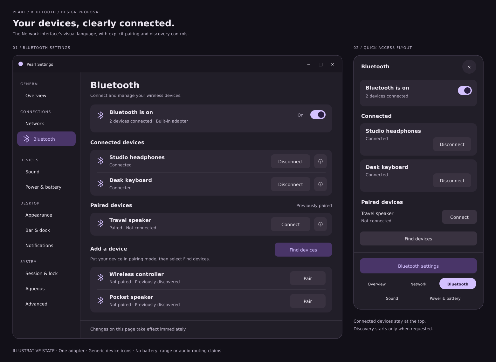
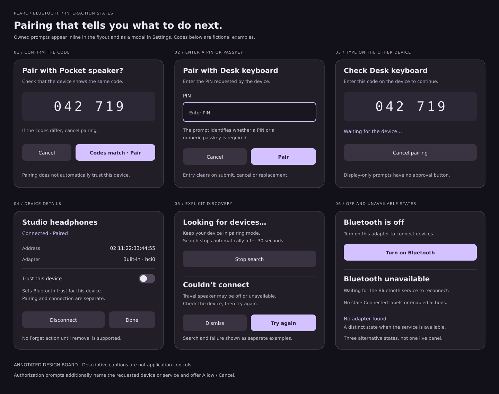
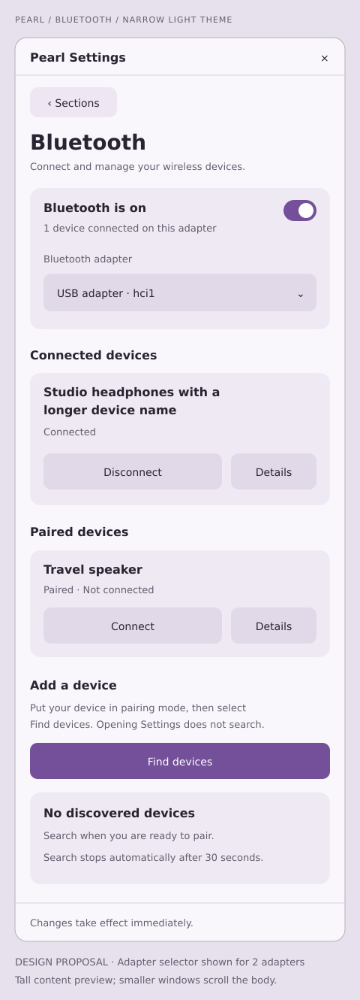

# Bluetooth interface mockups

Proposed Bluetooth flyout and Settings page using the implemented Network
interface's rounded cards, purple accents, clear status and responsive actions.
The [implementation plan](../../BLUETOOTH_UI_IMPLEMENTATION_PLAN.md) maps these
designs to Pearl's existing Zig/GTK and BlueZ service boundaries.

| Preview | Review focus | Editable source |
| --- | --- | --- |
| [Settings and flyout](desktop.png) | Adapter power, connected and paired devices, explicit discovery, persistent Settings action. | [desktop.svg](desktop.svg) |
| [Pairing and recovery](states.png) | Code confirmation, PIN input, display-only prompts, device details, trust, discovery and unavailable states. | [states.svg](states.svg) |
| [Narrow light settings](narrow-light.png) | 440-pixel window, multiple adapters, long names and actions below labels. | [narrow-light.svg](narrow-light.svg) |







These are static design assets, not working controls. Names, addresses and
pairing codes are fictional. Generic Bluetooth icons reflect the current model;
battery levels, device categories and audio-routing status are not inferred.
The states board includes annotations and alternative states. The tall narrow
preview illustrates content that scrolls in a shorter window. Sidebar entries
are abbreviated for the board; implementation retains Pearl's navigation.

The power switch applies to the selected adapter. Device sections and counts
also use that adapter. Pairing does not automatically connect or trust a device.
Find devices explicitly starts a bounded search; opening either view does not.
Previously discovered entries do not establish current reachability.

SVG preserves editable layout and text without adding application code or build
tooling in another language. PNGs are rendered previews. Re-render with librsvg:

```sh
rsvg-convert docs/mockups/bluetooth/desktop.svg -o docs/mockups/bluetooth/desktop.png
rsvg-convert docs/mockups/bluetooth/states.svg -o docs/mockups/bluetooth/states.png
rsvg-convert docs/mockups/bluetooth/narrow-light.svg -o docs/mockups/bluetooth/narrow-light.png
```

Validation: all three SVGs parsed and rendered, PNGs visually inspected, local
document links checked, and patch whitespace checked. No production Bluetooth
code changed; native behavior and accessibility require implementation testing.
