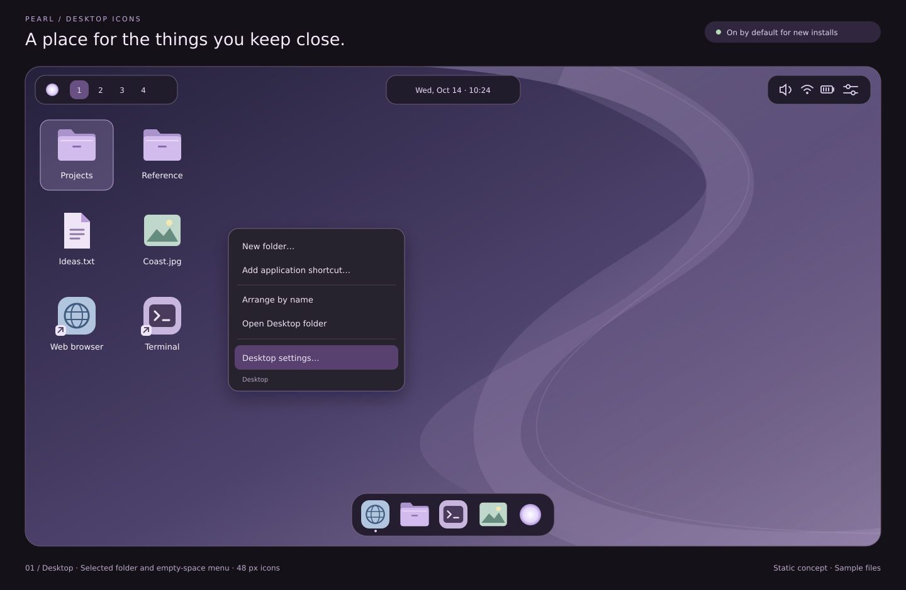
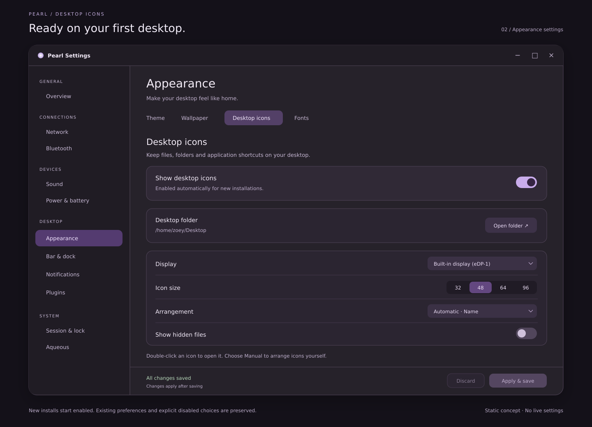

# Desktop icons mockups

Static concepts for Pearl's [desktop icons implementation plan](../../DESKTOP_ICONS_IMPLEMENTATION_PLAN.md).
Desktop icons start enabled on new installations. Existing preferences and
explicit disabled choices remain unchanged.

## Desktop



The grid shows folders, a document, an image and application shortcuts. A soft
selection background keeps the label legible over wallpaper. Shortcut badges
distinguish launchers from documents. The empty-space menu provides folder and
shortcut creation, arrangement, the Desktop folder and Settings. Bar islands
and the dock remain separate from the grid.

The illustrated 48-logical-pixel icon setting is enlarged for presentation;
this drawing is not a pixel-accurate GTK allocation specification. The sample
files and launchers are not content to seed on installation.

## Appearance settings



The Desktop icons section shows the enabled toggle, resolved Desktop folder,
display selection, icon size, arrangement and hidden-file preference. The saved
state has inactive Apply and Discard controls. Editing a preference will use
the normal draft workflow in the native implementation.

## Sources and verification

- Editable vector sources: [desktop.svg](desktop.svg), [settings.svg](settings.svg).
- PNG previews: [desktop.png](desktop.png), [settings.png](settings.png).
- SVG is used only as a static visual asset format. There is no application
  logic, browser prototype or non-Zig runtime implementation.
- Both sources were rendered with `rsvg-convert` and visually reviewed for
  legible labels, clipping, selection styling and enabled/disabled controls.
- The mockups do not exercise input routing, accessibility, file operations or
  persistence; native verification remains part of the implementation plan.

Regenerate previews from the repository root:

```sh
rsvg-convert docs/mockups/desktop-icons/desktop.svg -o docs/mockups/desktop-icons/desktop.png
rsvg-convert docs/mockups/desktop-icons/settings.svg -o docs/mockups/desktop-icons/settings.png
```
