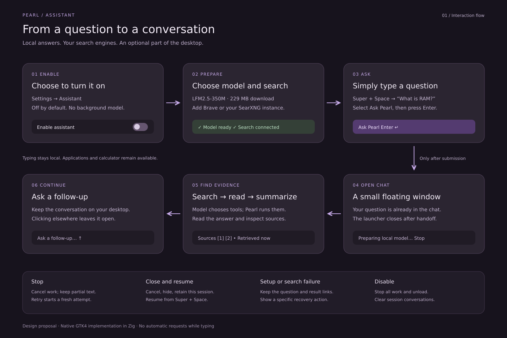
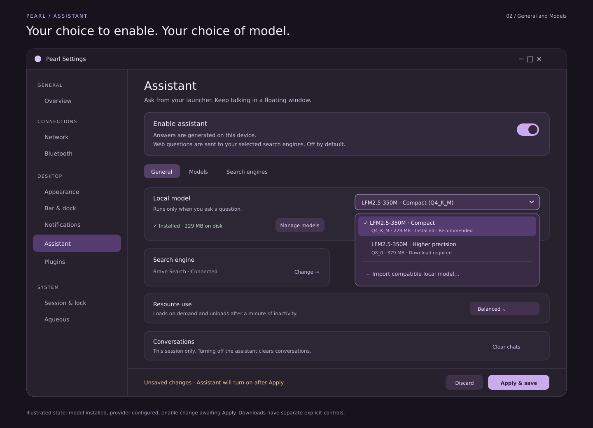
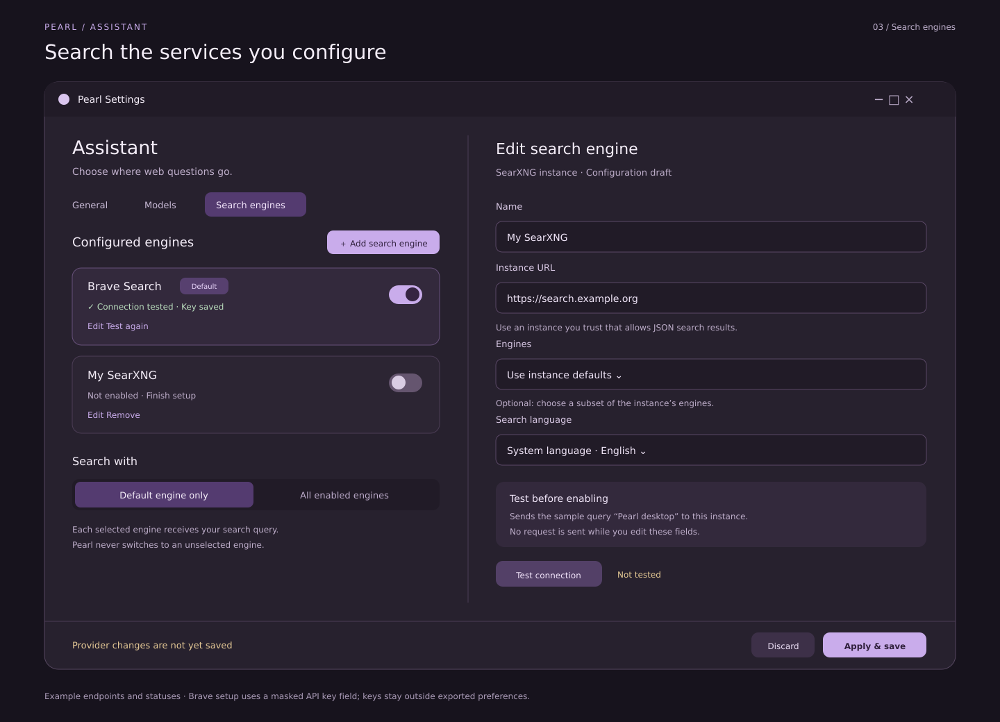
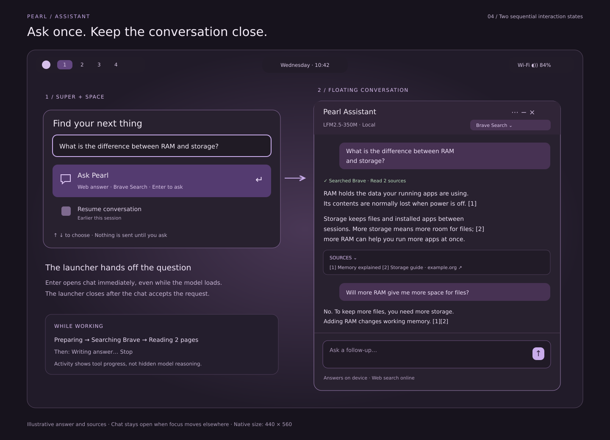
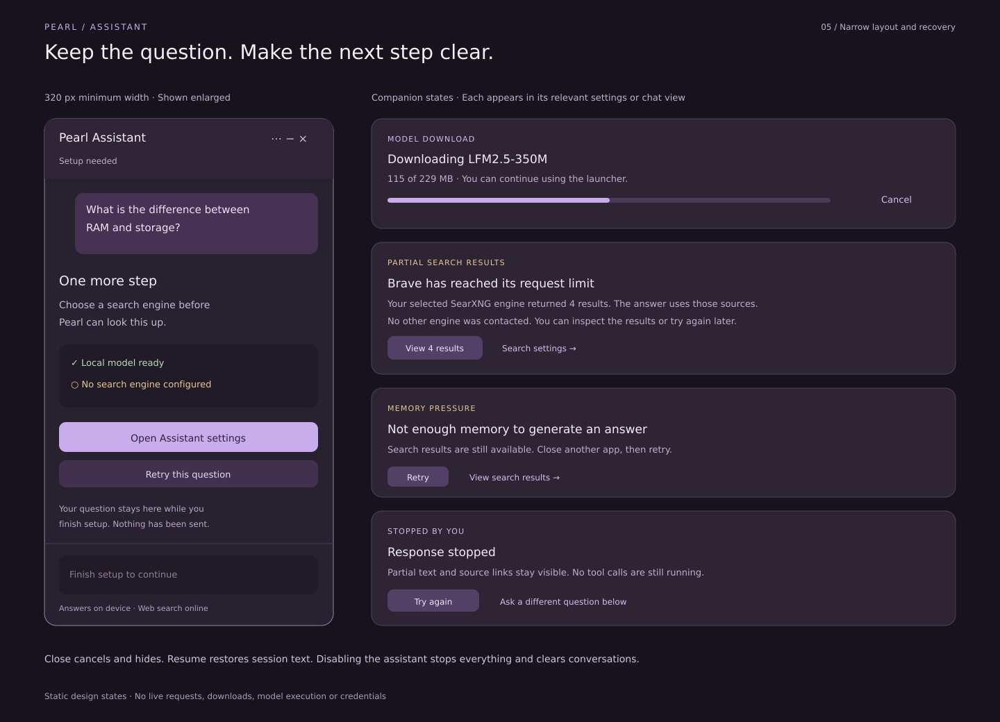

# Launcher assistant mockups

Visual companion to the [implementation plan](../../LAUNCHER_AI_IMPLEMENTATION_PLAN.md).
The feature is opt-in. These boards show the proposed interaction, not a working
assistant or evidence of model quality.

## Interaction flow



Typing stays local. Pressing Enter on Ask Pearl starts the request and presents
the conversation window. The model requests tools; Pearl executes the selected
provider's API. Follow-ups continue in the same chat.

## Opt-in and model selection



The illustrated model and Brave connection are already prepared. Enabling is
still an unsaved draft. Downloads are separate explicit actions. The open model
dropdown offers the default Q4_K_M, Q8_0 and compatible local model import.
The General/Models sections expose configuration and model management; the
dropdown does not imply that selecting an uninstalled model downloads it.

## Search engines



Brave is the default; the example SearXNG instance is still disabled and being
edited. Connection tests send a disclosed sample query only on explicit Test.
Provider credentials are masked and stored separately from exported settings.
Example URLs are placeholders, not a recommended public service.

## Launcher and conversation



This is a composite of **two sequential states**, not a requirement to keep the
launcher and chat open together. The initial native chat is 440 × 560 logical
pixels; the design drawing enlarges it for readability. It stays open when
focus moves elsewhere and includes activity, sources, follow-up input, Stop,
New chat through the header menu, minimize and close. Answers and example.org
sources are illustrative text, not actual retrieved evidence.

## Narrow layout and recovery



The narrow window represents the 320-logical-pixel minimum, enlarged for the
board. Adjacent cards are separate states shown in their respective views.
Questions and useful results survive recoverable failures. Partial-provider
failure applies only when the user selected all-enabled mode.

## Assets and verification

Editable vector sources: [flow.svg](flow.svg), [settings.svg](settings.svg),
[providers.svg](providers.svg), [conversation.svg](conversation.svg),
[recovery.svg](recovery.svg).

SVG is a static visual asset format, consistent with existing repository
mockups. No JavaScript, browser application or non-Zig application logic is
introduced. Production UI remains native GTK4 in Zig.

Regenerate the PNG previews from the repository root:

```sh
for name in flow settings providers conversation recovery; do
  rsvg-convert "docs/mockups/launcher-ai/$name.svg" \
    -o "docs/mockups/launcher-ai/$name.png"
done
```

The boards are checked for SVG validity, successful rendering and visual
legibility. They do not validate focus, keyboard behavior, screen readers,
runtime performance, network requests or real model responses. Those checks
belong to the implementation milestones.
