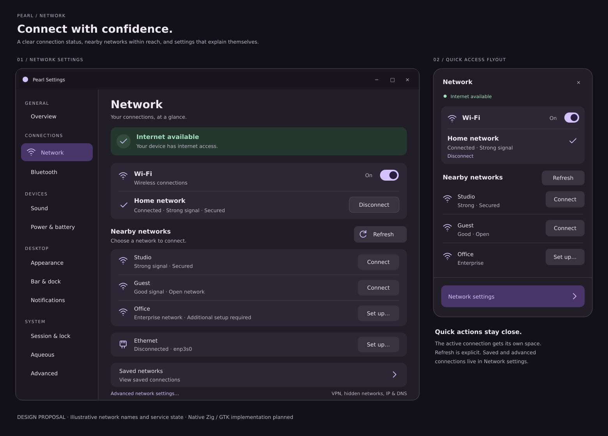
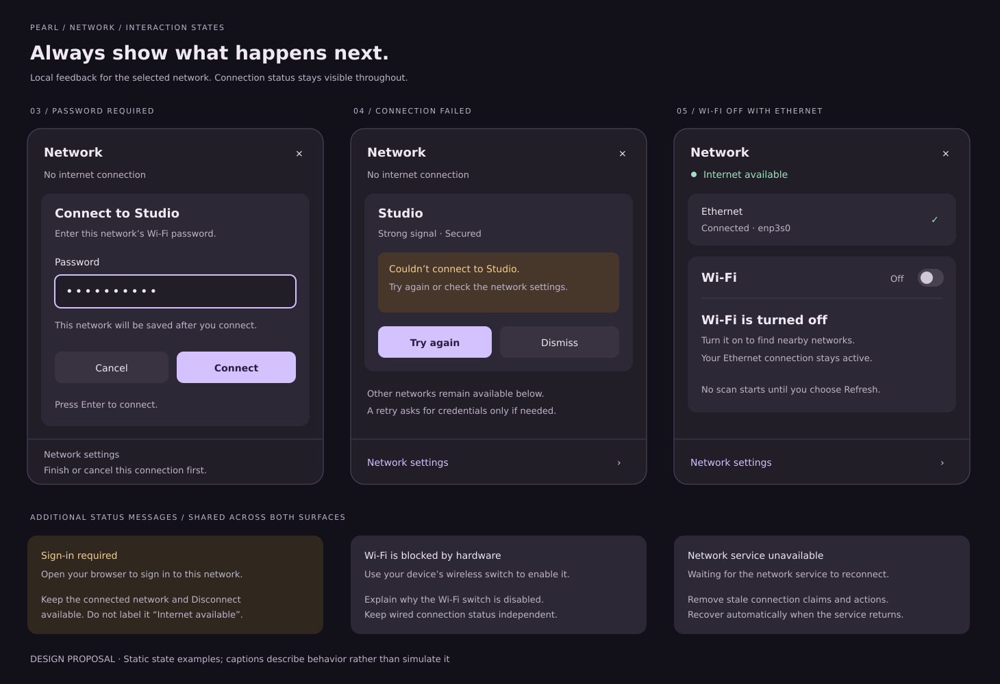
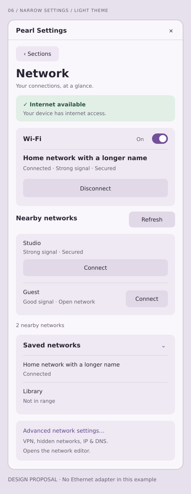

# Network interface mockups

Design proposal for Pearl's network flyout and Network settings page. The
[implementation plan](../../NETWORK_UI_IMPLEMENTATION_PLAN.md) describes the
shared state model, native Zig/GTK changes, interaction rules and acceptance
checks. The native interface is now implemented; see
[running-interface captures](../../../artifacts/network-ui/README.md).

| Preview | Review focus | Editable source |
| --- | --- | --- |
| [Settings and flyout](desktop.png) | Connection status, Wi-Fi switch, current network, nearby networks and management sections. | [desktop.svg](desktop.svg) |
| [Authentication and recovery](states.png) | Password, failed connection, Wi-Fi off with Ethernet, portal, hardware block and unavailable service. | [states.svg](states.svg) |
| [Narrow light settings](narrow-light.png) | Compact navigation, wrapping actions, saved profiles and light theme. | [narrow-light.svg](narrow-light.svg) |







These are static SVG design assets, using local fonts and no external resources.
PNG files are rasterized previews of those sources. Device names, networks and
service states are illustrative. The tall narrow view illustrates page content
that scrolls in a shorter window; the flyout drawing focuses on the Network
body within the existing shell navigation. The three nearby rows in the main
mockup fit the initial compact list; larger lists expose View all nearby networks.

The drawings do not connect to NetworkManager, accept credentials or demonstrate
working interactions. The recovery board includes explanatory captions outside
the proposed controls. The plan specifies behavior for remaining states and
production accessibility; the pictures alone do not establish that behavior.

Re-render from the repository root with librsvg:

```sh
rsvg-convert docs/mockups/network/desktop.svg -o docs/mockups/network/desktop.png
rsvg-convert docs/mockups/network/states.svg -o docs/mockups/network/states.png
rsvg-convert docs/mockups/network/narrow-light.svg -o docs/mockups/network/narrow-light.png
```

SVG is used for editable visual design assets; no non-Zig application code or
mockup build utility is introduced. Validation for this proposal consists of
rendering every SVG, inspecting its PNG, checking local document links and
checking patch whitespace. Native interaction evidence is recorded separately
in the implementation notes and captures linked above.
