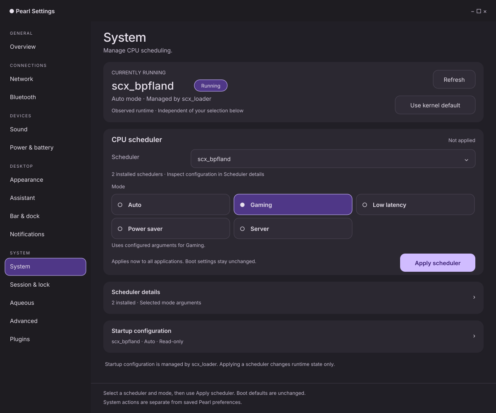

# System layout mockups

Proposed Settings → System layout matching the recent Appearance and Assistant
updates. The current runtime leads the page, followed by scheduler selection and
visible mode choices. Arguments, missing executables and boot configuration use
expandable details. See the [redesign plan](../../SYSTEM_LAYOUT_REDESIGN_PLAN.md)
for the complete control inventory, state rules and implementation sequence.

| View | Preview | Editable vector |
| --- | --- | --- |
| Dark desktop | [desktop.png](desktop.png) | [desktop.svg](desktop.svg) |
| Light desktop | [light.png](light.png) | [light.svg](light.svg) |
| Narrow window at 390 px | [narrow.png](narrow.png) | [narrow.svg](narrow.svg) |
| Expanded arguments and startup configuration | [details.png](details.png) | [details.svg](details.svg) |
| Independent runtime and recovery examples | [states.png](states.png) | [states.svg](states.svg) |



The overview shows scx_bpfland running in Auto while Gaming is selected but not
applied. Both schedulers, their availability, arguments and boot defaults are
illustrative fixture data. No scheduler was queried, started, switched or stopped
to produce these drawings. Actual mode availability comes from the catalog.

System has immediate runtime actions rather than the shared preference Apply
and Discard controls. The footer therefore retains System-specific guidance.
The normal retained-draft badge and review action still appear when other pages
have unsaved preferences; this sample has none.

The details view illustrates another scroll position. Its bottom card is a copy
example for a mode with empty arguments, not an extra proposed page section.
The state board contains independent examples, not simultaneous notifications.
Sidebar icons are omitted; retain the application's existing icons in GTK.

These are static design assets, not native screenshots or interactive controls.
The tall narrow view illustrates wrapping; actual short windows scroll the body
above the fixed footer. Native widgets use natural text measurement rather than
these fixed drawing dimensions. The native implementation now has separate
[screenshots and validation evidence](../../../artifacts/system-layout/README.md).
The plan retains the full input/accessibility acceptance scope.

## Reproduce

The [generator](generate.zig) is Zig, following the repository language policy.
SVG is the editable vector format and PNG its rendered preview; no web UI or
non-Zig implementation is introduced. From the repository root with Zig 0.16
and librsvg installed:

```sh
ZIG_GLOBAL_CACHE_DIR=/tmp/pearl-system-layout-zig-cache \
  zig run docs/mockups/system-layout/generate.zig
for view in desktop light narrow details states; do
  rsvg-convert "docs/mockups/system-layout/$view.svg" \
    -o "docs/mockups/system-layout/$view.png"
done
```

Edit the generator before regenerating the assets so changes are reproducible.
Validation covers generator compilation and formatting, SVG parsing/rendering,
PNG visual review, local document links and patch whitespace. It does not replace
the native scheduler fixture and presentation checks in the plan.
