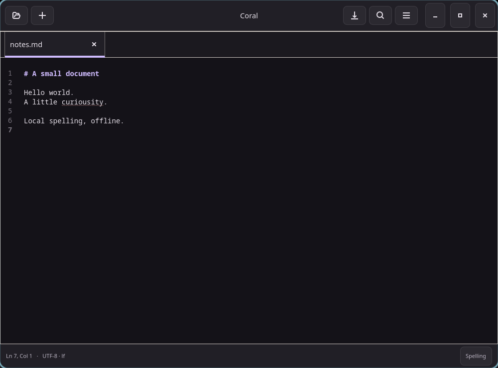

# Coral

A standalone Linux text editor written in **Zig 0.17.1 and GTK4**, with
GtkSourceView editing and offline Enchant spell checking. Its native foundation
includes independent editor groups, editable source excerpts and crash recovery,
with Pearl appearance. Multi-root workspaces include a bounded virtualized explorer,
Quick Open, streaming text search, movable native Explorer/Search docks, safe
settings with provenance, and explicit persistent workspace trust. Explicit saved sessions restore workspace roots and
editor layout safely. Explicit, reviewed Explorer file operations add bounded
create/rename/move/permanent-delete workflows. LSP, Git and agent services remain later work.



## Build and run

Use Zig 0.17.1, `pkg-config`, a C toolchain, GTK **4.12+**, GtkSourceView **5**,
Enchant **2**, and their development headers. GTK 4.24.1, GtkSourceView 5.22.0,
and Enchant 2.8.21 are the current tested versions. Older supported API baselines have
not been tested in a separate distribution image.

```sh
cd subprojects/coral
zig build -Doptimize=safe
zig build run -- /path/to/notes.txt
zig build test
```

The executable is `zig-out/bin/coral`. The build stages its desktop entry, icon,
AppStream metadata, and two editor color schemes under `zig-out/share/`.
Use `zig build --prefix PATH` to stage elsewhere. `zig build run` can find styles
in the source checkout; an installed application reads them relative to its
executable. Coral does not require a running Pearl shell or Aqueous compositor.

Pearl's `pearl`, `pearl-git`, and `pearl-intel-git` PKGBUILDs build, test, and
bundle Coral. The release package supplies `coral`; both Git packages supply
`coral-git` (**Coral Git**, application ID `org.aqueous.Coral.Git`). Build that
variant directly with `zig build -Dgit-variant=true`. Each variant has its own
launcher, metadata, icon, and installed styles (`share/coral/styles` or
`share/coral-git/styles`), allowing stable and Git packages to coexist.
Preferences and personal dictionaries are shared between the variants.

Spell checking requires an installed Enchant provider and language dictionary.
`enchant-lsmod-2 -list-dicts` lists available languages. This development host
uses Shelly; repository PKGBUILDs do not identify the host distribution.
No dictionaries were installed for this work; verification
uses an isolated test dictionary. Missing dictionaries leave editing usable and
show **Dictionary unavailable**. Choose an available language in Preferences.

Options: `--workspace PATH`, `--folder PATH`, `--follow-pearl`, `--light`, `--dark`,
`--native-theme`, `--width=N`, `--height=N`,
`--log-level LEVEL`, `--log-scopes LIST`, `--help`, `--version`, followed by
local filenames or local file URIs. Diagnostics share Pearl's log handler and
land wherever stderr goes; see [logging](../../docs/LOGGING.md).

## Workspaces — M2 preview

Choose **Open Folder…** or **Open Workspace…** from the menu or command palette,
or launch `coral --folder PATH` / `coral --workspace PATH`. A workspace file is
versioned JSON, for example:

```json
{
  "version": 1,
  "roots": [
    {"name": "Frontend", "path": "./frontend"},
    {"name": "Backend", "path": "./backend"}
  ],
  "exclude": ["build/", "**/*.tmp"]
}
```

Relative roots resolve beside the manifest. Root-qualified tabs distinguish
identical filenames. The virtualized expandable explorer reads children lazily,
applies nested `.gitignore` and explicit excludes, and batches live updates for
accessed directories. **Roots / Back / Rescan / Close workspace / Reset tree**
provide navigation and recovery from capacity limits. Switching roots preserves
open edits. Unavailable roots are shown, never created.

**Load more** replaces the current 256-entry page window; pages are sorted
individually, not globally. Storage is bounded to 64 directory states, eight
resident pages and 1 MiB of page arenas. Native acceptance reached all 100,000
files across 391 pages with bounded widgets/memory. Watch failures show a manual
Rescan fallback; ignore-policy errors fail closed.

**Ctrl+P** opens the fuzzy file picker; **Ctrl+Shift+F** searches text across roots.
Results stream into a virtualized list, honor ignore/exclude rules, and use dirty
buffer contents instead of stale disk text. Enter opens the selected result in
the active editor group. Search is literal, case-insensitive and bounded to 1,024
text results / 128 ranked paths; omissions are visible. These are snapshots, not
a continuously monitored recursive index—use **Refresh** for unmonitored changes.
See [search usage, limits and 100k validation](docs/WORKBENCH_M2_SEARCH.md).

Workspace manifests and root-local `.coral/settings.json` can set `lines`, `wrap`,
`spaces` and `indent`, with language overrides. Resolution is defaults → explicit
user → workspace → folder → language overrides. **Workspace: Settings and Trust…**
shows effective values and their origins. **Rescan** adopts updated folder settings;
repository values never overwrite user preferences.

Workspaces start **restricted**. **Trust workspace…** requires confirmation and
persists an exact machine-owned approval; **Workspace: Revoke trust** invalidates
permits for matching workspace scopes across this process immediately and removes
the approval asynchronously. Trust is not
blanket tool permission and starts no services. See the [settings/trust guide](docs/WORKBENCH_M2_POLICY.md)
for filesystem identity requirements, storage errors and revocation limits.

**Save Workspace Session** / **Restore Workspace Session** in the palette persist
one explicit checkpoint of roots, tabs, groups, excerpts, view state and dock layout. Clean files
rebind only after verification; dirty/conflicting/unavailable files become unsaved
copies. Existing documents stay intact. Close an active workspace before restoring.
There is no automatic startup restore or quit-time save; later Discard does not
remove an explicitly saved checkpoint. See [session usage and safety limits](docs/WORKBENCH_M2_SESSIONS.md).

Explorer and Search can be docked **left, right or bottom**, resized, hidden and
focused from the activity rail or palette. **Ctrl+B** toggles Explorer; **Ctrl+1**
returns to the editor. Quick Open is a transient overlay sharing Search's query
and results. Compact windows retain one auxiliary panel and preserve the desired
wide layout. See [dock controls and validation](docs/WORKBENCH_M2_DOCKS.md).

**Ctrl+Shift+N** opens an independent window; **Ctrl+Shift+W** closes its window,
and **Ctrl+Q** quits all windows with sequential dirty-document prompts. Each window
owns its documents, workspace, search and docks. User preferences are shared;
same-file buffers are independent, with coordinated in-process saves and disk
conflict checks. See [multi-window usage and limits](docs/WORKBENCH_M2_WINDOWS.md).

Select an Explorer entry, then use its buttons, menu or **Explorer:** palette commands
for **New file… / New directory… / Rename… / Move… / Delete permanently…**. Input
and worker preparation do not write: **all five kinds require explicit review confirmation**.
Creates are exclusive and do not auto-open; moves stay within one root/filesystem;
delete is permanent, regular-file/empty-directory only, with no trash, undo or recursion.
Restricted workspaces permit these explicit edits without running tools. All affected
open documents, **clean or dirty in any window**, must be resolved and closed first.
Any unavailable root or root/manifest lexical `..` in any open process workspace blocks
all mutations with `WorkspaceBusy`; close that workspace or reopen verified available,
normalized/canonical paths—never blindly collapse `..`. See the [file-operation guide](docs/WORKBENCH_M2_OPERATIONS.md)
for path checks, process-wide barriers and best-effort external-race limits.

This remains an **M2 preview**, without persistent indexing, workspace-wide replace,
automatic/per-project workspace/session management or additional workspace pickers.
Remaining M2 acceptance review is still open. Crash recovery
still restores documents/layout but not roots; the explicit session is separate.
See [workspace usage and remaining gates](docs/WORKBENCH_M2_WORKSPACES.md).

## Implemented

- Editable, reorderable document tabs; new/open/save/Save As; file arguments;
  canonical-path duplicate detection; dirty indicators and save/discard/cancel
  prompts for individual tabs and quitting.
- Asynchronous descriptor-checked local loads and GIO replacement saves. Etag
  conflicts and deleted files require a decision. Failed/cancelled saves retain
  edits. Edits made during a save stay dirty after the older revision finishes
  saving. Loading requires Linux `/proc/self/fd` for GIO-compatible metadata.
- Existing-file opens never create missing files or parent directories. Use
  **New document → Save As** to create a file, including when a CLI path is missing.
  Directories, FIFOs and devices are rejected; reloads use the same checked loader.
- External-file monitoring shows **Changed on disk** without replacing your edits.
  **Reload from Disk** in the menu/palette explicitly reloads; dirty documents
  require discard confirmation.
- Native **Command Palette** (`Ctrl+Shift+P`) with filtered, keyboard-accessible
  commands and focus restoration on cancellation.
- Independent equal-width editor groups: **Ctrl+\\** splits the current document;
  each view retains its own selection and scroll. Focus/close-group commands are
  available through the palette. Closing a duplicate view preserves its document.
- **Edit selection as excerpt** opens a source-mapped editable tab. Checked grouped
  buffer edits, grouped undo/redo and protected typing intervals prevent undoing
  only one participant in a multi-document change. Conflicting newer edits are
  refused. See the status report for conservative history-boundary limitations.
- Durable versioned recovery with explicit **Restore / Keep for later / Discard**,
  including groups, tabs, excerpts and selections. Restored text becomes unsaved
  copies, never automatic overwrites of source files.
- UTF-8 validation, BOM preservation, LF/CRLF and final-newline preservation,
  explicit mixed-line normalization, and rejection of binary/unsupported input.
- GtkSourceView syntax highlighting; Unicode editing; undo/redo; clipboard;
  literal case-insensitive find, match navigation, replace and replace-all;
  go to line; wrapping, line numbers, text size, indentation and spaces/tabs.
  Replace/replace-all and spelling corrections use revision-checked, undoable
  transactions; automated edit transactions are capped at 16 MiB per buffer and
  65,536 replacements, separately from the larger file-load limit.
- Offline spelling on a dedicated worker: Unicode/Pango word boundaries,
  underlines, up to five suggestions, undoable correction, document-local ignore,
  personal dictionary additions, and installed-language selection. Source code
  defaults to spelling off; Preferences can override the current document.
- Live Pearl appearance (Follow Pearl, the default): committed palette, variant,
  font and GTK theme mode reach the chrome through the shared appearance
  boundary, and the editor buffer follows through a generated GtkSourceView
  scheme under `$XDG_CACHE_HOME/coral/styles`. Pearl dark/light and native GTK
  remain as manual choices, narrow-window adaptation, keyboard
  operation, accessible control labels, and persisted preferences.
- Explicit presentation limits: syntax/automatic spelling are reduced at 524,288
  GTK characters or logical lines over 16 KiB. Giant lines offer a visible bounded
  excerpt editor rather than hanging on full-paragraph layout. That action is
  unavailable beyond the 16 MiB checked-edit cap. The separate >10 MiB load warning
  and 128 MiB read limit remain. See the measured tradeoffs in the status report.

Settings are stored in `$XDG_CONFIG_HOME/coral/preferences.ini` (default
`~/.config/coral/preferences.ini`). Personal words use Enchant's configuration
and may be shared with other Enchant applications.

Recovery journals live under `$XDG_STATE_HOME/coral/recovery` (normally
`~/.local/state/coral/recovery`). Recovery reaches the last durable checkpoint,
not necessarily the latest keystroke. Caps are **4 MiB per document / 8 MiB total
text / 12 MiB manifest**. An oversized open document rejects the whole new
checkpoint visibly; the previous checkpoint is retained. Save important work
explicitly—recovery is not a backup service.

| Shortcut | Action |
| --- | --- |
| Ctrl+N / Ctrl+O | New document / open existing file |
| Ctrl+Shift+P | Command palette |
| Ctrl+P | Quick Open workspace file |
| Ctrl+Shift+F | Search workspace text |
| Ctrl+\\ | Split editor group |
| Ctrl+S / Ctrl+Shift+S | Save / Save As |
| Ctrl+W / Ctrl+Q | Close tab / Quit All |
| Ctrl+Shift+N / Ctrl+Shift+W | New window / close window |
| Ctrl+Tab / Ctrl+Shift+Tab | Next / previous tab |
| Ctrl+Z / Ctrl+Shift+Z | Undo / redo |
| Ctrl+F / Ctrl+H | Find / replace |
| F3 / Shift+F3 | Next / previous match |
| Ctrl+G | Go to line |
| Ctrl+plus / Ctrl+minus / Ctrl+0 | Increase / decrease / reset text size |
| Ctrl+comma | Preferences |
| Shift+F10 | Spelling suggestions |
| Escape | Dismiss spelling/search and notices |

Right-click a flagged word for suggestions with Cut/Copy/Paste retained.
Right-click elsewhere for GtkSourceView's normal editing menu.

## Verification and design

The [workbench expansion plan](docs/WORKBENCH_IMPLEMENTATION_PLAN.md) targets a
VS Code-style workspace/editor with Zed-style agents and Git workflows.
The [native foundation status](docs/WORKBENCH_STATUS.md) records implemented
groups, excerpts, guarded undo, recovery, file monitoring and validation;
**M2 is in progress; LSP, Git, production terminal and agent UI are not implemented yet**.
Explore the separate [interactive workbench prototype](docs/mockups/workbench/index.html)
and its [interaction guide](docs/mockups/workbench/README.md). All prototype
operations stay in memory; they are not native feature evidence.

Read the [implementation report](docs/IMPLEMENTATION_STATUS.md) and
[native screenshot gallery](artifacts/native/README.md). Native integration
uses Pearl's existing private Wayland harness, temporary XDG directories and
files, and a small pinned Hunspell fixture:

```sh
zig build integration -Doptimize=safe
```

The harness needs the prepared `.cache/aqueous-activity-production` prefix,
Python, D-Bus, `wtype`, `wlr-randr`, and `grim`. Pass
`-- --aqueous-prefix PATH` for an alternate prefix. These are test dependencies,
not application dependencies. Integration builds a separate instrumented binary;
normal builds omit its test controls.

Run the complete M1 correctness suite (unit, widgets, native workflows, groups
and crash recovery), or individual display-backed checks:

```sh
zig build test-m1 -Doptimize=safe -j1
zig build test-m2-slice -Doptimize=safe -j1
zig build test-m2-explorer -Doptimize=safe -j1
zig build test-m2-search -Doptimize=safe -j1
zig build test-m2-policy -Doptimize=safe -j1
zig build test-m2-sessions -Doptimize=safe -j1
zig build test-m2-docks -Doptimize=safe -j1
zig build test-m2-windows -Doptimize=safe -j1
zig build operations -Doptimize=safe -j1
zig build test-m2-operations -Doptimize=safe -j1
zig build widgets -Doptimize=safe -- --aqueous-prefix /usr
```

`/usr` is the installed-tool prefix used for this host's foundation validation;
use the prepared fixture prefix on other setups. See the [status report](docs/WORKBENCH_STATUS.md#validation-completed)
for all commands and current acceptance limits. **File-operation final validation passed:**
all **25 native scenarios together**, all **nine aggregate gates** sequentially with
600-second bounds, and a fresh hooks-disabled production build (**46/46 steps;
25-second executable compilation**). Each of eight widget-including gates executed
191 tests; four headless runners were cached on the final rerun. Earlier fresh
validation passed 305 main-root tests, including 23 operation-backend tests and manager
tests (overlapping counts). The initial 22 native scenarios and three added alias-review
scenarios also passed in separate historical runs. No final regressions, timeouts or
leaked test-session processes were reported. See the [operations validation](docs/WORKBENCH_M2_OPERATIONS.md#final-validation--2026-11-09),
[gate logs](../../.cache/coral-operations-validation-logs/),
[production log](../../.cache/coral-operations-validation-logs/final-build.log) and
[native results](../../.cache/coral-operations/results.json). **M2 remains in progress.**

The [original plan](docs/IMPLEMENTATION_PLAN.md), [interactive mockup](docs/mockups/index.html),
and [mockup gallery](docs/mockups/README.md) remain design references. They do
not replace the native test evidence.

Automatic session history, cross-window tab transfer, remote files, legacy encodings,
grammar checking, project tooling and plugins are outside this preview. The user accepted M0's
bounded-editor tradeoffs to proceed to M2. Full giant-line rendering remains
unsupported and original input-to-paint targets remain unverified; acceptance
does not change the recorded measurements.
Markdown code fragments
are checked as text. Physical IME and screen-reader qualification remain manual
follow-up work; see the implementation report for precise limits.
