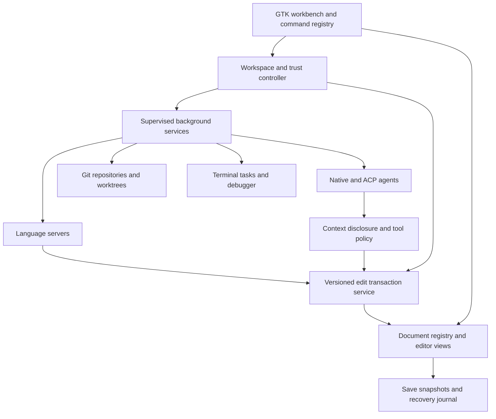

# Coral workbench implementation plan

Status: **implementation in progress — native foundation batch; M0/M1 gates still open**

See [current implementation status and validation](WORKBENCH_STATUS.md). The roadmap below remains the target, not a claim that all milestones are complete.

## 1. Product direction

Evolve Coral from a compact standalone text editor into a complete native development workbench: **VS Code-style editor/workspace organization, with Zed-style agent and Git workflows**. Preserve Coral's identity, Pearl appearance integration, fast single-file use, and safe document handling.

Design and implementation artifacts:

- This implementation plan, grounded in the current Coral sources and upstream Zed documentation.
- [Interactive workbench mockup](mockups/workbench/index.html) and [interaction guide](mockups/workbench/README.md). Open the HTML directly in a browser; no server is required.
- Native foundation implementation is described in [WORKBENCH_STATUS.md](WORKBENCH_STATUS.md). The mockup remains separate: editable memory fixtures, not a real language server, Git repository, terminal, or AI backend.
- Prototype evidence: [32 passing browser checks and source hashes](mockups/workbench/verification.json), [reproducible browser suite](mockups/workbench/verify.py), and [screenshots](mockups/workbench/README.md#screenshot-gallery). Chromium validation covers four widths in both themes, 52 geometry checks, and zero external requests or browser errors; it does not validate native features.

“Exactly like Zed” is a **workflow parity target**, not a claim that the mockup already reproduces every Zed feature. Before implementing parity-dependent features, pin a Zed release/commit and record behavior/keybinding fixtures. Zed's moving documentation cannot be a stable acceptance specification. Any intentional differences below must remain visible rather than silently being called parity.

“Full VS Code-style editor” means the development capabilities in this plan, not a VS Code fork, Electron frontend, Microsoft service integration, or automatic compatibility with VS Code extensions and Marketplace licensing.

### Product acceptance loop

A user can open a multi-root project, restore their layout and dirty buffers, navigate and edit with language intelligence, run/debug/test, inspect and selectively stage changes, ask an agent to make a scoped change, review/reject it without losing personal edits, and explicitly commit/push the intended result—all without leaving Coral.

## 2. Pre-implementation baseline and migration boundaries

Paths in this document are relative to `subprojects/coral/` unless stated otherwise. This section records the baseline that motivated the plan; [current status](WORKBENCH_STATUS.md) tracks completed extractions and remaining work.

| Current boundary | Existing behavior | Workbench action |
| --- | --- | --- |
| `src/app.zig` | Single-window application, document tabs, actions, I/O callbacks, search, spelling and settings orchestration | Extract workbench, services, and command routing incrementally; remove global callback-instance assumptions before multi-window support |
| `src/document.zig` | Document identity, GtkSourceView buffer, view/tab widgets, revisions and file metadata | Separate persistent document/buffer ownership from one or more editor views and tab groups |
| `src/platform/codec.zig` | UTF-8, BOM, newline and input policies | Preserve and extend; never let LSP or agents bypass encoding/file-integrity rules |
| `src/platform/settings.zig`, `file_error.zig` | Preferences and classified file errors | Keep global preferences; add versioned workspace/session configuration and actionable service errors separately |
| `src/spelling/checker.zig` | Dedicated Enchant worker with revision-aware results | Retain spelling; reuse the ownership/cancellation pattern, not its specialized queue |
| `src/appearance.zig`, `src/c.zig`, `build.zig` | Pearl appearance boundary, native FFI, Zig/GTK build | Keep Zig 0.17.0 and GTK4/GtkSourceView; use existing native bindings and packaging conventions |
| `src/tests.zig`, `tests/native.py` | Pure/native tests, isolated private Wayland fixtures | Extend with service simulators, temporary repositories, crash recovery and multi-pane workflows |

Implemented at the original baseline: reorderable tabs; async GIO file loads and replacement saves; dirty prompts; canonical-path deduplication; save snapshot/revision protection; etag conflict decisions; Unicode, syntax highlighting, find/replace, spelling and preferences. Reduced-feature mode starts above 10 MiB and reads are capped at 128 MiB. Preserve these limits until measurements justify changes.

Missing at the original baseline: project/workspace model, explorer, split editors, command palette, project search, recovery, LSP, Git, terminal/tasks, debugger, agents and extension host. The command palette is now implemented; the other user-facing workbench systems remain pending. **“Coral Git” is the development-build application identity, not Git integration.** Coral runs without Pearl/Aqueous, although its build imports shared modules from the Pearl tree.

The historical implementation plan/report contain older toolchain and appearance statements. Use current source/build/README for this expansion; do not reinterpret historical screenshots as fresh acceptance evidence. The README's historical Arch-host wording is not host detection: this environment uses Shelly. Inspect Shelly's available commands before installing native dependencies.

Migration safety requirement: the former `App.openPath` created missing files and parent directories. It has been replaced by non-mutating `openExisting`; New document followed by Save As is the explicit creation workflow. Future explorer/agent create operations must remain separate from navigation and reads.

## 3. Workbench interaction model

- **Title bar:** workspace picker, navigation history, command/quick-open entry, worktree selector and layout controls.
- **Activity rail / left dock:** Explorer, Search, Source Control, Run & Debug, Extensions; optional Outline and agent Threads views.
- **Center:** preview/pinned tabs, independent split groups, breadcrumbs, minimap option, source editor, editable project-diff and agent-review tabs. Drag tabs between groups/windows.
- **Bottom dock:** Terminal, Tasks/Output, Problems, Debug Console, Test Results; reveal on demand rather than steal editor focus.
- **Right dock:** agent conversations with threads, model/agent selection, context chips, permission cards, progress/tool output, and change review.
- **Status bar:** repository/branch, changes, diagnostics, server state, task state, caret/selection, encoding/newline/indentation and agent state.
- All docks resizable, movable and hideable; layout persists per workspace. Narrow windows show one auxiliary drawer at a time without removing keyboard access to commands.
- Pearl dark/light/native-theme following, density/font scale, high contrast, reduced motion, IME and screen-reader navigation remain first-class. Never rely on color alone for errors, additions or permission state.

Use one command registry for menus, buttons, palette and keymaps. Provide Coral/VS Code-style defaults plus an explicit Zed keymap preset; resolve focus contexts (editor, terminal, palette, agent) and chord conflicts. Do not globally intercept terminal input or composition events.

### Capability and parity matrix

Rows below describe the **target capabilities**; some foundational portions are implemented as recorded in [current status](WORKBENCH_STATUS.md). Prototype coverage is a separate column and is never native acceptance evidence.

| Capability | Native acceptance requirement | Prototype coverage |
| --- | --- | --- |
| Core editor | Independent splits, multi-cursor/selection, snippets, folding, bracket matching, indent guides, minimap toggle, regex find/replace, navigation history, undo/redo | Editable buffers/tabs, highlighting and dirty/save-preview state; no splits/multi-cursor |
| Workspace | Single files, folders, saved multi-root projects, recent workspaces, multiple windows, settings, trust, restoration | Two switchable fixture workspaces, two roots each, add sample root |
| Discovery | Ignore-aware lazy tree, file CRUD, quick-open, symbols, project search/replace | Expand roots, quick-open and literal buffer search |
| LSP | Server lifecycle, completion, hover, signature help, diagnostics, definitions/references, rename, code actions, formatting, symbols, semantic tokens/inlay hints | Diagnostic navigation and one deterministic quick fix |
| Zed agent panel | Threads/history, context attachments, native model/provider selector, profiles, streaming tools, cancellation, review hunks, inline assistant | Threads, two mock models, Ask/Edit profiles, read permission, canned response, accept/reject and stale patch protection |
| Zed agent ecosystem | ACP external agents, MCP, instructions/skills, per-tool permissions, parallel/worktree-isolated agents, terminal threads | Not connected; architecture and milestones below |
| Zed Git | Live index/worktree status, editable multi-file diffs, hunk staging, blame/history, branches/worktrees, remote operations, conflicts/stashes | File/hunk staging, index-vs-buffer diffs, staged-only simulated commits, label-only branch picker |
| Run/debug/test | PTY terminal, tasks/problem matchers, DAP launch/attach, breakpoints, variables/stack, test discovery/run/debug | Four canned terminal commands; no real execution |
| Extensibility | Versioned language/tool/theme/keymap/agent packages with permission and lifecycle controls | Not simulated |


## 4. Architecture: native Zig services, shared editor state

Retain GTK4 and GtkSourceView provisionally; **do not replace the editor engine just to resemble another product**. Implement new application logic, protocols, orchestration and tooling in Zig. C ABI bindings to required native libraries are integration boundaries, not a new application-language layer. HTML/CSS/JS are only for the prototype; Python is allowed for test harnesses.

Proposed source layout (new paths, not existing modules):

```text
src/
  workbench/      # window, commands/keymaps, docks, groups, navigation
  editor/         # buffer registry, views, selections, edit transactions, excerpts
  workspace/      # roots, filesystem/watchers, search, trust, settings, recovery
  language/       # language registry, LSP transport/client/supervisor, positions
  git/            # repo discovery, status, diff/index, operations, worktrees
  agent/          # threads, context, providers, tools, policy, review, ACP, MCP
  tasks/          # process supervisor, task definitions, output/problem matchers
  terminal/       # PTY/native terminal adapter
  debug/          # DAP client, sessions, breakpoints, variables
  extensions/     # manifest, capabilities, lifecycle, package registry
```



### Ownership and consistency contracts

1. `WorkspaceId`, `RootId`, `RepoId`, `DocumentId`, `ViewId`, `ThreadId`, revisions and request generations are distinct stable identities. Display names/relative paths are not IDs.
2. One canonical document owns a buffer, revisions, disk snapshot and format metadata. Views own scroll/focus/selection presentation. A workspace contains roots and editor groups; a root can contain several repositories, and a repository can back linked worktrees.
3. GTK objects stay on the main thread. Expensive filesystem, Git, parsing and network work uses bounded worker jobs or subprocesses. Results carry workspace/document identity and expected revision/generation; late results after close, rename or workspace switch are discarded.
4. Shared edit transactions serve formatting, rename, replace-in-files and agent tools. Each transaction records base revisions/hashes, operations, provenance and undo grouping. Validate all targets and edits before mutation; reject overlaps/stale ranges; preview multi-file or destructive edits.
5. Multi-file **buffer** edits can be grouped logically, but filesystem writes are not globally atomic. Persist a recovery record and explicit per-file outcome; do not report success or rollback over a newer user/disk edit after partial failure.
6. Dirty buffers are authoritative for open-document tools. Agent acceptance does not implicitly save, stage, commit or push. Keep agent-review baseline separate from Git HEAD/index and on-disk content.
7. Undoing/rejecting an agent change reverses only attributable edits against a checked baseline. If later user edits overlap, open a conflict review; never reset the workspace to an old snapshot wholesale.
8. Shutdown cancels and reaps child processes, flushes recovery safely, detaches callbacks and prevents stale results touching freed objects. Persist schema versions and migrations before shipping session formats.

### Early GtkSourceView feasibility gates

GTK insertion/selection marks are buffer-owned. Sharing one buffer between views is not by itself an implementation of independent split cursors. Spike independent selections, multi-cursor editing, overlays/inlay hints, folding, inline suggestions, huge lines and editable excerpt/diff mapping before promising them.

For Zed-style multibuffers, implement a projection/excerpt mapping to original buffer ranges with stable anchors, undo semantics and read-only historical sides. Do not concatenate file text into a new editable buffer and write it back by guessed offsets. Keep source and agent/Git diff ownership distinct.

Measure UI-thread full-buffer work during load/save and syntax/decorations. If the engine cannot meet acceptance, document the failing benchmark and cost a replacement in a separate decision—not a silent rewrite.

## 5. Workspace and editor services

- Introduce a versioned `.coral-workspace` JSON manifest with named roots and workspace settings; resolve relative roots from the manifest directory. Separate shared settings from machine-specific trust, layout, recovery, terminal and thread state in XDG state/config locations.
- Preserve existing `preferences.ini`; migrate or bridge with backups rather than discarding it. Settings precedence: defaults → user → workspace → folder → language override. Document permitted keys and provenance. Executable settings are gated by trust regardless of precedence.
- Folder tree is virtualized/lazy, with batched GIO notifications and rescans after watcher overflow. Respect `.gitignore`, explicit excludes, generated trees, symlink loops, case sensitivity, inaccessible mounts and cancellation. Opening a folder must not eagerly load all files or launch every server.
- Quick-open indexes paths; workspace search streams capped results with context. Prefer a supervised `rg --json` backend with availability detection and a Zig fallback or actionable missing-tool state. Search unsaved open buffers as an overlay; do not duplicate results or replace stale disk snapshots.
- Create/rename/move/delete operations are separate commands with dirty-buffer and LSP file-operation coordination. Prefer trash where supported; confirm irreversible deletion. Revalidate canonical root containment after symlink resolution and immediately before writes.
- Session restore records roots, groups, tabs, active document, scroll and safe recovery snapshots. Restore missing/offline roots as unavailable, not silently recreated. Keep a recovery chooser when the disk changed; recover unnamed/dirty buffers after process kill.
- Workspace trust defaults to restricted for unfamiliar content. Reading/editing manually stays usable; executable settings, LSP binaries, tasks, debug adapters, hooks, extensions and agent tools require explicit trust/approval.

## 6. LSP implementation

Implement negotiated LSP 3.17-compatible capabilities, not assumptions about every server. Initial reference server: **ZLS compatible with the pinned Zig toolchain**; record its exact version in test fixtures before enabling automatic setup. Add clangd, a TypeScript server adapter and Python server as separate smoke-test tracks.

### Service contract

- Supervise servers by language, root, configuration and toolchain. Share or separate multi-root servers according to advertised capabilities. Pin executable path/argv and working directory; never build shell commands from project strings.
- Bounded Content-Length JSON-RPC framing handles fragmented/coalesced messages, malformed/oversized payloads, IDs, cancellation, timeouts and server-to-client requests. Drain stderr separately; rate-limit/redact logs.
- Lifecycle: resolve → trust/config check → starting → initialize/initialized → ready → stopping/crashed → controlled restart. Expose missing binary, indexing, failed initialization and retry in the UI. Do not loop-restart indefinitely.
- `didOpen`/`didChange`/`didSave`/`didClose` respect server sync capabilities; monotonic document versions and proper change ordering. Support incremental and full sync as negotiated.
- Translate GTK character positions and UTF-8 bytes to negotiated UTF-8/UTF-16/UTF-32 LSP positions with tests for emoji, combining marks, CRLF, long lines and edits. Bound and validate all server-provided ranges and URIs.
- Diagnostics are version/generation-aware; aggregate Problems by workspace/root/file/severity. Completion and hover are cancelled or invalidated after edits; never insert a completion against the wrong snapshot.
- `WorkspaceEdit`, rename and code actions use the shared edit service; validate versions, file creates/deletes/renames and annotations. Unknown or outside-root targets require review/authorization. Server-requested commands are executable actions subject to policy.

Delivery sequence: synchronization/diagnostics → completion/hover/signatures → definition/references/symbols → formatting/rename/code actions → semantic tokens, inlay hints, lenses, links and file-operation support. Capability fallbacks must remain usable; syntax highlighting and plain editing work without any server.

## 7. Zed-style agent integration

### Two genuinely different integration paths

**Native Coral agent:** Coral owns the model transport, context, tools, permissions, thread persistence and review. Provider adapters support configured hosted APIs and local compatible endpoints; model capabilities determine tools/vision/context size. Never imply access to Zed-hosted subscriptions or reuse Zed credentials.

**External ACP agents:** a Zig ACP client hosts external sessions and forwards supported filesystem/terminal/MCP capabilities. The agent may own authentication, model selection, tools, instructions and storage. Pin negotiated protocol versions and maintain an adapter capability matrix. Do not display native profiles, token counts, checkpoint or resume controls as supported if the adapter cannot implement them. Installation/registry entries require explicit approval, provenance and version verification.

An external process can bypass client-side tool callbacks through its own filesystem/network access. ACP is **not a sandbox**. Either enforce OS confinement or clearly label the process as having user-level access before launch; permissions in the UI must never overstate enforcement.

### Required user workflows

- Persistent concurrent threads, grouped by project/worktree, with new/rename/archive/history/restore/export, editable resubmitted prompts and explicit context summaries/compaction.
- Composer with provider/model and native profile selection; Ask (read-only), Plan (no mutations), Edit (scoped changes), and configurable tool sets. Provider/model capability and authentication failures are actionable.
- `@` context: files, folders, symbols, selections, diagnostics, Git diffs, previous threads and opt-in URLs; show concrete attachments, revision/provenance, estimated size and excluded content. No invisible whole-repository upload.
- Streaming responses and structured tool timeline: queued/running/waiting for approval/completed/failed/cancelled. Inspect actual arguments, working directory, targets, output and elapsed time. Bound output/context budgets; distinguish estimates from provider-reported tokens/cost.
- Native tools: read/search/list, symbol/diagnostic access, versioned edits, scoped filesystem changes, bounded commands and approved web requests. MCP tools are separately registered, trusted and permissioned. Repository instructions/skills are shown with origin/scope; tool output and repository text cannot grant permissions or override policy.
- Review Changes opens a multi-file review with per-hunk/file/all accept/reject, inline review, next/previous change, and explicit stale/conflict handling. Inline Assistant acts on a selection with the same safe transaction model. Edit prediction is separately opt-in, capability-aware and cancellable.
- Stop cancels model requests and owned subprocess groups; partial edits remain visibly reviewable. Retry does not replay completed side effects. Queued messages and native-agent steering have explicit turn boundaries; external-agent support is negotiated.
- Isolate parallel writers in Git worktrees or use document leases plus conflict review. Thread → workspace → worktree bindings are stable; changing the visible workspace does not retarget an active tool. Terminal threads use the PTY service with the same execution disclosure.

### Permissions, privacy and recovery

Separate tool availability (profile) from permission decisions (allow/deny/ask). Support allow once and narrow, revocable session rules. Disclose command/argv, cwd, path scope, network destinations and whether secrets/environment are available. Unknown/destructive actions default to ask; deletion, outside-root writes, installs, Git history changes, commit and push require explicit authorization. A general “Edit” profile is not consent to push.

Use canonical-path/root checks, symlink and TOCTOU defenses, environment filtering, process-group cancellation, bounded resources and OS-level confinement where available. Block executable workspace configuration until trusted. Prompt injection mitigation belongs in enforced tool policy, not just model instructions.

Store API credentials using Secret Service; if unavailable, offer session-only credentials or a clearly explained secure alternative, never plaintext workspace files. Pearl's `src/agent/sse.zig` and `credentials.zig` are extraction candidates after limits/schema review; its web-search assistant controller is **not** an existing coding-agent engine.

Provider requests transmit selected code/context and can incur cost; show provider, destination, permissions and budgets before first use. MCP and external agents have independent data handling. Local endpoints are not automatically private if their toolchain makes network calls. Redact secrets in logs, exclude sensitive paths by default, and make thread retention/deletion/export explicit. No telemetry or conversation upload by default.

### Deliberate safety difference from automatic edits

Default Coral design stages native-agent proposed edits for review before applying them. Zed also supports agents writing changes then reviewing them. Offer a separately approved live-edit mode only once checkpoints and overlap-safe rejection are implemented; do not label staged-proposal mode an exact implementation of live editing. Both modes must expose the same review affordances and protect unrelated user changes.

## 8. Zed-style Git integration

Use the installed Git CLI first, orchestrated asynchronously from Zig: established credential/signing/filter behavior, fewer binding dependencies. Detect Git capabilities/version. Parse stable machine output (`status --porcelain=v2 -z`, NUL-delimited paths), not localized display text. Do not interpolate filenames/refs into shell strings. Bound output, cancel/reap jobs, and disable pagers for capture.

### Repository and index model

- Discover repositories for roots/subdirectories, nested repositories, submodules and `.git` files/linked worktrees. Lazy activation must not exclude searchable files. Repo picker and per-repo branch/status remain separate in multi-root workspaces.
- Watch worktree, index, HEAD/refs and relevant config with debounce/rescan fallback; surface external CLI changes without polling entire trees continuously.
- Track four different states: HEAD, index, on-disk working tree and unsaved buffers. Git normally stages disk bytes. If staging unsaved editor text, explicitly offer/save a snapshot or implement an accurately labelled buffer-to-index action; never silently stage a different version than the preview.
- Recheck index identity and file snapshots immediately before hunk operations. Use checked patches against the intended index state; on races refresh and ask, never compensate with `git add` of the entire file.

### Required operations and review

1. Git panel: tracked/untracked and staged/unstaged groupings, tree/flat modes, file/section/all stage/unstage, repository/remote pickers, commit editor.
2. Project Diff: editable excerpts across files, unified/split modes, word diffs, gutter markers, next/previous hunk, stage/unstage hunk or selection, view original/current file. Binary/rename/deleted/submodule changes get appropriate non-text views.
3. Blame, file history, commit diffs, host permalinks and issue/PR links; provider URLs are validated and user-opened. Git hosting link support is not a full PR API client.
4. Branch create/switch/delete, lightweight tags, detached/unborn HEAD states; dirty-worktree warnings and explicit stash/cancel choices. No silent discard or forced checkout.
5. Worktree picker/create/open/remove with checked-out branch restrictions and dirty-data protection. Support multiple repos per workspace; show which non-Git roots remain shared. Setup hooks require trust and explicit execution permission.
6. Fetch/pull/push with remote/upstream choice and Git push configuration; progress/cancellation and auth/signing errors. Respect credential helpers; protect secrets. Force push requires a distinct confirmation and lease-based behavior where appropriate; no background push.
7. Stash tracked/staged/all, named stash list/diffs/apply/pop/drop; version-gate staged stash, preserve entries on failed apply, confirm loss-producing drop.
8. Merge conflict navigation with current/incoming/both/manual resolution, ancestor context, index-conflict tracking and resolved-file staging. Handle rename/delete and binary conflicts explicitly. Rebase/merge continue/abort are visible, never guessed from text markers alone.
9. Commit reviewed index only by default. Show exact staged file/hunk summary and retained unstaged changes. Hooks/signing can execute code and must be disclosed within the trust model. AI commit-message generation is opt-in and sends only disclosed diff/context.
10. Uncommit only with explicit confirmation, a checked current HEAD and a supported local/unpublished state. Do not hard-reset or rewrite remote history as an “undo” convenience.

**Intentional difference:** Zed documents a convenience workflow that can auto-stage tracked changes when committing from its panel. Coral defaults to **Commit staged only**, matching the prototype and avoiding accidental inclusion. An optional, clearly named “Stage tracked and commit” command can provide that Zed workflow. This difference must be covered by parity tests and product approval.

Git config can run filters, hooks, helpers and external commands, even for apparently routine operations. Define the restricted-workspace read path with external diff/textconv disabled where applicable; do not treat arbitrary Git subprocesses as intrinsically safe.

## 9. Full-editor completion tracks

- **Terminal/tasks:** evaluate GTK4 VTE through Zig bindings versus existing compatible Pearl/Dome terminal infrastructure. Reuse only after checking embeddability/licensing; do not assume an executable is a reusable widget. PTY resize, Unicode, scrollback, links, process ownership, shell integration and safe OSC handling. Tasks have root/cwd/env, cancellation, output routing and diagnostic matchers. Task definitions are executable workspace content.
- **Debugging:** independent DAP client/supervisor; initial Zig/C/C++ adapter spike, launch/attach, breakpoints, conditional/log points, stepping, stack/scopes/watches, debug console and task dependencies. Validate adapter/toolchain compatibility, protocol framing and shutdown behavior.
- **Testing:** pluggable discovery and run/debug actions, structured result tree, rerun failed, output navigation and coverage adapters. Do not present command exit status as individual test results without a parser.
- **Extensions:** start with declarative language/server/task/theme/snippet/keymap packages. Later add a versioned, isolated execution boundary (evaluate Pearl's existing WASM facilities rather than blindly embedding them). Signed/checksummed packages, compatibility metadata, permissions, updates/rollback, cancellation and resource limits. No arbitrary in-process native plugins by default.
- Remote workspaces (SSH/dev containers), collaboration, notebooks and literal VS Code extension-host compatibility are outside this plan. Document these exclusions rather than claim universal parity. Git remote operations such as fetch, pull and push remain in scope.

## 10. Delivery sequence and gates

Indicative effort is relative, not a promised calendar schedule. One small team should expect a multi-release program, not a single feature patch. Re-estimate after M0 spikes.

| Milestone | Depends on | Scope / size | Exit gate |
| --- | --- | --- | --- |
| **M0: design and feasibility** | — | Pin parity reference, native view/excerpt/terminal spikes, benchmarks and UX review / M | Approve matrix and intentional differences; independent split selections and editable diff strategy demonstrated; prototype scenarios reviewed |
| **M1: safe editor foundation** | M0 | Registry, view/group separation, commands, transactions, file watchers and recovery / XL | Existing file-integrity/spelling/theme tests still pass; two independent views; stale/multi-file edits and interrupted saves recover safely |
| **M2: workspaces and workbench** | M1 | Multi-root, tree/search, settings/trust, docking/pickers, sessions/multi-window / L | Real two-root workflow; 100k-file fixture stays responsive; crash restores dirty files; untrusted workspace launches no process |
| **M3: language intelligence** | M1, M2 | LSP transport/lifecycle/core UI then advanced capabilities / XL | Fake-server suite plus real pinned ZLS navigation/completion/rename/formatting; Unicode and server crash/restart tests |
| **M4: Git and review engine** | M1, M2 | Repo discovery/status, shared excerpts, staging/commits, history/worktrees/conflicts/stashes / XL | Partial-stage commit preserves unstaged bytes; external index races fail safely; conflict/worktree tests; no unrequested writes/network |
| **M5: terminal and tasks** | M1, M2 | PTY adapter, process supervisor, task UI/problem matchers / L | Resize/exit/cancel/restart and trust tests; stdout cannot inject UI commands; processes cleaned up on close |
| **M6: agent core** | M3, M4, M5 | Native providers, context, threads, tools/policy, checkpoints, inline/multi-file review / XL | Real opt-in provider workflow plus deterministic CI; cancelled/stale/conflicting edits cannot overwrite user work; denial has no side effect |
| **M7: Zed agent parity** | M6 | ACP/MCP/skills, external auth, capability negotiation, concurrent/worktree agents, terminal threads / XL | Native and at least two pinned ACP adapters pass published feature matrix; isolation/permission bypass tests and thread restoration |
| **M8: complete local IDE** | M3, M5; M4/M7 for release | DAP/test runner, advanced editing, extension packages, keymap/accessibility polish / XL | Edit → build → debug → test → agent review → partial commit workflow passes natively without external editor |


Parallel work after M2: LSP (M3), Git (M4) and terminal/tasks (M5) can proceed independently against frozen document/workspace/process contracts. After M3/M5, debug/test work can proceed alongside agent development. Assign disjoint module ownership; integrate shared edit/excerpt changes through one owner.

Release labels must stay honest: M2 = workspace preview; M3–M5 = developer preview; M6–M7 = agent preview; M8 = local workbench release candidate. Do not call M2 a full IDE or claim Zed parity from a chat panel.

### M0/M1 delivery and accepted tradeoffs

The integrated bounded M1 foundation passes unit/widget/native/group/recovery acceptance. The user explicitly accepted the M0 tradeoffs and authorized proceeding to M2; see [current status](WORKBENCH_STATUS.md) for evidence and limits. Acceptance of a tradeoff is not a passing measurement for the original performance target.

1. **Delivered:** [frozen Zed/ZLS/ACP references](WORKBENCH_M0_REFERENCES.md), executable prototype fixtures and [technical UX review](WORKBENCH_M0_UX_REVIEW.md). The user's subsequent M0 tradeoff acceptance is recorded in the status report.
2. **Delivered:** path/save-race regressions, including undo during a save and stale clean markers across grouped typing intervals.
3. **Delivered:** canonical registry, independent presentation buffers, native editor groups and lifetime/focus routing.
4. **Delivered:** checked transactions, grouped history, guarded native typing intervals and source-mapped editable excerpts. Conflicts refuse rather than reset newer edits; pre-first-group typing history has a documented conservative boundary.
5. **Delivered:** native independent-view/excerpt demonstrations, [actual GTK4 VTE feasibility](WORKBENCH_M0_TERMINAL.md), advanced-editor mechanism probes and [reproducible B01–B05 baselines](WORKBENCH_M0_BENCHMARKS.md).
6. **Delivered:** process-local workspace identities, generation-based late-result isolation and owned process-group lifecycle. No M2 explorer or M5 production terminal is implied.
7. **Delivered:** versioned durable recovery, explicit restore/keep/discard, conflict-safe unsaved copies and native crash/interrupted-publication tests.
8. **M0 tradeoffs accepted by the user:** retain the measured syntax/long-line policy and bounded-excerpt fallback, accept documented timing misses for the foundation, and defer injected-input-to-paint qualification. Full giant-paragraph rendering remains unsupported/guarded; bounded 1 MiB excerpt editing passes its workload. Original targets remain recorded, not relabelled as passing measurements.

### M2 first implementation slice

Version-1 workspace manifests, canonical typed roots, native folder/workspace opening, root-qualified tabs and an asynchronous bounded directory browser are integrated. Restricted mode cannot be promoted by workspace content; settings are currently omitted/empty only. Native two-root, malformed-input, stale-result, no-execution and request-budget tests are in `tests/workspaces.py` (`zig build test-m2-slice`). See [workspace usage and remaining gates](WORKBENCH_M2_WORKSPACES.md).

This is **not completed M2**: directory paging/virtualization and watching, ignore rules, 100k-file responsiveness, quick-open/search, settings precedence, persistent trust, workspace-root session restore, docking and multi-window workflows remain.

## 11. Validation and release acceptance

### Automated layers

- **Zig unit/property tests:** IDs/lifecycle, path containment, ignore matching, URI/position conversion, revision transitions, edit overlap, diff projection, partial staging, configuration migrations, permission matching, recovery serialization and bounded protocol decoding.
- **Protocol fixtures:** fake LSP, DAP, ACP, MCP and provider streams; fragmented frames, invalid schemas, oversized payloads, tool failures, timeouts, disconnects, duplicate/out-of-order responses, cancelled requests and process crashes. CI requires no API key or paid service.
- **Temporary filesystem/Git integration:** Unicode/newline/leading-dash filenames, symlink swaps, permissions, atomic save failures, unborn/detached HEAD, nested/submodule/worktree repos, rename/delete/binary diffs, staged+unstaged changes, index locks/races, failed hooks/signing, stash/conflict cases. Never run destructive tests against the developer checkout.
- **Security:** prompt-injection fixtures cannot widen tool permissions; read-only profiles cannot write; outside-root traversal fails; external tools cannot inherit secrets by accident; cancellation kills owned children; logs are redacted; trust revocation cancels queued executable work. OS-sandbox enforcement is tested separately from UI approval state.
- **Native integration:** extend `tests/native.py` and its isolated XDG/private Wayland environment. Keyboard workflows, focus restoration, split views, dialogs, theme following, IME, accessibility, recovery and process cleanup must be tested in GTK—not inferred from browser tests.
- **Browser prototype:** test offline loading, buffer persistence, workspace switching, diagnostic quick fix, partial staging, staged-only commit, approval/deny/cancel/accept/reject/stale flows, keyboard pickers, both themes and narrow drawers. This is interaction evidence only, never proof of native implementation.

### Proposed performance budgets (targets, not measured claims)

Record CPU/RAM/storage, GTK/toolchain, release optimization and fixture hashes before comparison. Benchmark local work only; network model/server latency is reported separately.

| Scenario | Initial acceptance target |
| --- | --- |
| Keystroke to paint in 1 MiB source file | p95 ≤ 16 ms, p99 ≤ 32 ms on reference hardware |
| Warm quick-open over 100k indexed paths | First useful results ≤ 100 ms |
| Initial 100k-file scan / cancellation | Progress without blocked input; cancellation acknowledged ≤ 250 ms |
| External Git/status event | Updated visible status ≤ 1 s after debounce on reference repo |
| LSP/agent response rendering | No main-loop task > 50 ms attributable to parsing/decorations |
| Agent or task cancel | UI acknowledgement ≤ 100 ms; bounded process shutdown/kill escalation |
| Idle project | No unbounded queues, watcher storms, full-tree periodic scans or growing memory over a 30-minute soak |

Track cold/warm startup, memory for 1/20/100 tabs, very long lines, 10 MiB reduced-feature files, 128 MiB rejection, diagnostics floods and concurrent diffs. If targets fail, change scheduling/limits or document a deliberate product tradeoff; do not mask failures by disabling core behavior silently.

### Final local-workbench signoff

- [ ] All M0–M8 gates have fresh evidence, supported versions and named remaining limitations.
- [ ] Existing text-editor workflows and file-format guarantees still pass.
- [ ] Real multi-root LSP, Git, PTY/task and DAP flows work offline where applicable.
- [ ] Agent permissions, context disclosure, stale review and cancellation pass negative tests.
- [ ] Staging, agent acceptance and saving remain separate observable operations.
- [ ] Crash recovery protects unsaved user changes, including overlapping agent edits.
- [ ] Linux keyboard-only, screen-reader, IME, scaling and narrow-window checks complete.
- [ ] Packages list new runtime/optional dependencies and feature-unavailable behavior; no host distribution inferred from PKGBUILDs.
- [ ] No claims of Marketplace compatibility, hosted subscription access or universal ACP parity without separate evidence.

## 12. Risks and decisions to resolve

| Risk / open decision | Mitigation / decision gate |
| --- | --- |
| GtkSourceView cannot supply required cursor/excerpt semantics efficiently | M0 measured spike; adapter boundary and explicit engine decision |
| Workbench expansion regresses safe text editing | Preserve small-file mode, incremental extraction and original regression tests |
| Protocol churn / mismatched Zig and ZLS versions | Pin tested versions, capability negotiate, publish compatibility matrix |
| “Exactly Zed” grows indefinitely | Freeze reference release and behavior fixtures; log intentional deviations |
| External agents bypass permission callbacks | OS isolation or truthful full-process-access disclosure; never equate ACP with sandboxing |
| Git index races or agent rejection lose work | Checked snapshots, shared transactions, conflict review and recoverable records |
| Terminal/extension library suitability | Embedding, maintenance and license review before dependency adoption |
| Provider costs/data leakage | Explicit opt-in, credentials boundary, context preview, budgets and redaction |
| Multiple agents compete for shared files | Worktree isolation by default for parallel writers; stable thread bindings |
| Overpromising “full editor” | Explicit local IDE and extension acceptance gates; remote workspaces and other exclusions remain outside scope |

## 13. References and evidence boundary

Inspected on 2026-11-07:

- Coral [README](../README.md), current `src/`, `build.zig`, existing tests and [historical implementation report](IMPLEMENTATION_STATUS.md).
- [Zed AI overview](https://zed.dev/docs/ai/overview).
- [Zed Agent Panel](https://zed.dev/docs/ai/agent-panel): threads, context, model selection, tools, cancellation and hunk review.
- [Zed External Agents](https://zed.dev/docs/ai/external-agents): ACP, agent-native auth/config, capability differences and MCP forwarding.
- [Zed Git](https://zed.dev/docs/git): editable project diffs, staging, worktrees, history, conflicts, stash, remote operations and commit assistance.
- Implementation standards to pin/verify at M0: [LSP](https://microsoft.github.io/language-server-protocol/), [DAP](https://microsoft.github.io/debug-adapter-protocol/), [ACP](https://agentclientprotocol.com/), [MCP](https://modelcontextprotocol.io/).

Upstream descriptions are design references, not permission to reuse product branding, hosted services or source under incompatible licenses. Reimplement workflows in Coral's native architecture; review licenses before copying any upstream code/assets.
