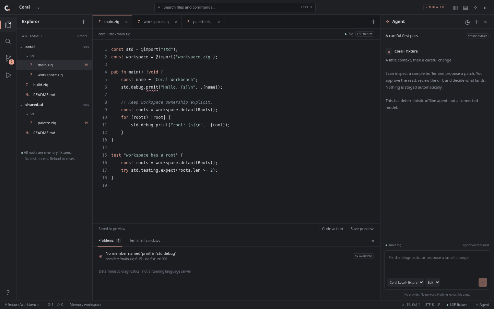

# Coral workbench — interactive prototype

A self-contained, offline design prototype for a denser Coral workbench: VS Code-style navigation and workspaces, with a Zed-style agent dock and review-first Git workflows. This is **not the production editor** or a new native implementation plan. The existing mockups and implementation documents are unchanged.

## Open

Open this exact URL in a modern browser with JavaScript enabled:

```text
file:///home/zoey/Projects/pearl/subprojects/coral/docs/mockups/workbench/index.html
```

Or open [index.html](index.html) from this directory. Keep `style.css` and `mockup.js` beside it. No server, installation, build step, dependency, account, font download, or API key is needed. A browser with native `dialog`, CSS Grid, and modern JavaScript support is required.

**All state lives in this page's memory. Reload resets everything.** Sample code is illustrative and is never compiled or executed.

## Design and interaction map

- Compact command/title bar; charcoal surfaces, muted coral accents, system UI/monospace fonts, fine borders, and restrained status colors. Light mode is also available.
- Activity rail → Explorer, workspace search, Source Control, fixture checks, and help.
- Multi-root Explorer → editable tabs → line-numbered, lightly highlighted code buffer.
- Bottom panel → clickable diagnostics or an explicitly simulated terminal.
- Agent dock → thread history, model/profile selectors, tool approval, patch review, and safe acceptance.
- Status bar → branch picker, Problems, caret position, LSP fixture information, and agent access.

The state model keeps four distinct strings per file: **HEAD**, **index**, **working buffer**, and **last preview save**. Staging changes only the index; committing copies only the index into HEAD; saving updates only the preview-save snapshot. Agent changes and code actions edit only the working buffer.

## Supported interactions

### Files and workspaces

- Expand/collapse root groups, open files, edit code, switch tabs, and close tabs.
- Unsaved tabs show a dot. Closing a tab retains its buffer; reopening it restores those edits. The last tab stays open with an explanatory notice.
- **Save preview** marks a buffer saved in memory, not on disk, and does not stage it.
- Use the workspace name to switch between **Coral** and **Pearl**. Each retains its own roots, buffers, tabs, search, staging, simulated commits, branch label, terminal history, and agent threads.
- Each workspace starts with two roots. Explorer **+**, the workspace picker, or the command palette adds the fixed **notes-kit** sample root once per workspace. Its file participates in search, tabs, Git, and agent flows. This is not a real folder picker.
- Quick Open searches filenames and full paths across roots. Search in the sidebar is literal and case-insensitive, operates on current buffers, and returns one result per matching line (first 100 lines displayed). Selecting a result opens the file and selects the first matching occurrence on that line.

### Language-server fixture

- The initial `main.zig` contains `std.debug.prnit`.
- Problems reports each occurrence of that exact token in `.zig` files with a line and column. Clicking a diagnostic selects the misspelled member.
- **Code action** offers **Change ‘prnit’ to ‘print’**. Choosing it edits the first diagnostic in the active buffer and updates Problems immediately.
- Typing the fixture typo back into a Zig buffer restores the diagnostic. Other syntax/type errors are deliberately not checked.
- The status-bar **LSP fixture** control explains the simulation.

### Git: file and hunk staging

1. Open **Source control** from the rail.
2. Select `main.zig` under **Working changes**. The initial fixture has separated changes, so there are multiple hunks.
3. Choose **Stage hunk** on just one hunk. The file now appears in both **Staged changes** and **Working changes**.
4. Open its staged diff to review **HEAD → index**, or working diff for **index → buffer**. **Unstage hunk** reverses only that indexed hunk. The row's **+ / −** controls stage or unstage the whole file.
5. Enter a commit message and choose **Commit staged only**. A `sim-001` history entry appears. Only staged content becomes HEAD; unstaged content remains in the working buffer, and unsaved markers are unaffected.
6. Use the status-bar branch picker to select a simulated branch. It changes the branch label used by subsequent history entries, **not the file tree or snapshots**. The picker explicitly labels this limitation.

There is no shell Git, repository discovery, real checkout, fetch/push, branch-specific history graph, merge, or filesystem mutation. Both fixture roots share one simulated index/history per workspace. Hunks are contiguous line changes without surrounding context; large comparisons use a single bounded prefix/suffix hunk. Final-newline changes participate in the string diff but do not have a special Git-style marker.

### Agent: permission → snapshot → review

1. Open a target file, then open the agent dock. Enter any nonempty prompt and send it.
2. The task captures the target path and asks permission for `read_buffer`. **Allow read**, **Deny**, and **Cancel request** are distinct state transitions. No file content is captured until approval.
3. After approval, an 800 ms local timer produces a deterministic response. **Cancel request** is available during that interval.
4. In **Edit** profile, the fixture replaces the first `std.debug.prnit` with `std.debug.print`. If that token is absent, it proposes appending a fixed comment/note. Prompt wording does not change this canned strategy.
5. Review the patch, then **Accept patch** or **Reject**. Acceptance changes only the target buffer; it does not save, stage, or commit. Rejection leaves the buffer and index untouched.
6. For the stale-edit scenario, approve the read and then edit the target buffer before acceptance. The task becomes **Patch blocked · buffer changed**; acceptance is unavailable. **Prepare new request** repopulates the prompt so you can send a fresh request and approve a new snapshot. A revision check also protects the acceptance function itself. Even editing and undoing back to identical text invalidates the old revision.
7. **Ask** profile returns a canned line-count/fixture-diagnostic report after approval and never proposes an edit.
8. Use **+** for a new thread and the clock/history button to revisit earlier threads. Drafts, model/profile choices, messages, and task outcomes are retained per thread. An in-flight timer may finish in a background thread; returning to it shows the outcome. Background proposals also become stale if their target buffer changes.

Model names are illustrative selections, not provider integrations; both use the same deterministic code. No keys, secret fields, external context, actual tool process, or real model is involved. There is one active request per thread. Switch files or workspaces freely; an approved task retains its original workspace and file target.

### Terminal and controls

- Supported terminal input: `help`, `clear`, `zig build`, and `git status`.
- `zig build` reports only the known fixture-typo count. It explicitly does **not** establish compilation success. The rail's Run control invokes the same fixture.
- `git status` describes the current in-memory index and buffer differences. Unknown commands produce a clear unsupported-command message; nothing executes.
- Toggle sidebar, agent dock, bottom panel, and dark/light theme from the title bar or command palette. Problems/Terminal tabs support left/right arrows and Home/End. Pickers omit already-added sample roots and code actions when the active file has no fixture diagnostic.
- At widths up to 1100 px the agent becomes an overlay drawer, initially closed. At widths up to 700 px both side panes are drawers, initially closed; opening one closes the other. The rail/title buttons reopen them, close buttons dismiss them, and Escape closes an open drawer. Resizing downward closes drawers at their breakpoints; growing the window preserves explicit open/closed choices.

## Keyboard and accessibility

| Shortcut | Action |
| --- | --- |
| Ctrl/⌘+P | Quick Open |
| Ctrl/⌘+Shift+P or Ctrl/⌘+K | Command palette |
| Ctrl/⌘+Shift+F | Search workspace |
| Ctrl/⌘+B | Toggle sidebar |
| Ctrl/⌘+J | Toggle bottom panel |
| Ctrl/⌘+S | Save active buffer in memory |
| Ctrl/⌘+. | Fixture code action |
| Ctrl/⌘+Enter, in the agent prompt | Send prompt |
| Up/Down, Enter, in a picker | Select and activate an option |
| Escape | Dismiss native dialog or responsive drawer |

Visible buttons provide alternatives to browser-reserved shortcuts. Native textarea selection and editing work normally; Tab moves focus rather than inserting indentation. Buttons have accessible names, focus-visible outlines, and pressed/selected state where applicable. Pickers and notices use native modal dialogs, with opener restoration when it remains available. Chromium keyboard tests verify that focus cannot enter background page controls while a modal is open; native Tab navigation may still move to browser chrome. An editable combobox/listbox pattern exposes picker selection. Toasts and agent messages have live regions. Mobile drawers are nonmodal; they do not trap keyboard focus. Screen-reader, IME, and physical touch behavior remain untested.

## Safety and limitations

- The prototype, base Python validation harness, JSON reports, and screenshots live in this directory. The additive M0 review runner is `tests/prototype_m0.py`; its review is `docs/WORKBENCH_M0_UX_REVIEW.md`. Nothing in the production Zig sources, existing parent mockup, parent README, or implementation plan is modified by this work.
- The prototype makes no external requests and uses no application persistence, cookies, filesystem APIs, provider APIs, execution APIs, secret handling, or remote dependencies. Content Security Policy blocks connections and limits scripts/styles to local files. Only the validation harness writes the documented report and screenshot artifacts.
- User text is rendered through `textContent`, text nodes, or textarea/input values. No user-controlled HTML is parsed. Code coloring creates individual safe spans; it is not a general syntax engine.
- Buffer input is capped at 30,000 characters, prompts at 2,000, commit messages at 180; oversized agent patches are blocked. Terminal output retains its last 200 entries. Large line diffs have a bounded fallback.
- This is a single-editor prototype, not an embedded editor engine: no splits, minimap, drag resizing, completion, real LSP, debugger, multi-cursor, folder CRUD, file watching, extensions, or durable undo history. Programmatic code actions/patches and tab switches need not preserve browser undo history.
- Search is single-line literal search, not regex, replace, or a project index. Agent responses are intentionally canned, and branch switching is label-only. Refresh is the reset mechanism.
- Fixture code need not compile against the installed Zig version. Native rendering, GTK accessibility, IME, performance, security hardening, and production provider permissions are outside this mockup.

## Browser validation

### M0 executable fixtures and technical UX review

[The M0 review](../../WORKBENCH_M0_UX_REVIEW.md) maps **W01–W12 and D1–D4** from the frozen references to existing/new executable fixtures, with partial browser coverage and unexecuted native gates explicitly separated. **Technical review is complete; user/product approval is not recorded. Native M2+ services are not implemented by this prototype.**

The additive [tests/prototype_m0.py](../../../tests/prototype_m0.py) imports this directory's existing harness and adds eight cases: editor/search palette focus and dispatch, unavailable-command filtering, duplicate-root Unicode search, empty-index commits, inert proposals with whole-workspace snapshot receipts, stale proposals after real browser undo, explicit reload/non-recovery behavior, and light narrow permission/drawer review.

Run from `pearl`:

```sh
PLAYWRIGHT_BROWSERS_PATH=/home/zoey/Projects/pearl/.cache/coral-workbench-validation/browsers .cache/coral-workbench-validation/venv/bin/python -B subprojects/coral/tests/prototype_m0.py
```

**2026-11-08 final expanded run: 40/40 passed, 0 failed, 55 geometry checkpoints, 23 screenshots, 14 exact fixture receipts; 0 external requests/console errors/page errors; 29.887 seconds.** [m0-review-verification.json](m0-review-verification.json) records source hashes, exact case mappings, fixture bytes/hashes, explicit coverage boundaries and the absence of user approval. This is not 40 independent new tests: it is the original 32 plus eight. `--only` creates a clearly marked partial report; use a complete run for acceptance evidence.

The review found one picker availability mismatch: already-added roots and inapplicable code actions remained offered even though the corresponding toolbar actions were disabled. The pickers now filter these entries. The [pre-fix 7/8 targeted run](m0-pre-fix-verification.json) and [failure screenshot](failure-m0-w01-unavailable-fixture-commands-are-not-offered-as-working.png) are historical regression evidence, not the current result. Both the 40-case suite and the original 32-case suite passed after the fix. Refer to the review for visual observations, screenshots and remaining usability risks.

### Original regression suite

[verify.py](verify.py) is the reproducible Playwright suite. [verification.json](verification.json) records the latest run, individual cases, source SHA-256 hashes, browser version, observed requests/errors, screenshot names, and measured pane/dialog bounds.

**Latest full run: 32/32 passed, 0 failed**, on 2026-11-08 with headless **Chromium 156.0.8078.4**. All **52 geometry checkpoints** passed. There were **0 external network requests, 0 console errors, and 0 uncaught page errors**. Local loading of `index.html`, `style.css`, and `mockup.js` was observed and asserted for every case. The supplied Playwright Ubuntu fallback browser launched successfully on this otherwise unsupported host.

Run from the `pearl` project root using the already-installed validation environment:

```sh
PLAYWRIGHT_BROWSERS_PATH=/home/zoey/Projects/pearl/.cache/coral-workbench-validation/browsers .cache/coral-workbench-validation/venv/bin/python -B subprojects/coral/docs/mockups/workbench/verify.py
```

A full run took about 27 seconds here. The suite opens the local `file://` page in isolated offline browser contexts and also aborts non-local requests. It uses locator waits and real click/keyboard/input events, with read-only inspection of the internal snapshots to verify HEAD/index/buffer invariants. Playwright's virtual clock makes in-flight cancellation and typing deterministic; it does not replace application state transitions. No test invokes an application mutation function directly.

For a focused rerun, append e.g. `--only 'thread history'`. **A focused run overwrites `verification.json` with a clearly marked partial result**, so run the full suite again for a complete report. Screenshots and the report are written beside the harness; failed cases also produce `failure-*.png` captures. The suite exits nonzero on a failed assertion or browser-launch error. It does not install dependencies or start a server.

Coverage:

- Offline rendering, applied styling, local asset loading, and error/request monitoring in every case.
- Real typing, tab switching/closing/reopening, and memory-only preview saves.
- Quick Open, arrow/Enter/Escape navigation, nested command pickers, empty results, modal behavior, and focus restoration.
- Live search and selected matches; workspace isolation, added roots, and index retention.
- Diagnostic navigation and quickfix changes limited to the buffer.
- Whole-file and individual-hunk staging/unstaging, staged-only partial commits, remaining unstaged edits, and label-only branch switching.
- Agent approval, denial, cancellation before and during a read, patch acceptance/rejection, stale-patch guards, user typing during and after a read, regeneration, background threads, cross-workspace/file target retention, drafts, models, and Ask/Edit profiles.
- HTML-like input safely rendered in the editor, agent messages, and commit history.
- Terminal fixtures, unsupported commands, panel keyboard navigation, theme/panel toggles, resizing, and drawer navigation.
- **1440×900, 1024×768, 700×800, and 390×844**, in both themes, with checks for document overflow and visible pane/dialog bounds. Intentional code, tab-strip, and diff scrolling is permitted.

Browser validation found and fixed one prototype defect: completing an **Ask** task removed the focused Cancel button without giving focus a destination. Completion now returns focus to the agent prompt when the task has no next action; a regression assertion covers this.

`node --check subprojects/coral/docs/mockups/workbench/mockup.js` also passed after that fix. Earlier implementation checks covered 400 deterministic randomized diff round trips, bounded large-buffer fallback, and static HTML references/nesting; those ad hoc checks are not counted as part of the 32 browser cases.

### Screenshot gallery



| Scenario | Captures |
| --- | --- |
| Desktop · 1440×900 | [Dark](workbench-1440-dark.png) · [Light](workbench-1440-light.png) |
| Tablet-width · 1024×768 | [Dark](workbench-1024-dark.png) · [Light](workbench-1024-light.png) |
| Drawer breakpoint · 700×800 | [Dark](workbench-700-dark.png) · [Light](workbench-700-light.png) |
| Narrow · 390×844 | [Dark](workbench-390-dark.png) · [Light](workbench-390-light.png) |
| Agent patch review | [Desktop](agent-review.png) · [Narrow drawer](agent-review-narrow.png) |
| Stale patch after user typing | [Blocked patch](agent-stale.png) |
| Git staged/unstaged separation | [Partially staged main.zig](git-partial-stage.png) |

### Validation limits

This is Chromium-only browser validation, not a claim of cross-browser, screen-reader, native GTK, IME, or real touch/virtual-keyboard compatibility. Narrow viewports exercise responsive CSS and pointer/keyboard navigation, not mobile-device emulation. Screenshots are review artifacts, not pixel-diff golden tests. Geometry checks do not establish text contrast or complete accessibility compliance. Native browser chrome focus is allowed during modal Tab navigation. No real filesystem, compiler, Git checkout, provider, durable undo, or production security boundary is exercised.
