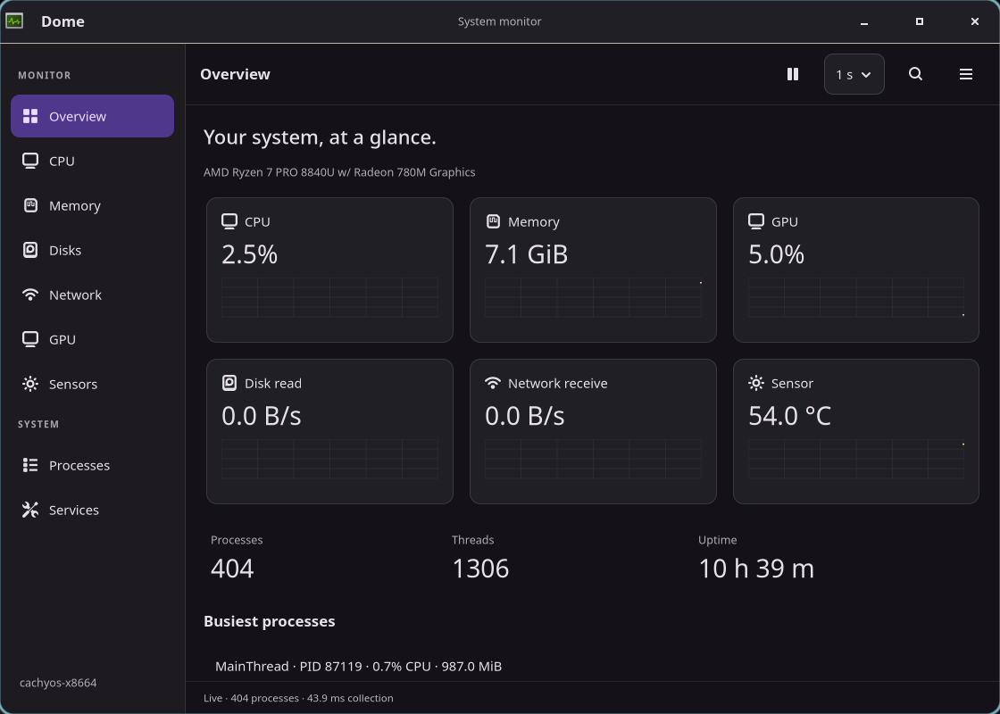

# Dome

A standalone Linux system monitor written in **Zig 0.17.0 and GTK4**, with Pearl
styling and Mission Center as its functional reference.



Dome provides live CPU, memory, disk, network, GPU and sensor pages, searchable
processes with right-click row menus, safe process termination, optional systemd
service controls and a compact summary. Sampling, graph duration, colors, columns
and units are configurable. It runs independently of Pearl and Aqueous.

Build from the Pearl checkout with Zig 0.17.0, `pkg-config`, GTK4/GLib,
Wayland and libpng development headers and libc. Dome uses Pearl's shared
appearance client and pinned Zig GObject/Wayland bindings:

```sh
cd subprojects/dome
zig build -Doptimize=safe
zig build run -Doptimize=safe
zig build test -Doptimize=safe
```

The executable is `zig-out/bin/dome`. `zig build` also stages the desktop entry,
AppStream metadata and icon under `zig-out/share/`. Use `--prefix PATH` for an
alternate staging directory; `-Dgit-variant=true` builds `dome-git` with the separate
`org.aqueous.Dome.Git` identity. The tested GTK version is 4.22.5; see the
[implementation status and capability limits](docs/IMPLEMENTATION_STATUS.md).

Useful options: `--follow-pearl`, `--light`, `--dark`, `--native-theme`, `--compact`, `--page=0..8`,
`--width=N`, `--height=N`, `--dump` (one read-only JSON snapshot), `--version`,
`--log-level LEVEL`, `--log-scopes LIST`. Diagnostics share Pearl's log handler
and land wherever stderr goes; see [logging](../../docs/LOGGING.md).
NVIDIA support loads NVML optionally at runtime. Missing GPU metrics or systemd
do not prevent resource and process monitoring.

New installations default to **Follow Pearl**. Committed Pearl palette, font and
compatible component styles update the open window, dialogs and graphs without
restarting or resuming paused sampling. Draft previews do not affect Dome.
Without a compatible Pearl session, Dome starts with native GTK styling; after
connecting it retains the last valid appearance during temporary disconnects
and reconnects automatically. Pearl's GTK mode follows its selected GTK theme.

Preferences → Appearance also offers **Native GTK**, **Light** and **Dark**,
which ignore Pearl updates. Existing version-1 preferences keep their previous
selection when migrated to version 2. To enable theme following on an existing
installation, select **Follow Pearl** and Apply, or launch with `--follow-pearl`.
Theme flags are processed in order; the last one wins. As before, the selected
mode is saved on normal close. No Pearl settings or GTK configuration are written.

| Shortcut | Action |
| --- | --- |
| Ctrl+1 / Ctrl+2 | Overview / Processes |
| Alt+1…9 | Navigate pages |
| Ctrl+F | Search active table, or open Processes |
| Ctrl+P / F5 | Pause or resume / request one sample |
| Alt+Enter | Selected details |
| Escape / Ctrl+W | Dismiss transient UI or clear search / close |

Right-click a Processes or Services row for a context menu with the same
actions as the side panel.

Preferences are written atomically to `$XDG_CONFIG_HOME/dome/preferences.ini`
(default `~/.config/dome/preferences.ini`). History and command lines are not
persisted. Process actions require an explicit confirmation and never elevate
privileges. Group controls require selecting an individual raw process.

Native verification uses Pearl's existing private Aqueous session harness:

```sh
zig build integration -Doptimize=safe
zig build integration-themes -Doptimize=safe -- --pearl ../../zig-out/bin/pearl
zig build benchmark -Doptimize=safe
python3 tests/soak.py --binary zig-out/bin/dome --seconds 1800
```

The integration harness needs the prepared `.cache/aqueous-activity-production`
prefix, `wtype`, `wlr-randr`, `grim`, D-Bus and Python GObject bindings. An alternate
prefix is accepted through `zig build integration -- --aqueous-prefix PATH`.
Tests create their own display, configuration and service manager fixture; process
actions target only disposable children. They do not alter host services.
The theme integration test additionally needs a built Pearl executable. It checks
live commits, community colors, open dialogs, paused graphs, mode changes,
standalone fallback, reconnect and preference persistence in the private session.

Browse the [native screenshots and results](artifacts/native/README.md),
[implementation report](docs/IMPLEMENTATION_STATUS.md), and
[original implementation plan](docs/IMPLEMENTATION_PLAN.md). The earlier
[interactive browser mockup](docs/mockups/index.html) and
[mockup gallery](docs/mockups/README.md) remain available with fictional data.
