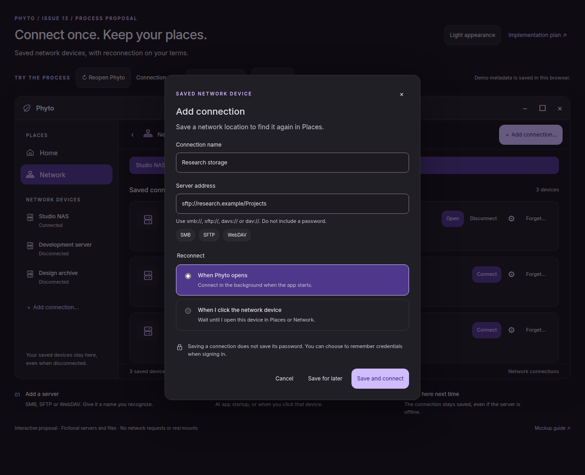

# Saved network connections mockup

Open [index.html](index.html) directly in a browser. It uses local HTML, CSS and
JavaScript, including the parent mockup's `style.css`; no server, build or network
access is needed. The [native implementation plan](../../NETWORK_SHARES_PLAN.md)
covers SMB, SFTP and WebDAV for [issue 13](https://github.com/Seafoam-Labs/pearl/issues/13).

## Try the process

1. Choose **Add connection…**, enter a name and example server address, then
   choose **When Phyto opens** or **When I click the network device**.
2. Choose **Save and connect** to save and open the fictional folder, or **Save
   for later** to retain a disconnected device. Each device has its own setting.
3. Choose **Reopen Phyto** in the review controls. Only startup devices reconnect.
   Click an on-demand device in Places or use Connect in Network to open it.
4. Set **Connection result** to **Server offline** before reopening or connecting
   to see a saved device remain available with Retry. Change the result to Success
   and retry. These controls are outside the proposed app window.
5. Choose **Sign-in required** and reopen: the app shows a status without a modal.
   Click Sign in, then **Continue with demo sign-in** to complete the process.
6. Use the gear to edit a device's reconnect preference, Disconnect to retain it
   without a mount, or Forget to remove its saved profile. Home demonstrates that
   local browsing remains available while a connection finishes.

Demo profiles are stored under `phyto-network-proposal-v1` in this browser's
localStorage. Reloading the page simulates a fresh process. Reset demo restores
three example profiles. Use fictional addresses only; there are no credential
fields, real connections or server requests. If storage is blocked, the editor
retains changes and reports that saving failed.

## Screens

| Process state | Screenshot |
| --- | --- |
| Add a connection and choose reconnection timing | [Add connection](add-connection.png) |
| Saved devices after launch with mixed policies | [Saved devices](saved-devices.png) |
| Explicit connection opens the remote folder | [Connected folder](connected-folder.png) |
| Failed connection retains the device and offers Retry | [Offline recovery](offline-recovery.png) |
| Explicit sign-in after deferred startup authentication | [Sign in](sign-in.png) |
| Light appearance | [Light](saved-devices-light.png) |
| Narrow connection editor | [Narrow](add-connection-narrow.png) |

## Verification and limits

Run `python3 subprojects/phyto/docs/mockups/network-shares/verify.py` from the
repository root with Python Playwright and system Chromium installed. Set
`CHROMIUM` to override `/usr/bin/chromium`. The script blocks HTTP/HTTPS, exercises
the process, writes these screenshots and records checks in
[verification.json](verification.json).

The mockup demonstrates stored metadata, reconnection policies, edit/forget,
failure/retry, cancellation, deferred sign-in, stale-navigation prevention and
narrow Places. It inherits Pearl's dark/light semantic palette and typography
from the existing Phyto browser mockup; the small inline SVG icons are local
vector artwork. Dialogs use native browser focus trapping and Escape dismissal.

Results, file contents, authentication and delays are simulated. Folder tiles
are illustrative. Reopen Phyto intentionally resets runtime state; production
will reuse mounts already present in GIO. The demo does not implement provider
discovery, host trust, the native two-job queue, etag conflict merging, concurrent
process coordination or a real keyring. Forgotten mounts are not represented as
unsaved mounts in the demo. Credentials and busy-unmount prompts will depend on
native GTK and the installed provider. Browser checks do not qualify native
accessibility, protocol support or filesystem operations.
